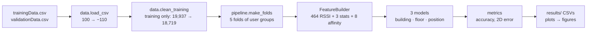
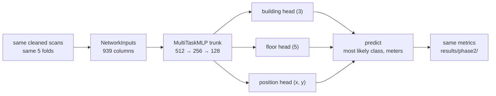

# Code explained: what is where, how it works, where every value comes from

Read this so that, when an examiner points at any file, value or figure, you can say **what it is, where it is made and why**.

- Code: <https://github.com/Jitmisra/T084-wifi-indoor-positioning>
- Every blue code link below opens the exact line on GitHub. The links are fixed to the final Phase 2 version (commit `6622034`), so they always point at the right line.

**How to read it**

1. Everyone: sections 1 and 2 (what is where, and how a scan travels through the code). About 20 minutes.
2. Then section 3 for the files you own (section 7 says which ones), and skim the rest.
3. In the viva, sections 4–6 are look-up tables: where a **number** comes from, where a **figure** is made, where **X** is in the code.

---

## 1. What is where

### 1.1 The repository in one picture

```text
T084-wifi-indoor-positioning/
├── Makefile                 the commands: make setup / data / test / run / run2 / notebooks / report / report2
├── pyproject.toml           our package "indoorloc" (Python ≥ 3.10), its dependencies, code-style rules
├── requirements.txt         minimum package versions
├── requirements-lock.txt    the exact versions that produced results/ (Python 3.14.3)
├── README.md                results, how to run, the project brief item by item
├── CONTRIBUTIONS.md         who did what, Phase 1 and Phase 2
├── data/
│   ├── README.md            dataset card: columns, license, how we prepare the data
│   └── raw/UJIndoorLoc/     trainingData.csv (19,937 scans), validationData.csv (1,111 scans = our test set)
├── src/indoorloc/           ALL the real code, as one Python package (section 1.2)
├── scripts/
│   ├── download_data.py     downloads the two CSVs if missing, checks their SHA-256 (make data)
│   ├── run_experiments.py   Phase 1: every experiment → results/ (make run, 25.7 min)
│   └── run_dl.py            Phase 2: every experiment → results/phase2/ (make run2, 78.0 min)
├── tests/                   44 unit tests on a tiny fake campus (make test, about 20 s)
├── notebooks/               01–03 Phase 1, 04–05 Phase 2: explain the results with text, tables, figures
├── results/                 every number and figure (section 1.3)
├── report/                  IEEE LaTeX: main.tex (Phase 1), main_phase2.tex (Phase 2), sections/, both PDFs
├── docs/                    literature reviews and literature matrices (Phase 1 and Phase 2)
└── presentation/            the slide decks: Phase 1 (11 slides) and Phase 2 (10 slides), .pptx and .pdf
```

> **The golden rule:** only the two run scripts compute results, and they write them to `results/`. The notebooks, the report, the README and the slides only **read** those files. The notebooks redraw the figures with the same plot functions and work through small examples, but they train no models. So every number anywhere comes from one file in `results/` (section 4).

### 1.2 `src/indoorloc/`, one line per file

| File | Lines | What is inside | Main names |
|---|---:|---|---|
| `config.py` | 124 | every path and setting, in one place (section 1.5) | `FILL_VALUE`, `GRIDS`, `DL_FIXED` … |
| `data.py` | 103 | load the CSVs, clean the training file, user groups, data facts | `load_csv`, `clean_training`, `heard_waps`, `user_device_groups`, `eda_summary` |
| `features.py` | 111 | Phase 1 features: signal statistics and AP-affinity | `signal_stats`, `APAffinity`, `FeatureBuilder` |
| `models.py` | 79 | kNN, Random Forest, XGBoost: one model per task | `make_estimator`, `LocalizationModel` |
| `pipeline.py` | 105 | CV folds, cross-validation, grid search, test evaluation | `make_folds`, `cross_validate`, `grid_search`, `evaluate_on_test` |
| `metrics.py` | 83 | errors and result tables | `per_scan_errors`, `summarize`, `error_breakdown`, `per_phone`, `floor_confusion` |
| `plots.py` | 251 | all 12 figures, in one style | `campus_map` … `ablation`, `save` |
| `dl.py` | 273 | Phase 2: the network's inputs, the network, its training | `NetworkInputs`, `MultiTaskMLP`, `NeuralLocalizationModel`, `hide_waps` |
| `hybrid.py` | 82 | Phase 2: the blend of the Random Forest and the network | `forest_outputs`, `blend`, `choose_weights` |
| `__init__.py` | 12 | makes the folder a package; imports every module except `dl` (it loads PyTorch, so it is imported only when needed) | |

### 1.3 `results/`: which file holds what, and which stage writes it

**Phase 1** (`results/`, written by `scripts/run_experiments.py`; the stages are in section 3.7):

| File | What is inside | Stage |
|---|---|:-:|
| [`metrics/cleaning.csv`](https://github.com/Jitmisra/T084-wifi-indoor-positioning/blob/66220345dbe6a195970a3da6015e9071caaf34f9/results/metrics/cleaning.csv) | scans removed by each cleaning rule (19,937 → 18,719) | 1 |
| [`metrics/eda_summary.json`](https://github.com/Jitmisra/T084-wifi-indoor-positioning/blob/66220345dbe6a195970a3da6015e9071caaf34f9/results/metrics/eda_summary.json) | data facts: 464 WAPs heard, 16 user groups, 64.3% of test scans from new phones … | 1 |
| [`metrics/feature_check.csv`](https://github.com/Jitmisra/T084-wifi-indoor-positioning/blob/66220345dbe6a195970a3da6015e9071caaf34f9/results/metrics/feature_check.csv) | the Baseline RF settings on the three feature sets (user-group CV) | 2 |
| [`metrics/cv_check.csv`](https://github.com/Jitmisra/T084-wifi-indoor-positioning/blob/66220345dbe6a195970a3da6015e9071caaf34f9/results/metrics/cv_check.csv) | random CV vs user-group CV vs test set | 3, 6 |
| `tuning/{knn,rf,xgb}_{building,floor,position}.csv` | every grid setting with its CV mean and std; column `chosen` | 4 |
| [`tuning/best_params.json`](https://github.com/Jitmisra/T084-wifi-indoor-positioning/blob/66220345dbe6a195970a3da6015e9071caaf34f9/results/tuning/best_params.json) | the chosen setting per model and task | 4 |
| [`metrics/cv_results.csv`](https://github.com/Jitmisra/T084-wifi-indoor-positioning/blob/66220345dbe6a195970a3da6015e9071caaf34f9/results/metrics/cv_results.csv) | CV scores of the four models | 4 |
| [`metrics/final_model.json`](https://github.com/Jitmisra/T084-wifi-indoor-positioning/blob/66220345dbe6a195970a3da6015e9071caaf34f9/results/metrics/final_model.json) | the final-model rule and its choice (Random Forest) | 5 |
| [`metrics/test_results.csv`](https://github.com/Jitmisra/T084-wifi-indoor-positioning/blob/66220345dbe6a195970a3da6015e9071caaf34f9/results/metrics/test_results.csv) | test scores of the four models | 6 |
| `predictions/{model}.csv` | every test scan: phone, true values, predicted values, 2D error | 6 |
| [`metrics/error_breakdown.csv`](https://github.com/Jitmisra/T084-wifi-indoor-positioning/blob/66220345dbe6a195970a3da6015e9071caaf34f9/results/metrics/error_breakdown.csv) | the three cases: building wrong / floor wrong / both right | 6 |
| [`metrics/per_phone.csv`](https://github.com/Jitmisra/T084-wifi-indoor-positioning/blob/66220345dbe6a195970a3da6015e9071caaf34f9/results/metrics/per_phone.csv) | phones seen in training vs new phones | 6 |
| [`metrics/floor_confusion.csv`](https://github.com/Jitmisra/T084-wifi-indoor-positioning/blob/66220345dbe6a195970a3da6015e9071caaf34f9/results/metrics/floor_confusion.csv) | floor confusion counts of the final model | 6 |
| `figures/*.png`, `*.pdf` | 7 figures (section 5) | 7 |

**Phase 2** (`results/phase2/`, written by `scripts/run_dl.py`; the stages are in section 3.10):

| File | What is inside | Stage |
|---|---|:-:|
| [`tuning/hybrid_mlp.csv`](https://github.com/Jitmisra/T084-wifi-indoor-positioning/blob/66220345dbe6a195970a3da6015e9071caaf34f9/results/phase2/tuning/hybrid_mlp.csv) | λ = 30, 100, 300 with their CV scores; column `chosen` | 1 |
| [`tuning/best_params.json`](https://github.com/Jitmisra/T084-wifi-indoor-positioning/blob/66220345dbe6a195970a3da6015e9071caaf34f9/results/phase2/tuning/best_params.json) | the chosen λ (300) and all fixed settings | 1 |
| [`metrics/learning_curves.csv`](https://github.com/Jitmisra/T084-wifi-indoor-positioning/blob/66220345dbe6a195970a3da6015e9071caaf34f9/results/phase2/metrics/learning_curves.csv) | CV scores every 10 epochs, for every ablation network | 2 |
| [`metrics/ablation.csv`](https://github.com/Jitmisra/T084-wifi-indoor-positioning/blob/66220345dbe6a195970a3da6015e9071caaf34f9/results/phase2/metrics/ablation.csv) | every one-change network: CV scores, change against the full network, folds worse | 2 |
| [`metrics/cv_seeds.csv`](https://github.com/Jitmisra/T084-wifi-indoor-positioning/blob/66220345dbe6a195970a3da6015e9071caaf34f9/results/phase2/metrics/cv_seeds.csv) | the full network in CV with seeds 43, 44, 45, plus mean and std | 2 |
| [`metrics/final_model.json`](https://github.com/Jitmisra/T084-wifi-indoor-positioning/blob/66220345dbe6a195970a3da6015e9071caaf34f9/results/phase2/metrics/final_model.json) | the final network and the rule | 3 |
| [`metrics/floor_confusion.csv`](https://github.com/Jitmisra/T084-wifi-indoor-positioning/blob/66220345dbe6a195970a3da6015e9071caaf34f9/results/phase2/metrics/floor_confusion.csv) | floor confusion counts of the final network | 4 |
| [`metrics/seeds.csv`](https://github.com/Jitmisra/T084-wifi-indoor-positioning/blob/66220345dbe6a195970a3da6015e9071caaf34f9/results/phase2/metrics/seeds.csv) | the final network on the test set with seeds 42–46, plus mean and std | 5 |
| [`tuning/blend.csv`](https://github.com/Jitmisra/T084-wifi-indoor-positioning/blob/66220345dbe6a195970a3da6015e9071caaf34f9/results/phase2/tuning/blend.csv) | blend CV scores for every forest weight 0, 0.1 … 1; the chosen one per task | 6 |
| [`tuning/blend.json`](https://github.com/Jitmisra/T084-wifi-indoor-positioning/blob/66220345dbe6a195970a3da6015e9071caaf34f9/results/phase2/tuning/blend.json) | the chosen forest weights and the blend's CV scores | 6 |
| [`metrics/test_results.csv`](https://github.com/Jitmisra/T084-wifi-indoor-positioning/blob/66220345dbe6a195970a3da6015e9071caaf34f9/results/phase2/metrics/test_results.csv) | test scores of `mlp`, `hybrid_single`, `hybrid_mlp` and `blend` | 4, 6 |
| `predictions/{model}.csv`, `metrics/error_breakdown.csv`, `metrics/per_phone.csv` | as in Phase 1, for the four Phase 2 models | 4, 6 |
| [`metrics/comparison.csv`](https://github.com/Jitmisra/T084-wifi-indoor-positioning/blob/66220345dbe6a195970a3da6015e9071caaf34f9/results/phase2/metrics/comparison.csv) | all Phase 1 and Phase 2 models: test scores, CV scores (`*_cv`), `phase` | 7 |
| `figures/*.png`, `*.pdf` | 5 figures (section 5) | 8 |

Not committed: `results/logs/run.log` and `results/phase2/logs/run.log` (the printout of a run, with times) and `results/_quick/` (check runs).

### 1.4 Environment: what the code needs and sets

- **Python 3.14.3** in a virtual environment, `.venv/`, made by `make setup`.
- **Exact versions** in `requirements-lock.txt` (these produced `results/`): numpy 2.5.4, pandas 3.0.6, scikit-learn 1.9.1, xgboost 3.4.1, torch 2.15.0, matplotlib 3.11.2, pytest 9.1.1. `requirements.txt` and `pyproject.toml` only give minimum versions.
- **The package:** `pip install -e .` installs `indoorloc` from `src/` in "editable" mode, so `import indoorloc` works everywhere and always uses the current code. The scripts also add `src/` to the path themselves, and pytest does the same (`pythonpath = ["src"]` in `pyproject.toml`).
- **Jupyter kernel** `indoorloc` ("Python (indoorloc)"), so the notebooks run with the `.venv` Python.
- **CPU only.** No line calls `.to("cuda")`, so PyTorch trains on the CPU. Why: with fixed seeds, the CPU gives exactly the same numbers on every run.
- **Data:** the two CSVs are committed in `data/raw/UJIndoorLoc/`; `make data` downloads them only if they are missing, and checks them against `SHA256` in `config.py`.

**Environment variables** (our code sets them; you never set them by hand):

| Variable | Value | Set in | Why |
|---|---|---|---|
| `MPLBACKEND` | `Agg` | [the run scripts](https://github.com/Jitmisra/T084-wifi-indoor-positioning/blob/66220345dbe6a195970a3da6015e9071caaf34f9/scripts/run_experiments.py#L19), `tests/conftest.py` | draw figures without a screen |
| `OMP_NUM_THREADS` | `1` | [`tests/conftest.py`](https://github.com/Jitmisra/T084-wifi-indoor-positioning/blob/66220345dbe6a195970a3da6015e9071caaf34f9/tests/conftest.py#L12) | the tests train XGBoost and PyTorch in one process; their two copies of OpenMP crash on macOS with several threads |
| `PYTHON_CONTEXT_AWARE_WARNINGS` | `1` | [`Makefile`](https://github.com/Jitmisra/T084-wifi-indoor-positioning/blob/66220345dbe6a195970a3da6015e9071caaf34f9/Makefile#L12) and the Jupyter kernel | on Python 3.14, scikit-learn's threads can flood the output with harmless warnings |
| `SOURCE_DATE_EPOCH` | `1792540800` (21 Oct 2026) | [`Makefile`](https://github.com/Jitmisra/T084-wifi-indoor-positioning/blob/66220345dbe6a195970a3da6015e9071caaf34f9/Makefile#L69), `report` and `report2` | rebuilding the report from unchanged sources gives an identical PDF |

**Make variables:** `PY` (default `.venv/bin/python`), `KERNEL` (`indoorloc`), `NB_TIMEOUT` (1800 s per notebook cell), `QUICK` (empty; `QUICK=1` means a quick check run).

**Commands** (`make help` lists them):

| Command | What it does | Time |
|---|---|---|
| `make setup` | create `.venv`, install the locked versions, the package and the Jupyter kernel; check that sklearn, xgboost and torch import | a few minutes |
| `make data` | download (only if missing) and check the two CSVs | seconds |
| `make test` | the 44 unit tests | about 20 s |
| `make run` | Phase 1: every experiment, writes `results/` | 25.7 min |
| `make run2` | Phase 2: every experiment, writes `results/phase2/` (needs `make run` first) | 78.0 min |
| `make run QUICK=1`, `make run2 QUICK=1` | a small check run; writes `results/_quick/` only | short |
| `make notebooks` | execute notebooks 01–05 in place | |
| `make report`, `make report2` | copy the figures into `report/figures/` (`sync_figures.sh`), then build `report/main.pdf` / `report/main_phase2.pdf` with tectonic | |
| `make all` | everything above, in order | |
| `make clean` | delete caches, LaTeX build files and quick runs (keeps `results/` and the PDFs) | |

**Quick mode** (`--quick`): 3,000 training scans, 3 folds, the first 2 settings of each grid, 20 trees (`QUICK_*` in `config.py`). Phase 2 also trains for only 2 epochs and is tested on held-out training users instead of the real test set ([`run_dl.main`](https://github.com/Jitmisra/T084-wifi-indoor-positioning/blob/66220345dbe6a195970a3da6015e9071caaf34f9/scripts/run_dl.py#L305)), so a check run never sees the test set.

**Seeds:** `SEED = 42` for every random choice (forests, XGBoost, random folds, the network). Phase 2 adds seed 43 (ablation and the blend's network), 44–45 (CV seed check) and 42–46 (test seed check).

### 1.5 Every setting in `config.py`

| Setting | Value | Meaning, and why this value | Used in |
|---|---|---|---|
| [`ROOT`](https://github.com/Jitmisra/T084-wifi-indoor-positioning/blob/66220345dbe6a195970a3da6015e9071caaf34f9/src/indoorloc/config.py#L7), [`RAW_DIR`](https://github.com/Jitmisra/T084-wifi-indoor-positioning/blob/66220345dbe6a195970a3da6015e9071caaf34f9/src/indoorloc/config.py#L8), [`RESULTS_DIR`](https://github.com/Jitmisra/T084-wifi-indoor-positioning/blob/66220345dbe6a195970a3da6015e9071caaf34f9/src/indoorloc/config.py#L11) | repo folder, `data/raw/UJIndoorLoc`, `results` | paths, found from where `config.py` is | run scripts, notebooks, `download_data.py` |
| [`TRAIN_CSV`](https://github.com/Jitmisra/T084-wifi-indoor-positioning/blob/66220345dbe6a195970a3da6015e9071caaf34f9/src/indoorloc/config.py#L9), [`TEST_CSV`](https://github.com/Jitmisra/T084-wifi-indoor-positioning/blob/66220345dbe6a195970a3da6015e9071caaf34f9/src/indoorloc/config.py#L10) | `trainingData.csv`, `validationData.csv` | the UCI "validation" file is **our test set** | run scripts, notebooks |
| [`DATA_URL`](https://github.com/Jitmisra/T084-wifi-indoor-positioning/blob/66220345dbe6a195970a3da6015e9071caaf34f9/src/indoorloc/config.py#L14), [`SHA256`](https://github.com/Jitmisra/T084-wifi-indoor-positioning/blob/66220345dbe6a195970a3da6015e9071caaf34f9/src/indoorloc/config.py#L15) | UCI zip, 2 checksums | where the data comes from; proof the files are unchanged | `download_data.py` |
| [`WAP_COLS`](https://github.com/Jitmisra/T084-wifi-indoor-positioning/blob/66220345dbe6a195970a3da6015e9071caaf34f9/src/indoorloc/config.py#L21) | `WAP001` … `WAP520` | the 520 signal columns | data, pipeline, dl, hybrid, plots |
| [`TARGET_COLS`](https://github.com/Jitmisra/T084-wifi-indoor-positioning/blob/66220345dbe6a195970a3da6015e9071caaf34f9/src/indoorloc/config.py#L22), [`COORD_COLS`](https://github.com/Jitmisra/T084-wifi-indoor-positioning/blob/66220345dbe6a195970a3da6015e9071caaf34f9/src/indoorloc/config.py#L23) | building, floor, longitude, latitude; the last two | what we predict; positions are Web-Mercator meters (1 data meter ≈ 0.766 m on the ground) | pipeline, models, dl, hybrid |
| [`FLOORS_PER_BUILDING`](https://github.com/Jitmisra/T084-wifi-indoor-positioning/blob/66220345dbe6a195970a3da6015e9071caaf34f9/src/indoorloc/config.py#L24) | `{0: 4, 1: 4, 2: 5}` | 3 buildings, 13 building-floors; gives the head sizes 3 and 5 | data, features, metrics, plots, dl, hybrid |
| [`NOT_HEARD`](https://github.com/Jitmisra/T084-wifi-indoor-positioning/blob/66220345dbe6a195970a3da6015e9071caaf34f9/src/indoorloc/config.py#L27) | `100` | the CSV's code for "not heard" | `data.load_csv` |
| [`FILL_VALUE`](https://github.com/Jitmisra/T084-wifi-indoor-positioning/blob/66220345dbe6a195970a3da6015e9071caaf34f9/src/indoorloc/config.py#L28) | `-110` | replaces 100: weaker than the weakest real reading (−104 dBm), so "not heard" = "very weak" | data, features, dl, plots |
| [`HIGH_RSSI`](https://github.com/Jitmisra/T084-wifi-indoor-positioning/blob/66220345dbe6a195970a3da6015e9071caaf34f9/src/indoorloc/config.py#L29) | `-30` | cleaning rule 3: readings of −30 dBm or stronger are physically implausible (mostly one faulty phone) | `data.clean_training` |
| [`MIN_SUPPORT`](https://github.com/Jitmisra/T084-wifi-indoor-positioning/blob/66220345dbe6a195970a3da6015e9071caaf34f9/src/indoorloc/config.py#L32) | `5` | a WAP needs at least 5 training scans before we trust its AP-affinity profile | `APAffinity.fit` |
| [`WEIGHT_EXPONENT`](https://github.com/Jitmisra/T084-wifi-indoor-positioning/blob/66220345dbe6a195970a3da6015e9071caaf34f9/src/indoorloc/config.py#L34) | `e` (2.718) | the exponent of the "powed" weight (Torres-Sospedra et al., 2015) | `APAffinity._weights` |
| [`SEED`](https://github.com/Jitmisra/T084-wifi-indoor-positioning/blob/66220345dbe6a195970a3da6015e9071caaf34f9/src/indoorloc/config.py#L37) | `42` | every random choice, so runs repeat exactly | models, pipeline, dl, run scripts |
| [`N_FOLDS`](https://github.com/Jitmisra/T084-wifi-indoor-positioning/blob/66220345dbe6a195970a3da6015e9071caaf34f9/src/indoorloc/config.py#L38) | `5` | 5-fold cross-validation | `make_folds`, run scripts |
| [`FEATURE_SETS`](https://github.com/Jitmisra/T084-wifi-indoor-positioning/blob/66220345dbe6a195970a3da6015e9071caaf34f9/src/indoorloc/config.py#L39) | `rssi`, `rssi+stats`, `rssi+stats+affinity` | the three Phase 1 feature sets | `FeatureBuilder`, stage 2 |
| [`RF_TREES`](https://github.com/Jitmisra/T084-wifi-indoor-positioning/blob/66220345dbe6a195970a3da6015e9071caaf34f9/src/indoorloc/config.py#L40) | `300` | trees per forest; not tuned, because more trees make a forest slower, not worse | `make_estimator` |
| [`XGB_FIXED`](https://github.com/Jitmisra/T084-wifi-indoor-positioning/blob/66220345dbe6a195970a3da6015e9071caaf34f9/src/indoorloc/config.py#L42) | learning rate 0.1, subsample 0.85, colsample 0.5, `hist` | common values, fixed to keep the grid small | `make_estimator` |
| [`GRIDS`](https://github.com/Jitmisra/T084-wifi-indoor-positioning/blob/66220345dbe6a195970a3da6015e9071caaf34f9/src/indoorloc/config.py#L49) | kNN: k ∈ {1, 3, 5, 7, 9, 11, 15} × uniform/distance × euclidean/manhattan (28 settings); RF: max_features {sqrt, 0.2, 0.5} × min_samples_leaf {1, 4} (6); XGBoost: max_depth {4, 6, 10} × n_estimators {300, 600} (6) | small grids, because every setting costs one full 5-fold CV | `settings_to_try` (stage 4) |
| [`MODEL_NAMES`](https://github.com/Jitmisra/T084-wifi-indoor-positioning/blob/66220345dbe6a195970a3da6015e9071caaf34f9/src/indoorloc/config.py#L60), [`MODEL_FAMILY`](https://github.com/Jitmisra/T084-wifi-indoor-positioning/blob/66220345dbe6a195970a3da6015e9071caaf34f9/src/indoorloc/config.py#L61), [`MODEL_FEATURES`](https://github.com/Jitmisra/T084-wifi-indoor-positioning/blob/66220345dbe6a195970a3da6015e9071caaf34f9/src/indoorloc/config.py#L62) | 4 models | Baseline RF (`rssi+stats`, default settings), kNN (`rssi`), Random Forest and XGBoost (`rssi+stats+affinity`) | run scripts, plots |
| [`DL_FIXED`](https://github.com/Jitmisra/T084-wifi-indoor-positioning/blob/66220345dbe6a195970a3da6015e9071caaf34f9/src/indoorloc/config.py#L71) | hidden (512, 256, 128), dropout 0.2, learning rate 0.001, weight decay 0.01, batch 256, position weight 100, hidden WAPs 10% | the network's settings; a tuned value replaces the fixed one (λ: 100 → 300) | `NeuralLocalizationModel`, stage 1 |
| [`DL_GRID`](https://github.com/Jitmisra/T084-wifi-indoor-positioning/blob/66220345dbe6a195970a3da6015e9071caaf34f9/src/indoorloc/config.py#L83) | λ ∈ {30, 100, 300} | the one tuned setting: how much the shared layers care about position | stage 1 |
| [`DL_EPOCHS`](https://github.com/Jitmisra/T084-wifi-indoor-positioning/blob/66220345dbe6a195970a3da6015e9071caaf34f9/src/indoorloc/config.py#L84), [`DL_EVERY`](https://github.com/Jitmisra/T084-wifi-indoor-positioning/blob/66220345dbe6a195970a3da6015e9071caaf34f9/src/indoorloc/config.py#L85) | `200`, `10` | passes over the training scans; CV is scored every 10 epochs (the learning curves) | `run_dl.py` |
| [`DL_SEEDS`](https://github.com/Jitmisra/T084-wifi-indoor-positioning/blob/66220345dbe6a195970a3da6015e9071caaf34f9/src/indoorloc/config.py#L86), [`DL_ABLATION_SEED`](https://github.com/Jitmisra/T084-wifi-indoor-positioning/blob/66220345dbe6a195970a3da6015e9071caaf34f9/src/indoorloc/config.py#L89), [`DL_CV_SEEDS`](https://github.com/Jitmisra/T084-wifi-indoor-positioning/blob/66220345dbe6a195970a3da6015e9071caaf34f9/src/indoorloc/config.py#L90) | 42–46, 43, 44–45 | test seed check; the ablation's seed (not the run that won the tuning, which would favor it); CV seed check | stages 2, 5, 6 |
| [`DL_VARIANTS`](https://github.com/Jitmisra/T084-wifi-indoor-positioning/blob/66220345dbe6a195970a3da6015e9071caaf34f9/src/indoorloc/config.py#L94) | 6 networks | the ablation: full network, three single-task networks, no Phase 1 features, no indicators, no hidden WAPs, no dropout and no weight decay | stage 2 |
| [`DL_CANDIDATES`](https://github.com/Jitmisra/T084-wifi-indoor-positioning/blob/66220345dbe6a195970a3da6015e9071caaf34f9/src/indoorloc/config.py#L110), [`DL_FINAL`](https://github.com/Jitmisra/T084-wifi-indoor-positioning/blob/66220345dbe6a195970a3da6015e9071caaf34f9/src/indoorloc/config.py#L113) | `mlp`, `hybrid_single`, `hybrid_mlp`; `hybrid_mlp` | the three networks tested on the test set; the final one, fixed in advance (the brief's design) | stages 3, 4, 7 |
| [`DL_CURVES`](https://github.com/Jitmisra/T084-wifi-indoor-positioning/blob/66220345dbe6a195970a3da6015e9071caaf34f9/src/indoorloc/config.py#L114) | `hybrid_mlp`, `no_regularization` | the two lines of the learning-curve figure | stage 8 |
| [`BLEND_WEIGHTS`](https://github.com/Jitmisra/T084-wifi-indoor-positioning/blob/66220345dbe6a195970a3da6015e9071caaf34f9/src/indoorloc/config.py#L117), [`BLEND`](https://github.com/Jitmisra/T084-wifi-indoor-positioning/blob/66220345dbe6a195970a3da6015e9071caaf34f9/src/indoorloc/config.py#L118) | 0, 0.1 … 1 (11 weights); names | the forest weights tried for the blend | stage 6 |
| [`QUICK_*`](https://github.com/Jitmisra/T084-wifi-indoor-positioning/blob/66220345dbe6a195970a3da6015e9071caaf34f9/src/indoorloc/config.py#L121) | 3,000 scans, 3 folds, 2 settings, 20 trees | the quick check run | run scripts |

**Values that are learned from the data, not set** (each one is learned again in every CV fold, from that fold's training rows only):

| Value | What it is | Learned in |
|---|---|---|
| 464 WAPs | the WAPs heard in at least one training scan (520 − 56 never heard) | [`heard_waps`](https://github.com/Jitmisra/T084-wifi-indoor-positioning/blob/66220345dbe6a195970a3da6015e9071caaf34f9/src/indoorloc/data.py#L36), called by `FeatureBuilder.fit` and `NetworkInputs.fit` |
| r_min = −105 dBm | the weakest training reading (−104) minus 1, so that reading still counts a little | [`APAffinity.fit`](https://github.com/Jitmisra/T084-wifi-indoor-positioning/blob/66220345dbe6a195970a3da6015e9071caaf34f9/src/indoorloc/features.py#L51), [`NetworkInputs.fit`](https://github.com/Jitmisra/T084-wifi-indoor-positioning/blob/66220345dbe6a195970a3da6015e9071caaf34f9/src/indoorloc/dl.py#L62) |
| WAP profiles | where each WAP "lives": building shares, mean floor, location | [`APAffinity.fit`](https://github.com/Jitmisra/T084-wifi-indoor-positioning/blob/66220345dbe6a195970a3da6015e9071caaf34f9/src/indoorloc/features.py#L60) |
| mean, std of the 11 Phase 1 columns | for standardizing the hybrid inputs | [`NetworkInputs.fit`](https://github.com/Jitmisra/T084-wifi-indoor-positioning/blob/66220345dbe6a195970a3da6015e9071caaf34f9/src/indoorloc/dl.py#L66) |
| position origin (and scale) | training mean (and std) of x and y | [`LocalizationModel.fit`](https://github.com/Jitmisra/T084-wifi-indoor-positioning/blob/66220345dbe6a195970a3da6015e9071caaf34f9/src/indoorloc/models.py#L58), [`NeuralLocalizationModel.fit`](https://github.com/Jitmisra/T084-wifi-indoor-positioning/blob/66220345dbe6a195970a3da6015e9071caaf34f9/src/indoorloc/dl.py#L137) |

---

## 2. How one scan travels through the code

**Phase 1**



1. [`load_csv`](https://github.com/Jitmisra/T084-wifi-indoor-positioning/blob/66220345dbe6a195970a3da6015e9071caaf34f9/src/indoorloc/data.py#L9) reads a CSV and replaces 100 ("not heard") with −110. Both files.
2. [`clean_training`](https://github.com/Jitmisra/T084-wifi-indoor-positioning/blob/66220345dbe6a195970a3da6015e9071caaf34f9/src/indoorloc/data.py#L16) removes 1,218 bad training scans (76 + 634 + 508). The test file is never cleaned.
3. [`make_folds`](https://github.com/Jitmisra/T084-wifi-indoor-positioning/blob/66220345dbe6a195970a3da6015e9071caaf34f9/src/indoorloc/pipeline.py#L20) makes 5 folds; each fold holds out whole user-phone groups.
4. In every fold, [`LocalizationModel.fit`](https://github.com/Jitmisra/T084-wifi-indoor-positioning/blob/66220345dbe6a195970a3da6015e9071caaf34f9/src/indoorloc/models.py#L53) first fits [`FeatureBuilder`](https://github.com/Jitmisra/T084-wifi-indoor-positioning/blob/66220345dbe6a195970a3da6015e9071caaf34f9/src/indoorloc/features.py#L85) on the fold's training rows only (which WAPs, the AP profiles), then trains three models: building, floor, position.
5. [`predict`](https://github.com/Jitmisra/T084-wifi-indoor-positioning/blob/66220345dbe6a195970a3da6015e9071caaf34f9/src/indoorloc/models.py#L70) → [`per_scan_errors`](https://github.com/Jitmisra/T084-wifi-indoor-positioning/blob/66220345dbe6a195970a3da6015e9071caaf34f9/src/indoorloc/metrics.py#L11) → [`summarize`](https://github.com/Jitmisra/T084-wifi-indoor-positioning/blob/66220345dbe6a195970a3da6015e9071caaf34f9/src/indoorloc/metrics.py#L28): accuracy and 2D error on the held-out rows.
6. After tuning and the final-model rule, [`evaluate_on_test`](https://github.com/Jitmisra/T084-wifi-indoor-positioning/blob/66220345dbe6a195970a3da6015e9071caaf34f9/src/indoorloc/pipeline.py#L97) fits on all 18,719 scans and predicts the 1,111 test scans, once.

**Phase 2**



1. Same data, cleaning and folds as Phase 1.
2. [`NeuralLocalizationModel.fit`](https://github.com/Jitmisra/T084-wifi-indoor-positioning/blob/66220345dbe6a195970a3da6015e9071caaf34f9/src/indoorloc/dl.py#L128) first fits [`NetworkInputs`](https://github.com/Jitmisra/T084-wifi-indoor-positioning/blob/66220345dbe6a195970a3da6015e9071caaf34f9/src/indoorloc/dl.py#L45) on the training rows only: the WAP list, r_min, the AP profiles, means and stds → **939 columns** (464 scaled RSSI + 464 heard indicators + 11 Phase 1 features).
3. One [`MultiTaskMLP`](https://github.com/Jitmisra/T084-wifi-indoor-positioning/blob/66220345dbe6a195970a3da6015e9071caaf34f9/src/indoorloc/dl.py#L86) trains for 200 epochs: mini-batches of 256, hidden WAPs, loss = CE(building) + CE(floor) + λ·MSE(position), AdamW, cosine learning rate.
4. [`outputs`](https://github.com/Jitmisra/T084-wifi-indoor-positioning/blob/66220345dbe6a195970a3da6015e9071caaf34f9/src/indoorloc/dl.py#L174) gives class probabilities (softmax) and positions in meters; [`predict`](https://github.com/Jitmisra/T084-wifi-indoor-positioning/blob/66220345dbe6a195970a3da6015e9071caaf34f9/src/indoorloc/dl.py#L188) takes the most likely class and returns the same table as Phase 1, so the **same metrics code** scores both phases.
5. The blend: [`forest_outputs`](https://github.com/Jitmisra/T084-wifi-indoor-positioning/blob/66220345dbe6a195970a3da6015e9071caaf34f9/src/indoorloc/hybrid.py#L21) (Random Forest) and `outputs` (network) are averaged per task with weights chosen by CV ([`blend`](https://github.com/Jitmisra/T084-wifi-indoor-positioning/blob/66220345dbe6a195970a3da6015e9071caaf34f9/src/indoorloc/hybrid.py#L35)).

---

## 3. The code, file by file (the important parts)

### 3.1 `data.py`: load, clean, group

| Function | What it does |
|---|---|
| [`load_csv`](https://github.com/Jitmisra/T084-wifi-indoor-positioning/blob/66220345dbe6a195970a3da6015e9071caaf34f9/src/indoorloc/data.py#L9) | reads one CSV; in the 520 WAP columns, 100 becomes −110 |
| [`clean_training`](https://github.com/Jitmisra/T084-wifi-indoor-positioning/blob/66220345dbe6a195970a3da6015e9071caaf34f9/src/indoorloc/data.py#L16) | removes bad training scans with three rules, in order, and counts each step (→ `cleaning.csv`) |
| [`heard_waps`](https://github.com/Jitmisra/T084-wifi-indoor-positioning/blob/66220345dbe6a195970a3da6015e9071caaf34f9/src/indoorloc/data.py#L36) | the WAP columns heard in at least one scan (464 in training) |
| [`user_device_groups`](https://github.com/Jitmisra/T084-wifi-indoor-positioning/blob/66220345dbe6a195970a3da6015e9071caaf34f9/src/indoorloc/data.py#L42) | the CV group of every scan: users who shared a phone form one group |
| [`eda_summary`](https://github.com/Jitmisra/T084-wifi-indoor-positioning/blob/66220345dbe6a195970a3da6015e9071caaf34f9/src/indoorloc/data.py#L62) | the data facts in `eda_summary.json` |

```python
# clean_training, the three rules (comments added here)
train = train[(train[WAP_COLS] > FILL_VALUE).any(axis=1)]   # 1. at least one WAP heard   (−76)
train = train[~train.duplicated(keep="first")]              # 2. no exact duplicate rows  (−634)
train = train[(train[WAP_COLS] < HIGH_RSSI).all(axis=1)]    # 3. no reading ≥ −30 dBm     (−508)
```

- **Why −110, not 0 or empty:** −110 is weaker than every real reading (−104), so "not heard" simply means "very weak", and every model gets plain numbers.
- **Why only the training file is cleaned:** the test set must stay exactly as published, or the test is not fair.
- **Why groups:** users 1, 9 and 16 used the same phone (14), so 18 users form 16 groups. A held-out fold must not share a phone with the training part, because the test set is mostly new phones. The `while` loop handles chains (A shares with B, B with C).

### 3.2 `features.py`: signal statistics and AP-affinity (Phase 1, also the Phase 2 hybrid inputs)

| Name | What it does |
|---|---|
| [`signal_stats`](https://github.com/Jitmisra/T084-wifi-indoor-positioning/blob/66220345dbe6a195970a3da6015e9071caaf34f9/src/indoorloc/features.py#L25) | per scan: number of WAPs heard, strongest reading, mean of the heard readings |
| [`APAffinity`](https://github.com/Jitmisra/T084-wifi-indoor-positioning/blob/66220345dbe6a195970a3da6015e9071caaf34f9/src/indoorloc/features.py#L39)`.fit` | gives every WAP heard in ≥ 5 training scans a profile: building shares, mean floor, location (weighted means over the scans that hear it) |
| `APAffinity.transform` | per scan: weighted mean of the profiles of the WAPs it hears (6 columns) + location of its strongest WAP (2 columns) = 8 columns |
| [`APAffinity._weights`](https://github.com/Jitmisra/T084-wifi-indoor-positioning/blob/66220345dbe6a195970a3da6015e9071caaf34f9/src/indoorloc/features.py#L77) | the weight of a reading: ((rssi − r_min) / −r_min)^e, 0 if not heard |
| [`FeatureBuilder`](https://github.com/Jitmisra/T084-wifi-indoor-positioning/blob/66220345dbe6a195970a3da6015e9071caaf34f9/src/indoorloc/features.py#L85) | builds the table of one feature set; `fit` learns from training scans only, `transform` applies it to any scans |

```python
# APAffinity: the weight, and one profile row per WAP (comments added here)
scaled = np.clip(values - self.min_rssi_, 0, None) / -self.min_rssi_
return np.where(values > FILL_VALUE, scaled**WEIGHT_EXPONENT, 0.0)       # −40 dBm → 0.27, −70 → 0.05
self.profiles_ = (weights.T @ targets) / weights.sum(axis=0)[:, None]   # weighted mean per WAP
```

- The 8 AP-affinity columns: `aff_b0`, `aff_b1`, `aff_b2` (building shares), `aff_floor`, `aff_lon`, `aff_lat`, `aff_top_lon`, `aff_top_lat` (location of the strongest WAP).
- **Why the weight:** a strong reading means the phone was close to the WAP, so it should count more. The exponent e comes from Torres-Sospedra et al. (2015).
- A scan that hears no known WAP gets the training means.

### 3.3 `models.py`: three models per method

| Name | What it does |
|---|---|
| [`make_estimator`](https://github.com/Jitmisra/T084-wifi-indoor-positioning/blob/66220345dbe6a195970a3da6015e9071caaf34f9/src/indoorloc/models.py#L13) | an unfitted kNN, Random Forest or XGBoost: a classifier for building and floor, a regressor with 2 outputs for position; fixed settings + the tuned ones |
| [`LocalizationModel`](https://github.com/Jitmisra/T084-wifi-indoor-positioning/blob/66220345dbe6a195970a3da6015e9071caaf34f9/src/indoorloc/models.py#L40) | `fit(X, y)`: features, then 3 models; `predict(X)`: a table of building, floor, longitude, latitude |

- **Why positions are learned as offsets from the training mean:** XGBoost computes with 32-bit floats, which store a northing of 4,864,900 m only to the nearest 0.5 m.
- **Why XGBoost is imported inside `make_estimator`** ([line](https://github.com/Jitmisra/T084-wifi-indoor-positioning/blob/66220345dbe6a195970a3da6015e9071caaf34f9/src/indoorloc/models.py#L32)): XGBoost and PyTorch each bring their own OpenMP library, and one process that uses both crashes on macOS.
- **Why the same `fit` / `predict`:** the Phase 2 network has the same two methods, so both phases go through the same evaluation code.

### 3.4 `pipeline.py`: folds, CV, tuning, test

| Name | What it does |
|---|---|
| [`make_folds`](https://github.com/Jitmisra/T084-wifi-indoor-positioning/blob/66220345dbe6a195970a3da6015e9071caaf34f9/src/indoorloc/pipeline.py#L20) | `"user"`: GroupKFold over user-phone groups (our CV); `"random"`: shuffled KFold, only to show it is too optimistic |
| [`cross_validate`](https://github.com/Jitmisra/T084-wifi-indoor-positioning/blob/66220345dbe6a195970a3da6015e9071caaf34f9/src/indoorloc/pipeline.py#L34) | per fold: fit on the training rows (features included), score the held-out rows |
| [`cv_summary`](https://github.com/Jitmisra/T084-wifi-indoor-positioning/blob/66220345dbe6a195970a3da6015e9071caaf34f9/src/indoorloc/pipeline.py#L49) | mean and std over the folds |
| [`grid_settings`](https://github.com/Jitmisra/T084-wifi-indoor-positioning/blob/66220345dbe6a195970a3da6015e9071caaf34f9/src/indoorloc/pipeline.py#L59) | every combination of a grid |
| [`grid_search`](https://github.com/Jitmisra/T084-wifi-indoor-positioning/blob/66220345dbe6a195970a3da6015e9071caaf34f9/src/indoorloc/pipeline.py#L64) | CV every setting on the same folds; each task picks its best (highest accuracy, lowest 2D error; on a tie the earlier setting) |
| [`evaluate_on_test`](https://github.com/Jitmisra/T084-wifi-indoor-positioning/blob/66220345dbe6a195970a3da6015e9071caaf34f9/src/indoorloc/pipeline.py#L97) | fit on all training scans, predict the test scans: **the only function that shows the test set to a model** |

```python
return list(GroupKFold(n_folds).split(train, groups=user_device_groups(train)))   # make_folds
pick = int(np.argmin(means) if task == "position" else np.argmax(means))         # grid_search
```

### 3.5 `metrics.py`: errors and tables

| Name | What it does |
|---|---|
| [`per_scan_errors`](https://github.com/Jitmisra/T084-wifi-indoor-positioning/blob/66220345dbe6a195970a3da6015e9071caaf34f9/src/indoorloc/metrics.py#L11) | per scan: building right?, floor right?, x error, y error, 2D error = √(dx² + dy²) in meters |
| [`summarize`](https://github.com/Jitmisra/T084-wifi-indoor-positioning/blob/66220345dbe6a195970a3da6015e9071caaf34f9/src/indoorloc/metrics.py#L28) | building accuracy, floor accuracy, mean x and y error, mean and median 2D error |
| [`error_breakdown`](https://github.com/Jitmisra/T084-wifi-indoor-positioning/blob/66220345dbe6a195970a3da6015e9071caaf34f9/src/indoorloc/metrics.py#L40) | the three cases (building wrong / building right, floor wrong / both right): scans, mean error, **share of the total error** |
| [`per_phone`](https://github.com/Jitmisra/T084-wifi-indoor-positioning/blob/66220345dbe6a195970a3da6015e9071caaf34f9/src/indoorloc/metrics.py#L57) | floor accuracy and 2D error on phones seen in training vs new phones |
| [`floor_confusion`](https://github.com/Jitmisra/T084-wifi-indoor-positioning/blob/66220345dbe6a195970a3da6015e9071caaf34f9/src/indoorloc/metrics.py#L75) | counts: a row per true (building, floor), a column per predicted floor |

### 3.6 `plots.py`: every figure

- [`STYLE`](https://github.com/Jitmisra/T084-wifi-indoor-positioning/blob/66220345dbe6a195970a3da6015e9071caaf34f9/src/indoorloc/plots.py#L19): one look for all figures (font size 8, 300 dpi, fonts embedded in the PDF as the IEEE check requires).
- [`save`](https://github.com/Jitmisra/T084-wifi-indoor-positioning/blob/66220345dbe6a195970a3da6015e9071caaf34f9/src/indoorloc/plots.py#L46): writes each figure twice, PNG (slides) and PDF (report); the PDF date is left out, so re-runs give identical files.
- One function per figure: section 5.

### 3.7 `scripts/run_experiments.py`: Phase 1, stage by stage

| Stage | What it does | Writes |
|---|---|---|
| [1. EDA](https://github.com/Jitmisra/T084-wifi-indoor-positioning/blob/66220345dbe6a195970a3da6015e9071caaf34f9/scripts/run_experiments.py#L61) | clean the training file (never the test file), summarize the data | `cleaning.csv`, `eda_summary.json` |
| [2. Feature check](https://github.com/Jitmisra/T084-wifi-indoor-positioning/blob/66220345dbe6a195970a3da6015e9071caaf34f9/scripts/run_experiments.py#L75) | the Baseline RF settings on the three feature sets, user-group CV | `feature_check.csv` |
| [3. CV check](https://github.com/Jitmisra/T084-wifi-indoor-positioning/blob/66220345dbe6a195970a3da6015e9071caaf34f9/scripts/run_experiments.py#L85) | the Baseline RF under random CV, to show it is too optimistic | (`cv_check.csv`, in stage 6) |
| [4. Tuning](https://github.com/Jitmisra/T084-wifi-indoor-positioning/blob/66220345dbe6a195970a3da6015e9071caaf34f9/scripts/run_experiments.py#L92) | grid search for kNN, Random Forest and XGBoost on the same folds | `tuning/*`, `cv_results.csv` |
| [5. Final model](https://github.com/Jitmisra/T084-wifi-indoor-positioning/blob/66220345dbe6a195970a3da6015e9071caaf34f9/scripts/run_experiments.py#L108) | the fixed rule: lowest CV mean 2D error → **Random Forest** (11.09 m) | `final_model.json` |
| [6. Test](https://github.com/Jitmisra/T084-wifi-indoor-positioning/blob/66220345dbe6a195970a3da6015e9071caaf34f9/scripts/run_experiments.py#L118) | all four models fitted on all training scans, test set predicted once | `test_results.csv`, `predictions/`, `error_breakdown.csv`, `per_phone.csv`, `floor_confusion.csv`, `cv_check.csv` |
| [7. Figures](https://github.com/Jitmisra/T084-wifi-indoor-positioning/blob/66220345dbe6a195970a3da6015e9071caaf34f9/scripts/run_experiments.py#L147) | the 7 Phase 1 figures | `figures/` |

CSV files are rounded to 4 decimals ([`save_csv`](https://github.com/Jitmisra/T084-wifi-indoor-positioning/blob/66220345dbe6a195970a3da6015e9071caaf34f9/scripts/run_experiments.py#L32)).

### 3.8 `dl.py`: the Phase 2 network

| Name | What it does |
|---|---|
| [`OUTPUTS`](https://github.com/Jitmisra/T084-wifi-indoor-positioning/blob/66220345dbe6a195970a3da6015e9071caaf34f9/src/indoorloc/dl.py#L33), [`LOSSES`](https://github.com/Jitmisra/T084-wifi-indoor-positioning/blob/66220345dbe6a195970a3da6015e9071caaf34f9/src/indoorloc/dl.py#L38) | head sizes 3 / 5 / 2; losses: cross-entropy, cross-entropy, MSE |
| [`NetworkInputs`](https://github.com/Jitmisra/T084-wifi-indoor-positioning/blob/66220345dbe6a195970a3da6015e9071caaf34f9/src/indoorloc/dl.py#L45) | the 939 input columns, learned from training scans only |
| [`MultiTaskMLP`](https://github.com/Jitmisra/T084-wifi-indoor-positioning/blob/66220345dbe6a195970a3da6015e9071caaf34f9/src/indoorloc/dl.py#L86) | the network: shared trunk (Linear → ReLU → Dropout, three times), one Linear head per task |
| [`NeuralLocalizationModel`](https://github.com/Jitmisra/T084-wifi-indoor-positioning/blob/66220345dbe6a195970a3da6015e9071caaf34f9/src/indoorloc/dl.py#L103) | trains it; same `fit` / `predict` as Phase 1; `multitask=False` trains three single-task networks |
| [`_train_one_epoch`](https://github.com/Jitmisra/T084-wifi-indoor-positioning/blob/66220345dbe6a195970a3da6015e9071caaf34f9/src/indoorloc/dl.py#L198) | one pass over the training scans in random mini-batches |
| [`hide_waps`](https://github.com/Jitmisra/T084-wifi-indoor-positioning/blob/66220345dbe6a195970a3da6015e9071caaf34f9/src/indoorloc/dl.py#L225) | training only: hides 10% of the heard WAPs of each batch (RSSI and indicator set to 0) |
| [`cross_validate_epochs`](https://github.com/Jitmisra/T084-wifi-indoor-positioning/blob/66220345dbe6a195970a3da6015e9071caaf34f9/src/indoorloc/dl.py#L245), [`epoch_summary`](https://github.com/Jitmisra/T084-wifi-indoor-positioning/blob/66220345dbe6a195970a3da6015e9071caaf34f9/src/indoorloc/dl.py#L269) | CV where one training run per fold is scored every 10 epochs (the learning curves) |

**The inputs** ([`NetworkInputs.transform`](https://github.com/Jitmisra/T084-wifi-indoor-positioning/blob/66220345dbe6a195970a3da6015e9071caaf34f9/src/indoorloc/dl.py#L70)):

```python
scaled = np.clip((values - self.min_rssi_) / -self.min_rssi_, 0, 1)
blocks = [np.where(heard, scaled, 0.0)]                                # 464 scaled RSSI, not heard = 0
if self.indicators:
    blocks.append(heard.astype(float))                                 # 464 heard indicators, 1 / 0
if self.hybrid:
    blocks.append((self._phase1_features(X) - self.mean_) / self.std_) # 11 Phase 1 columns, standardized
```

**The network** ([`MultiTaskMLP`](https://github.com/Jitmisra/T084-wifi-indoor-positioning/blob/66220345dbe6a195970a3da6015e9071caaf34f9/src/indoorloc/dl.py#L93)):

```python
for size in hidden:                                   # (512, 256, 128)
    layers += [nn.Linear(width, size), nn.ReLU(), nn.Dropout(dropout)]
    width = size
self.trunk = nn.Sequential(*layers)
self.heads = nn.ModuleDict({task: nn.Linear(width, OUTPUTS[task]) for task in tasks})
```

**One training step** ([`_train_one_epoch`](https://github.com/Jitmisra/T084-wifi-indoor-positioning/blob/66220345dbe6a195970a3da6015e9071caaf34f9/src/indoorloc/dl.py#L216)):

```python
weights = {"building": 1.0, "floor": 1.0, "position": p["position_weight"]}   # λ = 300
loss = sum(weights[t] * LOSSES[t](outputs[t], targets[t][rows]) for t in outputs)
optimizer.zero_grad()
loss.backward()      # gradients of all three heads flow into the shared trunk
optimizer.step()     # AdamW: learning rate 0.001, weight decay 0.01
schedule.step()      # cosine: the learning rate falls a little after every batch, to 0 at the end
```

- **Why scaled RSSI (0 to 1):** networks learn badly from big, mixed numbers like −40 and −110.
- **Why heard indicators:** they tell the network directly which WAPs are missing (the brief asks for them).
- **Why standardized positions** ([line](https://github.com/Jitmisra/T084-wifi-indoor-positioning/blob/66220345dbe6a195970a3da6015e9071caaf34f9/src/indoorloc/dl.py#L138)): outputs near 0 with spread 1 train well; [`outputs`](https://github.com/Jitmisra/T084-wifi-indoor-positioning/blob/66220345dbe6a195970a3da6015e9071caaf34f9/src/indoorloc/dl.py#L185) turns them back into meters. A 10 m error is only about 0.1 in these units, which is why λ must be large.
- **Why hidden WAPs:** a new phone, or the same phone on another day, misses some WAPs; hiding WAPs at random teaches the network not to depend on any single one.
- **Dropout on and off:** `net.train()` in [`_train_one_epoch`](https://github.com/Jitmisra/T084-wifi-indoor-positioning/blob/66220345dbe6a195970a3da6015e9071caaf34f9/src/indoorloc/dl.py#L200) turns dropout on; `net.eval()` in [`outputs`](https://github.com/Jitmisra/T084-wifi-indoor-positioning/blob/66220345dbe6a195970a3da6015e9071caaf34f9/src/indoorloc/dl.py#L180) turns it off for predictions.
- **Same seed, same network:** [`fit`](https://github.com/Jitmisra/T084-wifi-indoor-positioning/blob/66220345dbe6a195970a3da6015e9071caaf34f9/src/indoorloc/dl.py#L130) fixes the starting weights, the batches and the hidden WAPs.

### 3.9 `hybrid.py`: the blend (hybrid 2)

| Name | What it does |
|---|---|
| [`forest_outputs`](https://github.com/Jitmisra/T084-wifi-indoor-positioning/blob/66220345dbe6a195970a3da6015e9071caaf34f9/src/indoorloc/hybrid.py#L21) | the Random Forest's class probabilities (lined up with all 3 buildings and 5 floors) and positions |
| [`blend`](https://github.com/Jitmisra/T084-wifi-indoor-positioning/blob/66220345dbe6a195970a3da6015e9071caaf34f9/src/indoorloc/hybrid.py#L35) | per task: w × forest + (1 − w) × network; the most likely class wins |
| [`out_of_fold_outputs`](https://github.com/Jitmisra/T084-wifi-indoor-positioning/blob/66220345dbe6a195970a3da6015e9071caaf34f9/src/indoorloc/hybrid.py#L50) | every training scan gets outputs from a model that never saw it (one model per fold) |
| [`weight_table`](https://github.com/Jitmisra/T084-wifi-indoor-positioning/blob/66220345dbe6a195970a3da6015e9071caaf34f9/src/indoorloc/hybrid.py#L64) | the blend's CV score for every w = 0, 0.1 … 1 |
| [`choose_weights`](https://github.com/Jitmisra/T084-wifi-indoor-positioning/blob/66220345dbe6a195970a3da6015e9071caaf34f9/src/indoorloc/hybrid.py#L75) | per task the best w; on a tie the smaller w (more network) |

```python
mixed = {task: weights[task] * forest[task] + (1 - weights[task]) * network[task] for task in TASKS}
```

w = 0 is the network alone and w = 1 the forest alone, so CV can always pick one model alone. Chosen: 0.8 (building), 1.0 (floor), 0.1 (position).

### 3.10 `scripts/run_dl.py`: Phase 2, stage by stage

| Stage | What it does | Writes |
|---|---|---|
| [1. Tuning](https://github.com/Jitmisra/T084-wifi-indoor-positioning/blob/66220345dbe6a195970a3da6015e9071caaf34f9/scripts/run_dl.py#L88) | the hybrid MLP with λ = 30, 100, 300; 5-fold user-group CV, 200 epochs; lowest CV 2D error → **λ = 300** | `tuning/hybrid_mlp.csv`, `tuning/best_params.json` |
| [2. Ablation](https://github.com/Jitmisra/T084-wifi-indoor-positioning/blob/66220345dbe6a195970a3da6015e9071caaf34f9/scripts/run_dl.py#L119) | the 6 networks of `DL_VARIANTS`, seed 43, same folds; then the CV seed check (seeds 44, 45) | `learning_curves.csv`, `ablation.csv`, `cv_seeds.csv` |
| [3. Final network](https://github.com/Jitmisra/T084-wifi-indoor-positioning/blob/66220345dbe6a195970a3da6015e9071caaf34f9/scripts/run_dl.py#L160) | fixed in advance: `hybrid_mlp` (one trunk, three heads) | `final_model.json` |
| [4. Test](https://github.com/Jitmisra/T084-wifi-indoor-positioning/blob/66220345dbe6a195970a3da6015e9071caaf34f9/scripts/run_dl.py#L174) | the 3 candidate networks fitted on all training scans, test set predicted once | `predictions/`, `floor_confusion.csv` |
| [5. Seed check](https://github.com/Jitmisra/T084-wifi-indoor-positioning/blob/66220345dbe6a195970a3da6015e9071caaf34f9/scripts/run_dl.py#L202) | the final network again with seeds 42–46, on the test set | `seeds.csv` |
| [6. Blend](https://github.com/Jitmisra/T084-wifi-indoor-positioning/blob/66220345dbe6a195970a3da6015e9071caaf34f9/scripts/run_dl.py#L213) | out-of-fold outputs of the Phase 1 Random Forest (its tuned settings, read from Phase 1's `best_params.json`) and of the network (seed 43); weights by CV; then the test outputs are blended once | `tuning/blend.*`, `predictions/blend.csv`, `test_results.csv`, `error_breakdown.csv`, `per_phone.csv` |
| [7. Comparison](https://github.com/Jitmisra/T084-wifi-indoor-positioning/blob/66220345dbe6a195970a3da6015e9071caaf34f9/scripts/run_dl.py#L255) | Phase 1's CV and test results (read from `results/metrics/`) next to Phase 2's | `comparison.csv` |
| [8. Figures](https://github.com/Jitmisra/T084-wifi-indoor-positioning/blob/66220345dbe6a195970a3da6015e9071caaf34f9/scripts/run_dl.py#L268) | the 5 Phase 2 figures | `figures/` |

That is why `make run2` needs `make run` first: stages 6 and 7 read Phase 1's results. CSV files keep 6 decimals ([`save_csv`](https://github.com/Jitmisra/T084-wifi-indoor-positioning/blob/66220345dbe6a195970a3da6015e9071caaf34f9/scripts/run_dl.py#L41)): 0.94149 stored as 0.9415 would later be rounded again to 94.2% instead of 94.1%.

### 3.11 `tests/`: 44 tests (40 test functions, some run several cases), about 20 s

[`make_campus`](https://github.com/Jitmisra/T084-wifi-indoor-positioning/blob/66220345dbe6a195970a3da6015e9071caaf34f9/tests/conftest.py#L20) builds a tiny fake campus: 3 buildings, 13 floors, 8 WAPs per floor, 195 scans, with a simple signal model; users 1 and 2 share a phone.

| File | Tests | What they check |
|---|---:|---|
| `test_data.py` | 6 | −110 fill; cleaning order and counts (also on the real file); heard WAPs; phone-sharing groups; data facts |
| `test_features.py` | 6 | statistics and AP-affinity worked out by hand; stronger readings count more; the three feature sets |
| `test_models.py` | 2 | fixed vs tuned settings; fit and predict |
| `test_pipeline.py` | 5 | user folds never split a group; held-out labels never reach the features; grid-search ties; the quick run writes every file |
| `test_metrics.py` | 4 | errors, breakdown, seen/new phones, confusion |
| `test_dl.py` | 13 | inputs by hand; training statistics; heads; hidden WAPs; λ and the cosine schedule; same seed = same model; meters; dropout state; epoch CV; leakage; quick run |
| `test_hybrid.py` | 4 | w = 0 and w = 1 give each model alone; probabilities line up with the classes; out-of-fold outputs; ties |

### 3.12 Notebooks, report, docs, slides

- **Notebooks** import `indoorloc`, read `results/` and redraw the figures with the same `plots` functions: 01 data and cleaning, 02 features, 03 models and errors (Phase 1); 04 the network, 05 Phase 1 vs Phase 2 (Phase 2).
- **Report:** `report/main.tex` and `report/main_phase2.tex` with their sections in `report/sections/` and `report/sections/phase2/`, one `references.bib`, the official IEEE class `IEEEtran.cls`; built with tectonic (`make report`, `make report2`).
- **Docs:** `docs/literature_review.md` and `literature_matrix.csv` (Phase 1), `*_phase2.*` (Phase 2).
- **Slides:** made by a python-pptx script that reads every number from `results/` and the figures as PNG files.

---

## 4. Where does each number come from?

| Number | What it is | File | Made by |
|---|---|---|---|
| 19,937 → 18,719 | training scans before and after cleaning (−76 no WAP heard, −634 duplicates, −508 ≥ −30 dBm) | `metrics/cleaning.csv` | [`clean_training`](https://github.com/Jitmisra/T084-wifi-indoor-positioning/blob/66220345dbe6a195970a3da6015e9071caaf34f9/src/indoorloc/data.py#L16) |
| 1,111 | test scans (never cleaned) | `metrics/eda_summary.json` | [`eda_summary`](https://github.com/Jitmisra/T084-wifi-indoor-positioning/blob/66220345dbe6a195970a3da6015e9071caaf34f9/src/indoorloc/data.py#L62) |
| 520 / 464 / 367 | WAP columns / WAPs heard in training / WAPs heard in the test file | `eda_summary.json` | `eda_summary` |
| −104 / −31 dBm | weakest / strongest training reading after cleaning | `eda_summary.json` | `eda_summary` |
| 96.6% | share of training readings that are "not heard" | `eda_summary.json` | `eda_summary` |
| 18 users → 16 groups | users 1, 9 and 16 share phone 14 | `eda_summary.json` | [`user_device_groups`](https://github.com/Jitmisra/T084-wifi-indoor-positioning/blob/66220345dbe6a195970a3da6015e9071caaf34f9/src/indoorloc/data.py#L42) |
| 64.3%; 9 of 11 | test scans from phones never seen in training; new test phones | `eda_summary.json` | `eda_summary` |
| 0.766 | ground meters per data meter (Web-Mercator) | `eda_summary.json` | `eda_summary` |
| 3.67 / 15.87 / 12.52 m | Baseline RF: random CV / user-group CV / test set | `metrics/cv_check.csv` | stages 3 and 6 |
| 15.55 / 15.87 / 11.38 m | feature check (CV): `rssi` / `+stats` / `+affinity` | `metrics/feature_check.csv` | stage 2 |
| k = 1 / 5 / 3 | kNN neighbors for building / floor / position | `tuning/best_params.json` | [`grid_search`](https://github.com/Jitmisra/T084-wifi-indoor-positioning/blob/66220345dbe6a195970a3da6015e9071caaf34f9/src/indoorloc/pipeline.py#L64) |
| 11.09 m | Random Forest CV error, the lowest → final Phase 1 model | `cv_results.csv`, `final_model.json` | stages 4, 5 |
| 7.42 m, 92.2%, 100% | Random Forest on the test set (2D error, floor, building) | `metrics/test_results.csv` | stage 6 |
| 95.2% | XGBoost floor accuracy on the test set (the best) | `metrics/test_results.csv` | stage 6 |
| 939 | network inputs: 464 + 464 + 11 | notebook 04 §1 | [`NetworkInputs`](https://github.com/Jitmisra/T084-wifi-indoor-positioning/blob/66220345dbe6a195970a3da6015e9071caaf34f9/src/indoorloc/dl.py#L45) |
| 646,794 | weights of the multi-task network (three single-task networks: 1,937,802) | notebook 04 §6 | counts the parameters of `MultiTaskMLP` |
| λ = 300 | CV 9.2499 m, against 9.2509 (λ = 100) and 9.5115 (λ = 30) | `phase2/tuning/hybrid_mlp.csv` | run_dl stage 1 |
| 9.21 m, 78.8% | the full network in CV (seed 43) | `phase2/metrics/ablation.csv` | stage 2 |
| +1.08 / +0.58 / +0.16 / −0.04 / −0.30 m | ablation: no dropout & weight decay / no indicators / no hidden WAPs / no Phase 1 features / three single-task networks | `ablation.csv` (`change_mean_2d`, `folds_worse`) | stage 2 |
| 9.12 ± 0.11 m → 0.16 m | CV seed check; chance level = √2 × 0.11 (the difference of two runs) | `phase2/metrics/cv_seeds.csv` | stage 2 |
| 8.32 m, 90.8%, 99.9% | the final network on the test set | `phase2/metrics/test_results.csv` | stage 4 |
| 8.03 m, 94.1% | three single-task networks on the test set | `phase2/metrics/test_results.csv` | stage 4 |
| 8.21 ± 0.06 m, 91.7 ± 0.7% | test seed check, seeds 42–46 | `phase2/metrics/seeds.csv` | stage 5 |
| 0.8 / 1.0 / 0.1 | blend forest weights: building / floor / position | `phase2/tuning/blend.json` | [`choose_weights`](https://github.com/Jitmisra/T084-wifi-indoor-positioning/blob/66220345dbe6a195970a3da6015e9071caaf34f9/src/indoorloc/hybrid.py#L75) |
| 9.14 m, 83.6% | the blend in CV | `phase2/tuning/blend.json` | stage 6 |
| 8.10 m, 92.2% | the blend on the test set | `phase2/metrics/test_results.csv` | stage 6 |
| 1 / 101 / 1,009 scans; 85.4% | network: building wrong / floor wrong / both right; share of the error on "both right" | `phase2/metrics/error_breakdown.csv` | [`error_breakdown`](https://github.com/Jitmisra/T084-wifi-indoor-positioning/blob/66220345dbe6a195970a3da6015e9071caaf34f9/src/indoorloc/metrics.py#L40) |
| 100 of 102 | wrong floors that are one floor off (102 = 101 + the scan with the wrong building) | `phase2/metrics/floor_confusion.csv` | [`floor_confusion`](https://github.com/Jitmisra/T084-wifi-indoor-positioning/blob/66220345dbe6a195970a3da6015e9071caaf34f9/src/indoorloc/metrics.py#L75) |
| 9.27 / 6.62 m | network on new / seen phones (Random Forest: 8.30 / 5.84 m) | `phase2/metrics/per_phone.csv` (RF: `metrics/per_phone.csv`) | [`per_phone`](https://github.com/Jitmisra/T084-wifi-indoor-positioning/blob/66220345dbe6a195970a3da6015e9071caaf34f9/src/indoorloc/metrics.py#L57) |

---

## 5. Where is each figure made?

Every figure is drawn by one function in `plots.py`, called by a run script, and saved as PNG and PDF. **Slides** use the PNG, the **report** uses the PDF (copied into `report/figures/` by `sync_figures.sh`), and the **notebooks** redraw it live with the same function from the same CSV.

| Figure | What it shows | Drawn by | Data | Shown in |
|---|---|---|---|---|
| `eda_campus_map` | training positions per building, test positions as crosses | [`campus_map`](https://github.com/Jitmisra/T084-wifi-indoor-positioning/blob/66220345dbe6a195970a3da6015e9071caaf34f9/src/indoorloc/plots.py#L70) | the two CSVs | Phase 1 slide 4; report: Data; notebook 01 §4 |
| `eda_waps_per_scan` | how many WAPs one scan hears, training vs test | [`waps_per_scan`](https://github.com/Jitmisra/T084-wifi-indoor-positioning/blob/66220345dbe6a195970a3da6015e9071caaf34f9/src/indoorloc/plots.py#L91) | the two CSVs | notebook 01 §3 |
| `eda_scans_per_floor` | share of scans per building and floor, training vs test | [`scans_per_floor`](https://github.com/Jitmisra/T084-wifi-indoor-positioning/blob/66220345dbe6a195970a3da6015e9071caaf34f9/src/indoorloc/plots.py#L105) | the two CSVs | notebook 01 §5 |
| `feature_check` | CV floor accuracy and 2D error of the three feature sets | [`feature_check`](https://github.com/Jitmisra/T084-wifi-indoor-positioning/blob/66220345dbe6a195970a3da6015e9071caaf34f9/src/indoorloc/plots.py#L119) | `feature_check.csv` | Phase 1 slide 7; report: Results; notebook 02 §5 |
| `model_comparison` | CV (blue) next to test (orange), floor accuracy and 2D error, 4 models | [`model_comparison`](https://github.com/Jitmisra/T084-wifi-indoor-positioning/blob/66220345dbe6a195970a3da6015e9071caaf34f9/src/indoorloc/plots.py#L135) | `cv_results.csv`, `test_results.csv` | report: Results; notebook 03 §4 |
| `floor_confusion` | floor confusion of the Random Forest, one matrix per building | [`floor_confusion`](https://github.com/Jitmisra/T084-wifi-indoor-positioning/blob/66220345dbe6a195970a3da6015e9071caaf34f9/src/indoorloc/plots.py#L158) | `metrics/floor_confusion.csv` | Phase 1 slide 10; report: Results; notebook 03 §6 |
| `error_map` | true test positions (gray) and predictions colored by their error | [`error_map`](https://github.com/Jitmisra/T084-wifi-indoor-positioning/blob/66220345dbe6a195970a3da6015e9071caaf34f9/src/indoorloc/plots.py#L178) | `predictions/rf.csv` | notebook 03 §6, notebook 05 §7 |
| `dl_learning_curves` | CV 2D error and floor accuracy every 10 epochs, with and without dropout + weight decay | [`learning_curves`](https://github.com/Jitmisra/T084-wifi-indoor-positioning/blob/66220345dbe6a195970a3da6015e9071caaf34f9/src/indoorloc/plots.py#L209) | `phase2/metrics/learning_curves.csv` | Phase 2 slide 4; report: Results; notebook 04 §8 |
| `dl_ablation` | bars: CV error and floor accuracy of each ablation network (full network on top, blue) | [`ablation`](https://github.com/Jitmisra/T084-wifi-indoor-positioning/blob/66220345dbe6a195970a3da6015e9071caaf34f9/src/indoorloc/plots.py#L228) | `phase2/metrics/ablation.csv` | Phase 2 slide 9; notebook 05 §1 |
| `aml_vs_dl` | CV next to test for all 8 models; dotted line between Phase 1 and Phase 2 | `model_comparison` with `split` | `phase2/metrics/comparison.csv` | report: Results; notebook 05 §3 |
| `dl_floor_confusion` | floor confusion of the final network | `floor_confusion` | `phase2/metrics/floor_confusion.csv` | Phase 2 slide 10; report: Results; notebook 05 §6 |
| `dl_error_map` | error map of the final network | `error_map` | `phase2/predictions/hybrid_mlp.csv` | notebook 05 §7 |

---

## 6. "Where is X in the code?" (viva look-up)

**Data**

- *Where is the test set read, and where does a model see it?* `TEST_CSV` ([`config`](https://github.com/Jitmisra/T084-wifi-indoor-positioning/blob/66220345dbe6a195970a3da6015e9071caaf34f9/src/indoorloc/config.py#L10)); a model sees it only in [`evaluate_on_test`](https://github.com/Jitmisra/T084-wifi-indoor-positioning/blob/66220345dbe6a195970a3da6015e9071caaf34f9/src/indoorloc/pipeline.py#L97), and the blend only in run_dl stage 6, after its weights are fixed.
- *Where does 100 become −110?* [`load_csv`](https://github.com/Jitmisra/T084-wifi-indoor-positioning/blob/66220345dbe6a195970a3da6015e9071caaf34f9/src/indoorloc/data.py#L9).
- *Where are the three cleaning rules?* [`clean_training`](https://github.com/Jitmisra/T084-wifi-indoor-positioning/blob/66220345dbe6a195970a3da6015e9071caaf34f9/src/indoorloc/data.py#L16).
- *Where are the 464 WAPs chosen?* [`heard_waps`](https://github.com/Jitmisra/T084-wifi-indoor-positioning/blob/66220345dbe6a195970a3da6015e9071caaf34f9/src/indoorloc/data.py#L36).
- *Where are users grouped, and where is GroupKFold?* [`user_device_groups`](https://github.com/Jitmisra/T084-wifi-indoor-positioning/blob/66220345dbe6a195970a3da6015e9071caaf34f9/src/indoorloc/data.py#L42), used in [`make_folds`](https://github.com/Jitmisra/T084-wifi-indoor-positioning/blob/66220345dbe6a195970a3da6015e9071caaf34f9/src/indoorloc/pipeline.py#L28).

**Phase 1**

- *Where is the AP-affinity weight formula?* [`APAffinity._weights`](https://github.com/Jitmisra/T084-wifi-indoor-positioning/blob/66220345dbe6a195970a3da6015e9071caaf34f9/src/indoorloc/features.py#L77); the 5-scan rule: [`APAffinity.fit`](https://github.com/Jitmisra/T084-wifi-indoor-positioning/blob/66220345dbe6a195970a3da6015e9071caaf34f9/src/indoorloc/features.py#L52).
- *Where is k of kNN?* The values tried: [`GRIDS`](https://github.com/Jitmisra/T084-wifi-indoor-positioning/blob/66220345dbe6a195970a3da6015e9071caaf34f9/src/indoorloc/config.py#L49); the chosen ones (1, 5, 3): `results/tuning/best_params.json`; every k's CV score: `results/tuning/knn_*.csv`.
- *Where are the three models trained?* [`LocalizationModel.fit`](https://github.com/Jitmisra/T084-wifi-indoor-positioning/blob/66220345dbe6a195970a3da6015e9071caaf34f9/src/indoorloc/models.py#L53).
- *Where is the best setting picked?* [`grid_search`](https://github.com/Jitmisra/T084-wifi-indoor-positioning/blob/66220345dbe6a195970a3da6015e9071caaf34f9/src/indoorloc/pipeline.py#L85). *The final model?* [run_experiments stage 5](https://github.com/Jitmisra/T084-wifi-indoor-positioning/blob/66220345dbe6a195970a3da6015e9071caaf34f9/scripts/run_experiments.py#L108).
- *Where is the 2D error?* [`per_scan_errors`](https://github.com/Jitmisra/T084-wifi-indoor-positioning/blob/66220345dbe6a195970a3da6015e9071caaf34f9/src/indoorloc/metrics.py#L23).

**Phase 2 network**

- *Where are the 939 inputs made?* [`NetworkInputs.transform`](https://github.com/Jitmisra/T084-wifi-indoor-positioning/blob/66220345dbe6a195970a3da6015e9071caaf34f9/src/indoorloc/dl.py#L70). *r_min = −105?* [`NetworkInputs.fit`](https://github.com/Jitmisra/T084-wifi-indoor-positioning/blob/66220345dbe6a195970a3da6015e9071caaf34f9/src/indoorloc/dl.py#L62).
- *Where is "the test set is not normalized separately"?* The mean and std come from the training scans in [`NetworkInputs.fit`](https://github.com/Jitmisra/T084-wifi-indoor-positioning/blob/66220345dbe6a195970a3da6015e9071caaf34f9/src/indoorloc/dl.py#L66) and are reused in `transform`.
- *Where is the network, and the head sizes?* [`MultiTaskMLP`](https://github.com/Jitmisra/T084-wifi-indoor-positioning/blob/66220345dbe6a195970a3da6015e9071caaf34f9/src/indoorloc/dl.py#L86), [`OUTPUTS`](https://github.com/Jitmisra/T084-wifi-indoor-positioning/blob/66220345dbe6a195970a3da6015e9071caaf34f9/src/indoorloc/dl.py#L33).
- *Where is the loss and λ?* [`_train_one_epoch`](https://github.com/Jitmisra/T084-wifi-indoor-positioning/blob/66220345dbe6a195970a3da6015e9071caaf34f9/src/indoorloc/dl.py#L202); λ values: [`DL_GRID`](https://github.com/Jitmisra/T084-wifi-indoor-positioning/blob/66220345dbe6a195970a3da6015e9071caaf34f9/src/indoorloc/config.py#L83); chosen 300: `results/phase2/tuning/best_params.json`.
- *Where are dropout, AdamW, weight decay and the cosine schedule?* [`dropout`](https://github.com/Jitmisra/T084-wifi-indoor-positioning/blob/66220345dbe6a195970a3da6015e9071caaf34f9/src/indoorloc/dl.py#L93), [`AdamW`](https://github.com/Jitmisra/T084-wifi-indoor-positioning/blob/66220345dbe6a195970a3da6015e9071caaf34f9/src/indoorloc/dl.py#L151), [`cosine`](https://github.com/Jitmisra/T084-wifi-indoor-positioning/blob/66220345dbe6a195970a3da6015e9071caaf34f9/src/indoorloc/dl.py#L159); their values: [`DL_FIXED`](https://github.com/Jitmisra/T084-wifi-indoor-positioning/blob/66220345dbe6a195970a3da6015e9071caaf34f9/src/indoorloc/config.py#L71).
- *Where are the hidden WAPs?* [`hide_waps`](https://github.com/Jitmisra/T084-wifi-indoor-positioning/blob/66220345dbe6a195970a3da6015e9071caaf34f9/src/indoorloc/dl.py#L225), called for every batch in `_train_one_epoch`.
- *Where are softmax and argmax?* [`outputs`](https://github.com/Jitmisra/T084-wifi-indoor-positioning/blob/66220345dbe6a195970a3da6015e9071caaf34f9/src/indoorloc/dl.py#L174) and [`predict`](https://github.com/Jitmisra/T084-wifi-indoor-positioning/blob/66220345dbe6a195970a3da6015e9071caaf34f9/src/indoorloc/dl.py#L188).
- *Where is the single-task version?* [here](https://github.com/Jitmisra/T084-wifi-indoor-positioning/blob/66220345dbe6a195970a3da6015e9071caaf34f9/src/indoorloc/dl.py#L145): `multitask=False` makes three networks with one head each.
- *Does it use a GPU?* No: nothing moves the network to a GPU, so PyTorch uses the CPU.

**Phase 2 experiments**

- *Where is λ tuned?* [stage 1](https://github.com/Jitmisra/T084-wifi-indoor-positioning/blob/66220345dbe6a195970a3da6015e9071caaf34f9/scripts/run_dl.py#L88). *The ablation list?* [`DL_VARIANTS`](https://github.com/Jitmisra/T084-wifi-indoor-positioning/blob/66220345dbe6a195970a3da6015e9071caaf34f9/src/indoorloc/config.py#L94), run in [stage 2](https://github.com/Jitmisra/T084-wifi-indoor-positioning/blob/66220345dbe6a195970a3da6015e9071caaf34f9/scripts/run_dl.py#L119).
- *Where are the seed checks?* CV: [stage 2](https://github.com/Jitmisra/T084-wifi-indoor-positioning/blob/66220345dbe6a195970a3da6015e9071caaf34f9/scripts/run_dl.py#L149); test: [stage 5](https://github.com/Jitmisra/T084-wifi-indoor-positioning/blob/66220345dbe6a195970a3da6015e9071caaf34f9/scripts/run_dl.py#L202).
- *Where is the final network fixed?* [`DL_FINAL`](https://github.com/Jitmisra/T084-wifi-indoor-positioning/blob/66220345dbe6a195970a3da6015e9071caaf34f9/src/indoorloc/config.py#L113), [stage 3](https://github.com/Jitmisra/T084-wifi-indoor-positioning/blob/66220345dbe6a195970a3da6015e9071caaf34f9/scripts/run_dl.py#L160).
- *Where is the blend?* [`blend`](https://github.com/Jitmisra/T084-wifi-indoor-positioning/blob/66220345dbe6a195970a3da6015e9071caaf34f9/src/indoorloc/hybrid.py#L35), weights by [`choose_weights`](https://github.com/Jitmisra/T084-wifi-indoor-positioning/blob/66220345dbe6a195970a3da6015e9071caaf34f9/src/indoorloc/hybrid.py#L75), run in [stage 6](https://github.com/Jitmisra/T084-wifi-indoor-positioning/blob/66220345dbe6a195970a3da6015e9071caaf34f9/scripts/run_dl.py#L213).
- *Where are Phase 1's numbers read for the comparison?* [stage 7](https://github.com/Jitmisra/T084-wifi-indoor-positioning/blob/66220345dbe6a195970a3da6015e9071caaf34f9/scripts/run_dl.py#L256).

**Fairness: how do we know nothing leaked?**

- Everything learned (WAP list, r_min, AP profiles, means and stds, the models) is fitted inside every fold, on that fold's training rows only: [`cross_validate`](https://github.com/Jitmisra/T084-wifi-indoor-positioning/blob/66220345dbe6a195970a3da6015e9071caaf34f9/src/indoorloc/pipeline.py#L34), [`cross_validate_epochs`](https://github.com/Jitmisra/T084-wifi-indoor-positioning/blob/66220345dbe6a195970a3da6015e9071caaf34f9/src/indoorloc/dl.py#L245).
- [`test_held_out_labels_never_reach_the_features`](https://github.com/Jitmisra/T084-wifi-indoor-positioning/blob/66220345dbe6a195970a3da6015e9071caaf34f9/tests/test_pipeline.py#L44) and [`test_epoch_cross_validation_keeps_held_out_labels_away`](https://github.com/Jitmisra/T084-wifi-indoor-positioning/blob/66220345dbe6a195970a3da6015e9071caaf34f9/tests/test_dl.py#L203) shuffle the labels of the held-out scans and check that the features learned for that fold do not change.
- [`test_choices_never_depend_on_the_test_set`](https://github.com/Jitmisra/T084-wifi-indoor-positioning/blob/66220345dbe6a195970a3da6015e9071caaf34f9/tests/test_dl.py#L288) runs Phase 2 twice with shuffled test labels: the test scores change, but every choice (λ, ablation, blend weights) and every prediction stays exactly the same.
- [`test_user_folds_never_split_a_group`](https://github.com/Jitmisra/T084-wifi-indoor-positioning/blob/66220345dbe6a195970a3da6015e9071caaf34f9/tests/test_pipeline.py#L16): no user-phone group is ever on both sides of a fold.

---

## 7. Who owns which code (from CONTRIBUTIONS.md)

| Code | Phase 1 | Phase 2 |
|---|---|---|
| `data.py`, `download_data.py`, `test_data.py`, notebook 01 | **Ansh** | (reused as it is) |
| `features.py`, `test_features.py`, notebook 02 | **Agnik** | reused by Gauri as the hybrid inputs |
| `models.py`, `pipeline.py`, `config.py`, `run_experiments.py`, `Makefile`, `test_models.py`, `test_pipeline.py`, notebook 03 §1–4 | **Kartikey** | |
| `metrics.py`, `plots.py`, `test_metrics.py`, notebook 03 §5–9 | **Lokendra** | Lokendra: `learning_curves`, `ablation`, `model_comparison` |
| `dl.py`: `NetworkInputs`, `hide_waps`; `DL_FIXED`; notebook 04 §1–4 and 8 | | **Ansh** |
| `dl.py`: the hybrid input block; `hybrid.py`, `test_hybrid.py`; run_dl stage 6; notebook 04 §5, notebook 05 §4 | | **Gauri** |
| `dl.py`: `MultiTaskMLP`, `NeuralLocalizationModel`, `cross_validate_epochs`; `run_dl.py`; `run2`/`report2`; notebook 04 §6–7, notebook 05 §2–3 | | **Kartikey** |
| `DL_VARIANTS`, the seed checks (run_dl stages 2 and 5); notebook 05 §1 and 5–9 | | **Lokendra** |
| literature review, report introduction and related work, README | **Gauri** | **Agnik** |

---

## 8. Five facts about the code everyone must know

1. **Only two scripts compute results** (`run_experiments.py`, `run_dl.py`); everything else reads `results/`.
2. **Everything is learned from training rows only**, again inside every CV fold: the WAP list, r_min, the AP profiles, the means and stds, the models.
3. **The test set is used only at the end**, after every choice is fixed: in `evaluate_on_test`, and for the blend after its weights are chosen.
4. **Phase 1 and Phase 2 have the same `fit` / `predict`**, so the same metrics code scores both: a fair comparison.
5. **Fixed seeds and the CPU**: running the code again gives exactly the same numbers.
