# Common Summary: what we built (read this first)

**Project 9: Indoor Location Prediction Using Wi-Fi Signals (Phase 1)**
Team T084 · Section D · Newton School of Technology, Rishihood University
Code: https://github.com/Jitmisra/T084-wifi-indoor-positioning

---

## 1. The project in one line

From **one Wi-Fi scan** on a phone, we guess **which building**, **which floor** and **where exactly (x, y)** the phone is.

## 2. Why this matters

- GPS works badly inside buildings, because walls and roofs block the satellite signals.
- But almost every building has Wi-Fi, and a phone can "hear" many Wi-Fi routers (access points) at once.
- Each router is heard at a different strength depending on where you stand. That pattern works like a **fingerprint of the place**.

## 3. The big picture

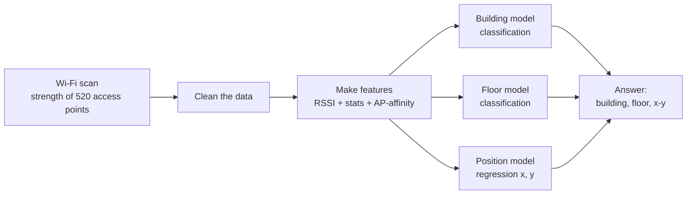

## 4. Step by step (what we did, and why)

| Step | What we did | Why |
|---|---|---|
| 1. Data | UJIIndoorLoc dataset (public, from UCI): 3 buildings, 520 access points, 19,937 training scans, 1,111 test scans | A well-known benchmark, so others can compare with us |
| 2. "Not heard" | The file writes 100 for "not heard". We changed it to **−110 dBm** | 100 would look like the strongest signal. −110 means "very weak", which is the truth |
| 3. Cleaning | Removed 76 empty scans, 634 duplicates and 508 scans with impossible readings (−30 dBm or stronger). 19,937 became **18,719** | These scans teach the model nothing, or wrong things. The test set is never cleaned |
| 4. Fair testing | **User-group cross-validation**: 5 folds, and each fold hides whole users with their phones | The test set is mostly new phones, so we practise on new phones too |
| 5. Features | Raw signals + 3 simple stats + **AP-affinity (our own idea)** | Raw signals say how loud a router is, not where it is. AP-affinity adds "where" |
| 6. Models | 4 models: Baseline RF, kNN, Random Forest, XGBoost. Each has 3 parts: building, floor, position | Simple, well-known models that are easy to explain |
| 7. Tuning | Small grids of settings, picked by cross-validation | Each setting tried costs a full 5-fold run, so we kept the grids small |
| 8. Final pick | A rule fixed **before** testing: the lowest cross-validation error wins. That was **Random Forest** | So the test set cannot influence our choice |
| 9. Test | Every model is tested **once** on the 1,111 test scans | An honest final score |
| 10. Error check | Where do the mistakes come from? Floors? New phones? | To plan Phase 2 |

## 5. Fair testing (picture)

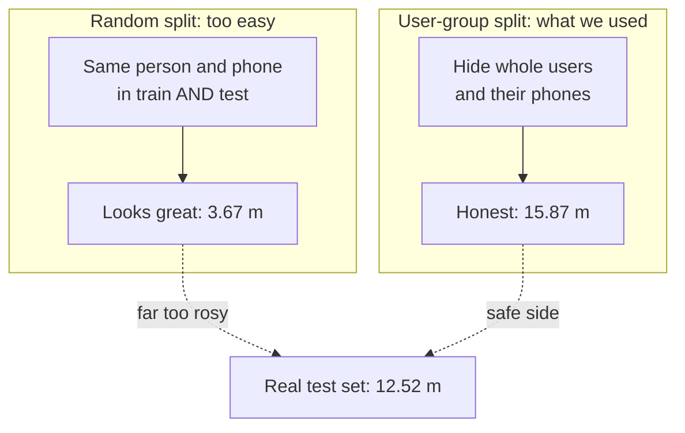

The same Baseline RF model, scored three ways. A random split promised 3.67 m, but the real test gave 12.52 m. A random split lies, so we did not use it for any choice.

## 6. AP-affinity, our idea (picture)

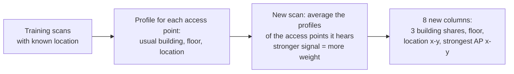

**In simple words:** if you hear the router of "Room 101" very loudly, you are probably near Room 101. We first learn where each router usually lives. Then we describe a scan by the places of the routers it hears.

- It is learned **only from training data**, and rebuilt in every cross-validation fold, so the answer never leaks in.
- **It was our biggest gain:** the error went from 15.87 m to **11.38 m** (28% lower).

## 7. Results on the test set (1,111 scans)

| Model | Building | Floor | Mean error | Median error |
|---|---:|---:|---:|---:|
| Baseline RF | 99.8% | 91.2% | 12.52 m | 7.70 m |
| kNN | 99.8% | 87.5% | 9.22 m | 5.88 m |
| **Random Forest (final)** | **100%** | 92.2% | **7.42 m** | **5.34 m** |
| XGBoost | **100%** | **95.2%** | 7.86 m | 6.19 m |

- **Mean error** = the average straight-line distance between the guess and the true spot.
- One "data meter" is about 0.77 real meters, so 7.42 m is about 5.7 m on the ground.
- Random Forest has the lowest position error, and XGBoost gets the most floors right. **No model wins everything.**

## 8. What we learned → Phase 2

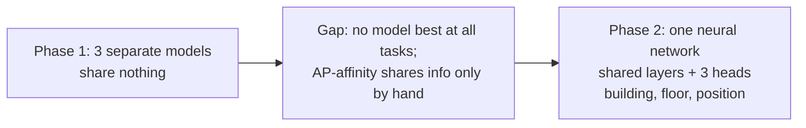

- The building was never wrong.
- 81 of the 87 floor mistakes are just one floor off.
- New phones are harder: 8.30 m, against 5.84 m on phones seen in training.
- 86% of the error comes from scans where the building and floor are right, so fine position is the main problem.

## 9. Tech we used

| What | Tool | Used for |
|---|---|---|
| Language | Python 3.14 | Everything |
| Data | pandas, NumPy | Reading the CSVs, cleaning, tables |
| ML models | scikit-learn | kNN, Random Forest, cross-validation (GroupKFold) |
| Boosting | XGBoost | The XGBoost model |
| Charts | matplotlib | All figures |
| Notebooks | Jupyter | 3 short notebooks: data, features, models |
| Testing | pytest | 27 small tests that check the code works |
| Code style | ruff, black | Clean, consistent code |
| Report | LaTeX (IEEE template) | The 5-page report |
| Slides | PowerPoint (python-pptx) | 11 slides |
| Running | Makefile | `make all` runs everything |
| Sharing | Git, GitHub | Team code sharing |

## 10. Who presents what

| Slides | Person | Topic |
|---|---|---|
| 1–3 | Gauri Mehrotra | Opening, the problem, related work and the gap |
| 4–5 | Ansh | The data, cleaning, fair split |
| 6–7 | Agnik Misra | Features, AP-affinity, feature check |
| 8–9 | Kartikey Gupta | Models, tuning, test results |
| 10–11 | Lokendra Singh | Where the errors are, Phase 2, thank you |

## 11. Numbers everyone should know

- **520** access points (464 kept), **3** buildings, **13** building-floor classes
- **19,937 → 18,719** training scans after cleaning; **1,111** test scans
- **16** user groups, **5** folds
- Test phones: **11**, of which **9 are new** (64.3% of test scans)
- AP-affinity: **15.87 → 11.38 m**
- Final model: **Random Forest**, building **100%**, floor **92.2%**, error **7.42 m**

## 12. Five questions anyone may get

1. **Why −110 for "not heard"?** 100 would look like the strongest possible signal. −110 is weaker than any real reading (the weakest is −104), so "not heard" correctly means "very weak".
2. **Why not a random split?** The same person scanned the same spot many times, so near-copies end up on both sides of the split and the test becomes too easy (3.67 m, against a real 12.52 m).
3. **Why Random Forest if XGBoost gets more floors right?** We fixed the rule before testing: the lowest cross-validation error wins. Changing the pick after seeing the test would be cheating.
4. **Is AP-affinity cheating?** No. It is learned only from training scans, and rebuilt inside every fold. A test scan's true answer never goes into its own features.
5. **What is Phase 2?** One neural network that learns building, floor and position together, with shared layers and 3 outputs. It will be tested the same way, so we can compare it fairly with Phase 1.

## 13. All 11 slides

| | |
|---|---|
| 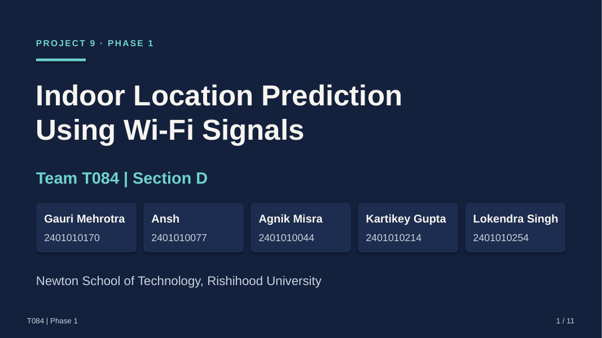 | 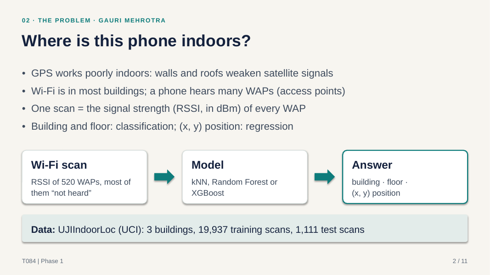 |
| 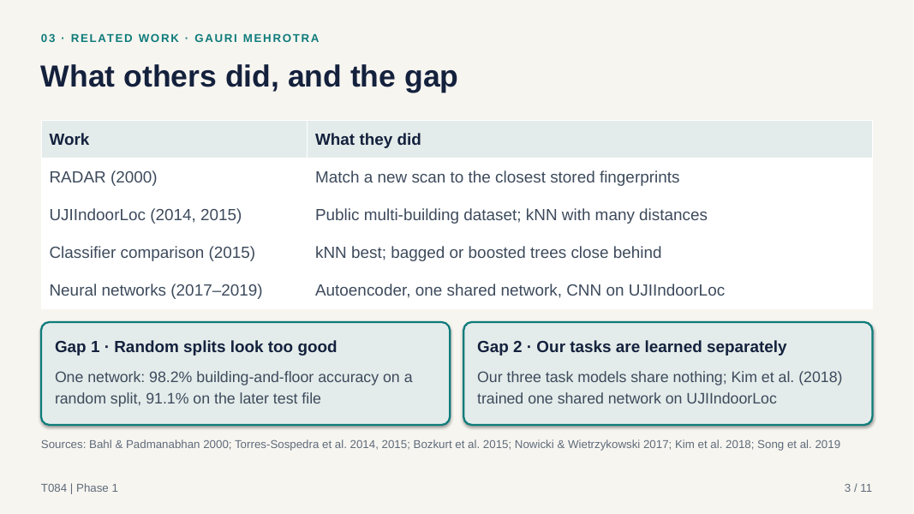 | 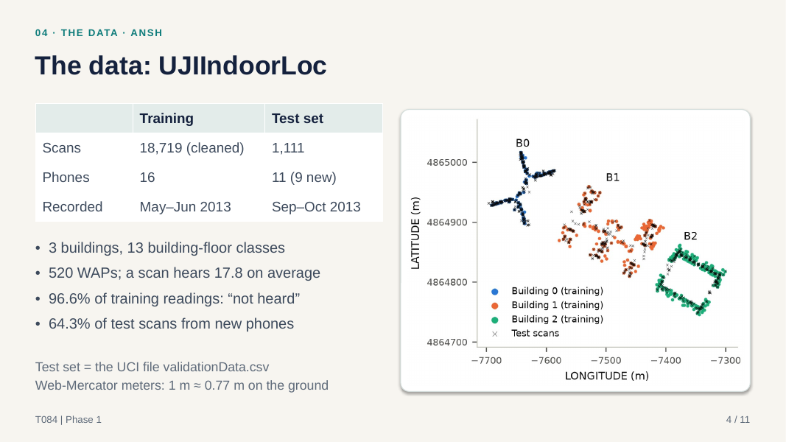 |
| 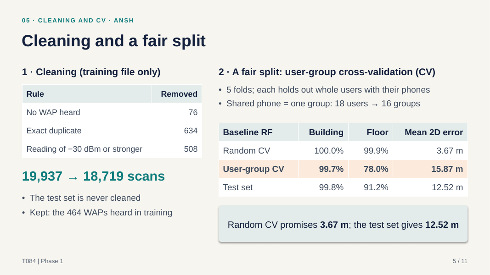 |  |
|  | 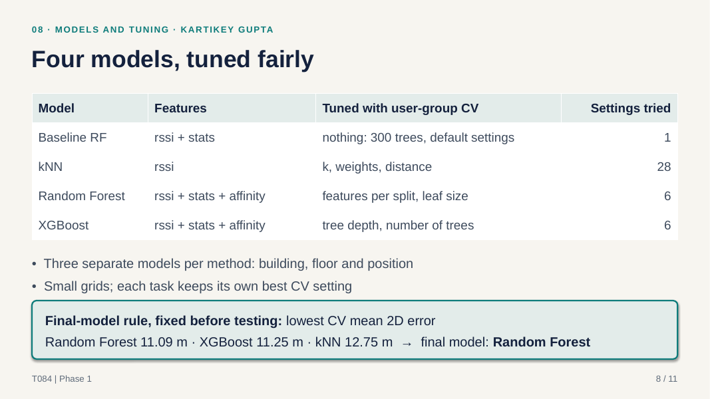 |
| 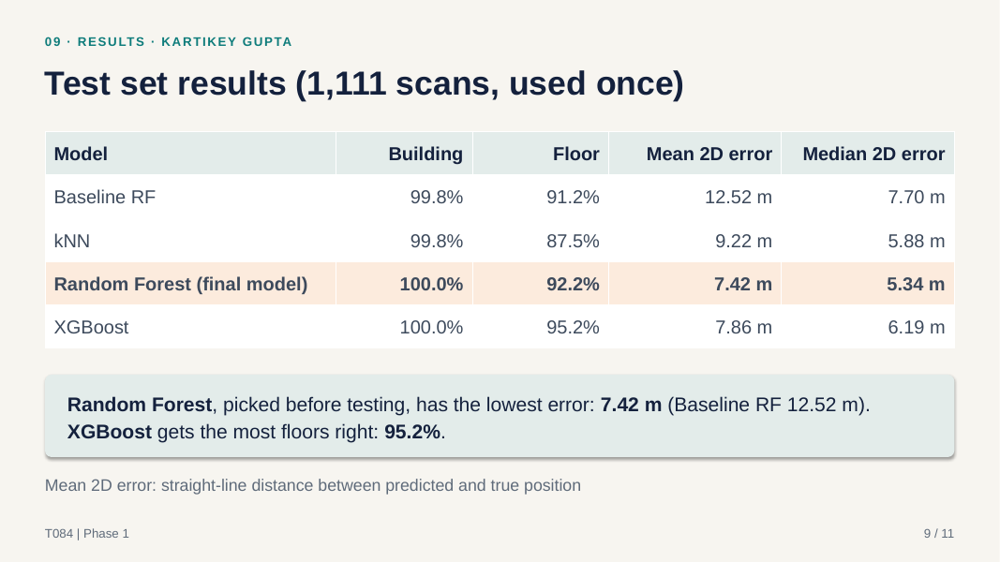 |  |
|  | |
