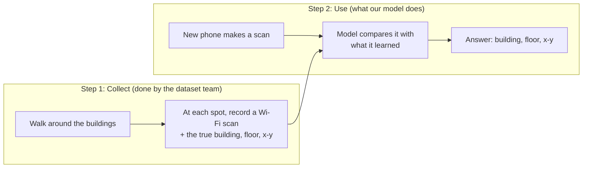
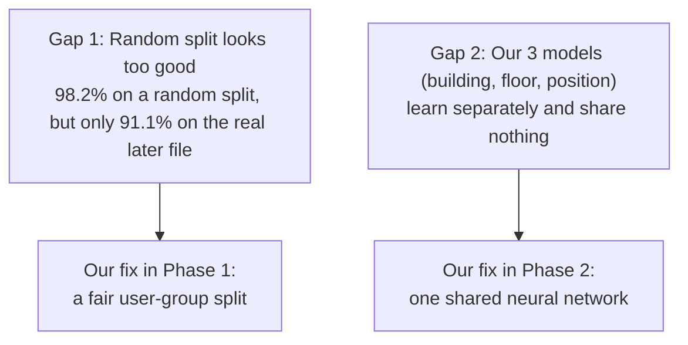

# Gauri Mehrotra (2401010170): Slides 1, 2, 3

**Your part:** opening the talk, explaining the problem, what others did before us (related work), and the gap we found.
**Time:** about 1.5 minutes.

---

## First, understand the idea (diagrams)

### How Wi-Fi positioning works

### What one scan looks like

| | WAP001 | WAP002 | WAP003 | ... | WAP520 | Building | Floor | x, y |
|---|---|---|---|---|---|---|---|---|
| Scan 1 | not heard | −45 dBm | not heard | ... | −82 dBm | 1 | 2 | known |

- A scan is just a row of 520 numbers, one per Wi-Fi router.
- Most of them are "not heard", and only about 18 are heard at once.
- A value like −45 dBm means the router is loud, so probably close. −90 dBm means it is weak, so probably far.

### The two gaps

---

## Your script

> **Remember:** GPS fails indoors → Wi-Fi gives a fingerprint → we predict building, floor, position → two gaps.

### Slide 1: Title

> Good morning. We are **Team T084, Section D**, and our project is **Indoor Location Prediction using Wi-Fi Signals**.
> I am Gauri, with Ansh, Agnik, Kartikey and Lokendra.
> This is **Phase 1**, using classical machine learning: **kNN, Random Forest and XGBoost**.

### Slide 2: The problem

> **GPS does not work well inside buildings**, because walls block the signal. But every building has **Wi-Fi**.
> A phone hears many routers: near ones are **loud**, far ones are **weak**. This pattern is like a **fingerprint** of the place.
> From one scan, we predict the **building**, the **floor** and the **exact position**.
> Our data: **UJIIndoorLoc**, 3 buildings, 520 routers.

### Slide 3: Related work and gap

> The classic method is **RADAR (2000)**: find the most similar old scans. That is **kNN**. Later work used trees and neural networks.
> **Gap 1:** random splits look **too good**: 98% versus 91% on the real test.
> **Gap 2:** our 3 models **learn separately**. One shared network could do better. That is **Phase 2**.
> Now Ansh will explain the data.

---

## Words you should know

| Word | Simple meaning | Example |
|---|---|---|
| **GPS** | Finding your position from satellites | Works on the road, fails inside a mall |
| **Indoor positioning** | Finding where someone is inside a building | "3rd floor, near room 305" |
| **WAP (Wireless Access Point)** | A Wi-Fi router. Our dataset has 520 | The router on the ceiling of a classroom |
| **RSSI** | Received Signal Strength Indicator: how loud a WAP is heard | −50 means loud, −95 means very weak |
| **dBm** | The unit of RSSI. Always negative here, and closer to 0 is stronger | −30 is extremely strong, −104 is the weakest in our data |
| **Scan** | One reading of all 520 WAPs at one place and time | One row in the dataset |
| **Fingerprint** | The pattern of signal strengths at a spot; each spot has its own | Room A hears WAP 5 loudly; Room B hears WAP 9 loudly |
| **Fingerprinting** | First record fingerprints at known spots, then match new scans to them | This is what RADAR did |
| **Classification** | Predicting a category | Building 0, 1 or 2; floor 0 to 4 |
| **Regression** | Predicting a number | The position x = 12.4 m, y = 30.1 m |
| **kNN (k-Nearest Neighbours)** | Find the k most similar old scans and copy their answer | k = 3: if the 3 closest scans are on floor 2, answer floor 2 |
| **Random split** | Shuffle all the data and cut it into train and test | Too easy here: the same person scanned each spot many times |
| **Neural network** | A model made of layers that learn patterns; used in Phase 2 | Like many small calculators connected in layers |
| **Multi-task network** | One neural network that gives several answers at once | One model gives building + floor + position together |
| **UJIIndoorLoc** | Our dataset, from Universitat Jaume I in Spain, free on the UCI website | 3 buildings, 4–5 floors each |
| **UCI** | A famous website of free machine-learning datasets | Our data is dataset number 310 |

## What you made / worked on

- **The problem statement:** why indoor positioning matters, and why Wi-Fi.
- **The literature review** (`docs/literature_review.md`): 10 papers compared in a table.
- **The report sections** Introduction and Related Work.
- **The reference list:** 17 papers in `report/references.bib`.

## Notebooks (short, in case they ask you)

Our project has **3 notebooks**. They only *show* the results; the heavy work runs in a script.

| Notebook | Who | What it shows |
|---|---|---|
| 01 Data quality & EDA | Ansh | Loading the data, cleaning, the campus map, the fair split |
| 02 Feature engineering | Agnik | The features and the AP-affinity idea, and whether they help |
| 03 Models & evaluation | Kartikey + Lokendra | The models, tuning, test results and error analysis |

Each notebook section has three parts: **What** we did, **Why**, and the **Result**.

## Questions they may ask you

**Q: Why not just use GPS?**
A: Indoors, walls and roofs weaken the satellite signals, so GPS becomes unreliable. Wi-Fi is already inside almost every building, so we can use it for free without new hardware.

**Q: What is RADAR?**
A: The first well-known Wi-Fi fingerprinting system, from Microsoft Research in 2000. It matches a new scan to the closest stored scans, which is the same idea as kNN.

**Q: Why is building and floor classification, but position regression?**
A: Building and floor are fixed categories (0, 1, 2...). Position is a continuous number in meters, so we predict it with regression.

**Q: What gap did you find?**
A: First, random splits give scores that are too optimistic, so we use a fair user-group split. Second, our three task models share nothing; one shared network could learn all three together, and that is Phase 2.

**Q: Why this dataset?**
A: It is public and widely used, so our results can be compared with others. It also has a separate test file recorded about 3 months later, mostly with new phones, which is like real life.

**Q: Which papers matter most?**
A: Bahl & Padmanabhan 2000 (RADAR, the classic method); Torres-Sospedra 2014 and 2015 (the dataset); Nowicki 2017 (random split versus the real test); and Kim 2018 (one shared network for all three tasks).

**Q: What is classical ML, compared with deep learning?**
A: Classical ML means models like kNN, Random Forest and XGBoost that work on table data. Deep learning means neural networks with many layers. We use classical ML in Phase 1 and deep learning in Phase 2.
