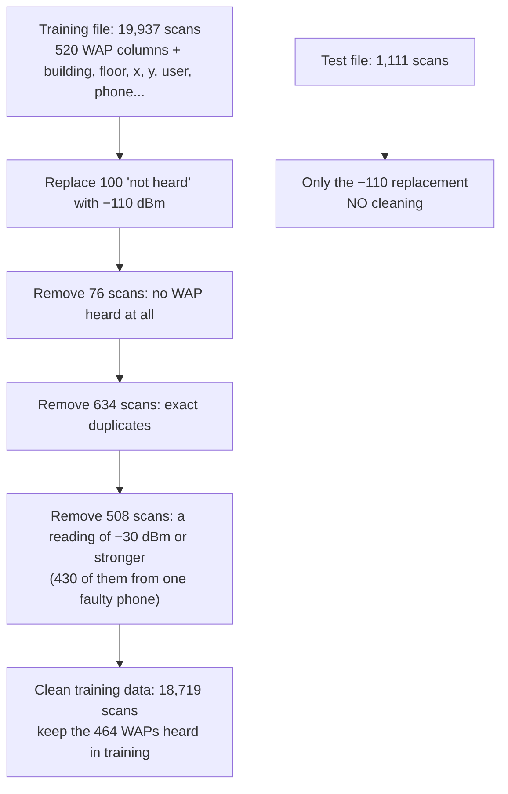
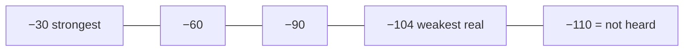
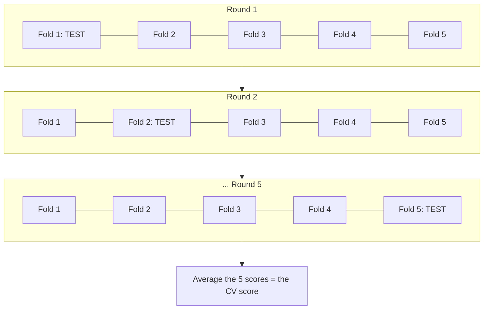
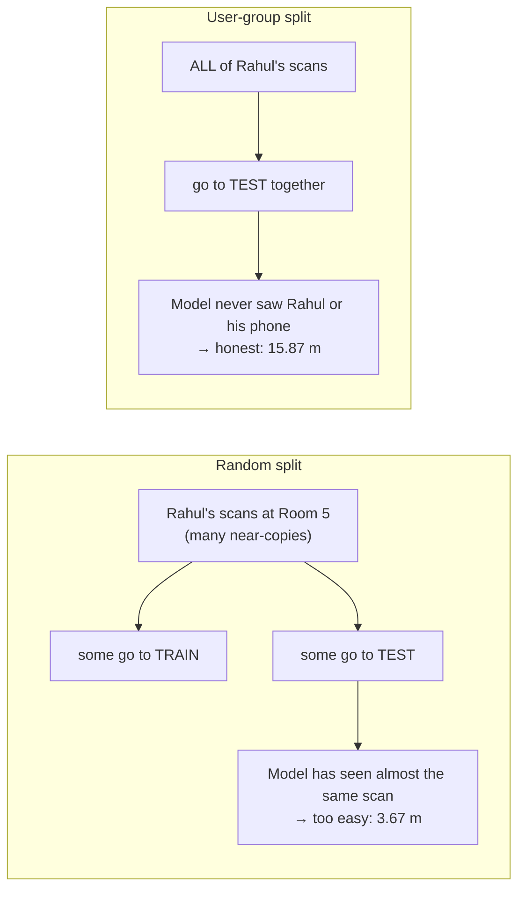

# Ansh (2401010077): Slides 4, 5

**Your part:** the data, cleaning it, and the fair way of testing (user-group cross-validation).
**Time:** about 2.5 minutes.

---

## First, understand the idea (diagrams)

### From raw data to clean data

### Why 100 is wrong and −110 is right

The file writes **100** for "not heard". As a number, 100 is bigger than −30, so a model would think "not heard" is the **strongest** signal, which is the opposite of the truth. **−110** sits just below the weakest real reading, so it correctly means "very weak".

### Cross-validation: how we test fairly during training

- In each round, the model trains on 4 folds and is tested on the 1 left out.
- **Our twist:** a fold is made of **whole users with their phones**, not random scans. So the test fold always holds people and phones the model has never seen, just like the real test set.

### Random split vs user-group split

(Rahul is just an example name.) The real test set gave **12.52 m**, so the random split lied and the group split was honest, on the safe side.

---

## Your script

### Slide 4: The data (about 1 min)

> Thank you, Gauri. Our dataset is **UJIIndoorLoc**, from a university in Spain.
> On this map, the **coloured dots** are where the training scans were taken, and the **black crosses** are the test scans. There are **3 buildings** with 4 or 5 floors each, which gives **13 building-floor combinations**.
> There are **520 access points**, but one scan hears only about **18** of them on average. So almost **97%** of all the readings are "not heard". The data is very sparse.
> The file writes "not heard" as **100**. That is a problem, because to a model 100 looks stronger than any real signal. So we replaced it with **−110 dBm**, which is weaker than the weakest real reading of −104. Now "not heard" means "very weak", which is the truth.
> The training data was recorded in **May–June 2013**, and the test set about **3 months later, in September–October**. The test set has 11 phones, and **9 of them are new**, never seen in training. So it is like a real exam with new students.
> One small note: the positions are in map units, and one data meter is about 0.77 real meters.

### Slide 5: Cleaning and fair split (about 1.5 min)

> First, cleaning. We cleaned **only the training file**, with three simple rules.
> **One:** remove scans where no access point was heard at all. They tell nothing about location. That removed **76**.
> **Two:** remove **exact duplicates**, because they would just count twice. That removed **634**.
> **Three:** remove scans with a reading of **−30 dBm or stronger**. That is unrealistically strong, and 430 of these 508 scans came from one single phone, so it looks like a faulty device.
> So **19,937 scans became 18,719**. We never clean the test set, because in real life you cannot choose which scans users send you.
> Second, how do we test fairly while choosing settings? We use **cross-validation**: cut the training data into 5 parts, train on 4, test on the 5th, and repeat five times so every part is tested once.
> The important point is that we split by **user**, not randomly. Each part holds **whole users with their phones**. Some users shared a phone, so we kept them together, and the 18 users became **16 groups**.
> This table shows why it matters, using the same model. A **random split** promised just **3.67 m** of error, but the **real test** gave **12.52 m**. A random split is too easy, because one person scanned each spot many times, so almost the same scan lands on both sides. Our **user-group split** said 15.87 m, which is a bit stricter, and that is the safe side.
> Now Agnik will explain the features.

---

## Words you should know

| Word | Simple meaning | Example / our number |
|---|---|---|
| **Dataset** | The full collection of data we use | UJIIndoorLoc |
| **Training set** | The data the model learns from | 18,719 scans after cleaning |
| **Test set** | Data kept aside and used **once**, at the end, to give the final score | 1,111 scans (`validationData.csv`) |
| **EDA (Exploratory Data Analysis)** | Looking at the data with tables and plots before modelling | The campus map, scans per floor |
| **Sparse data** | Data where most values are empty or zero | 96.6% of the readings are "not heard" |
| **Fill value** | The value we put in place of "missing" | −110 dBm for "not heard" |
| **Data cleaning** | Removing rows that are useless or wrong | 3 rules, 1,218 scans removed |
| **Duplicate** | A row exactly the same as another row in every column | 634 removed |
| **Outlier** | A value that is not realistic | A reading of −30 dBm or stronger |
| **Cross-validation (CV)** | Testing on parts of the training data, several times, to pick settings safely without touching the test set | 5 rounds |
| **Fold** | One of the 5 parts in cross-validation | Each fold is about 1/5 of the data |
| **GroupKFold** | The scikit-learn tool that makes folds from whole groups | We used it |
| **User-device group** | One user with their phone. Users who shared a phone become one group | Users 1, 9, 16 shared phone 14, so 16 groups |
| **Random CV** | Cross-validation where scans are shuffled randomly | Too optimistic: 3.67 m |
| **Data leakage** | When test information sneaks into training, so the score looks better than it really is | A random split leaks near-copies |
| **Web-Mercator meters** | The map units used for positions in the dataset | 1 data meter ≈ 0.77 real meters |
| **SHA-256** | A "fingerprint" code of a file, used to check the file is not changed or broken | Our download script checks it |

## What you made / worked on

- **Loading and cleaning** (`src/indoorloc/data.py`): the −110 fill, the 3 cleaning rules, and finding the user groups.
- **Getting the data** (`scripts/download_data.py`): downloads the files only if they are missing, and checks them.
- **Notebook 01** (described below).
- **The CV check:** random CV compared with user-group CV (`results/metrics/cv_check.csv`).

## Your notebook: 01 Data quality & EDA

| Section | What it shows | Main result |
|---|---|---|
| 1. Load the data | Reads both files and replaces 100 with −110 | 19,937 training + 1,111 test scans |
| 2. Clean | Applies the 3 rules (table of removed counts) | 18,719 scans left |
| 3. Key facts | How many WAPs one scan hears (a histogram) | About 18 heard; 96.6% "not heard" |
| 4. Campus map | Where the scans were taken: dots = training, crosses = test | The test covers the same 3 buildings |
| 5. Scans per floor | How many scans each of the 13 floors has | Every floor has data; the test mix is different |
| 6. Users and phones | Which users shared a phone | 18 users → 16 groups |
| 7. Fair split | Which users each fold holds out, plus the CV-check table | Random 3.67 m vs test 12.52 m |

## Questions they may ask you

**Q: Why −110 and not 0, or the original 100?**
A: 0 and 100 are both bigger than real readings like −50, so the model would read "not heard" as a very strong signal. −110 is below every real reading (the weakest is −104), so "not heard" correctly means "very weak". Other researchers (Nowicki 2017) also found this works better.

**Q: Why remove readings of −30 dBm or stronger?**
A: That is unrealistically strong; you would have to hold the phone right next to the router. 430 of the 508 such scans came from one phone (phone 19), so it is most likely a faulty device.

**Q: Why not clean the test set too?**
A: In real use we cannot choose which scans users send. The test must look like real life, so we leave it as published.

**Q: Why not a random split?**
A: One person scanned the same spot many times, so almost identical scans fall into both train and test, and the test becomes too easy. A random split said 3.67 m, but the real test said 12.52 m.

**Q: Why 16 groups and not 18?**
A: Users 1, 9 and 16 used the same phone (phone 14). If we split them apart, the same phone would appear in both train and test, so we keep them together as one group.

**Q: Why 5 folds?**
A: It is a common choice. Each round still trains on about 80% of the data, and 5 rounds do not take too long.

**Q: Why is the test score (12.52 m) better than the CV score (15.87 m)?**
A: Two reasons. In CV, every held-out scan comes from a new user and phone, but in the test set about a third of the scans come from 2 phones that are also in training, which is easier. Also, the final model trains on all the data, while each CV round trains on only part of it.

**Q: What is EDA, and why do it?**
A: Exploratory Data Analysis: looking at the data with plots and counts before modelling. It showed us the "100" problem, the sparse scans, the faulty phone and the shared phones.
