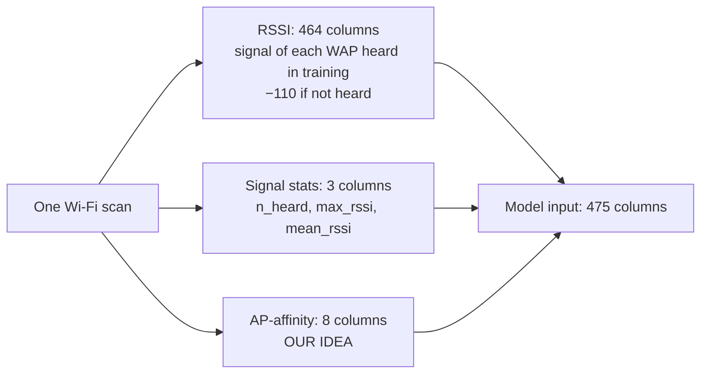
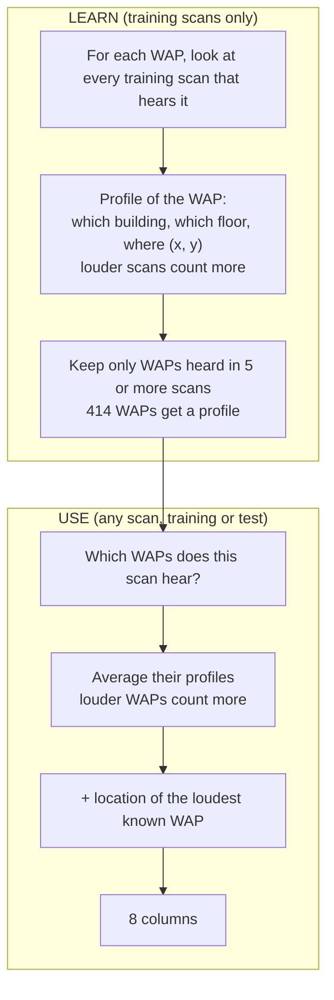
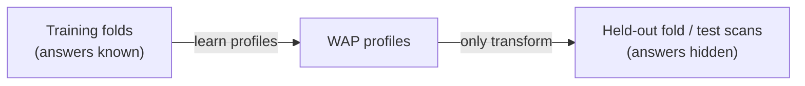
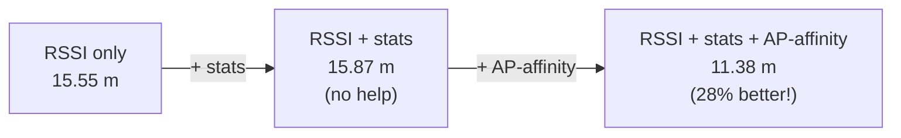
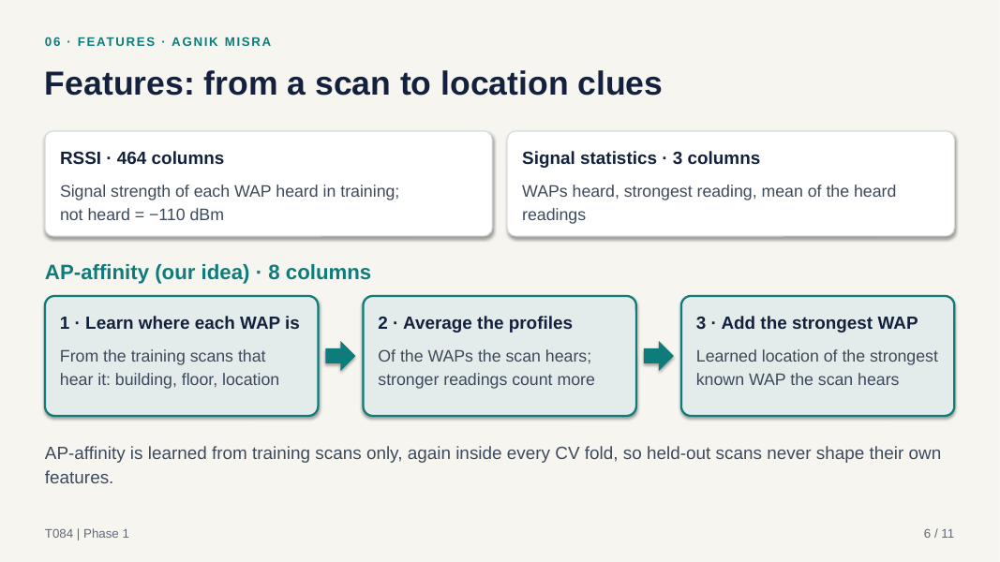
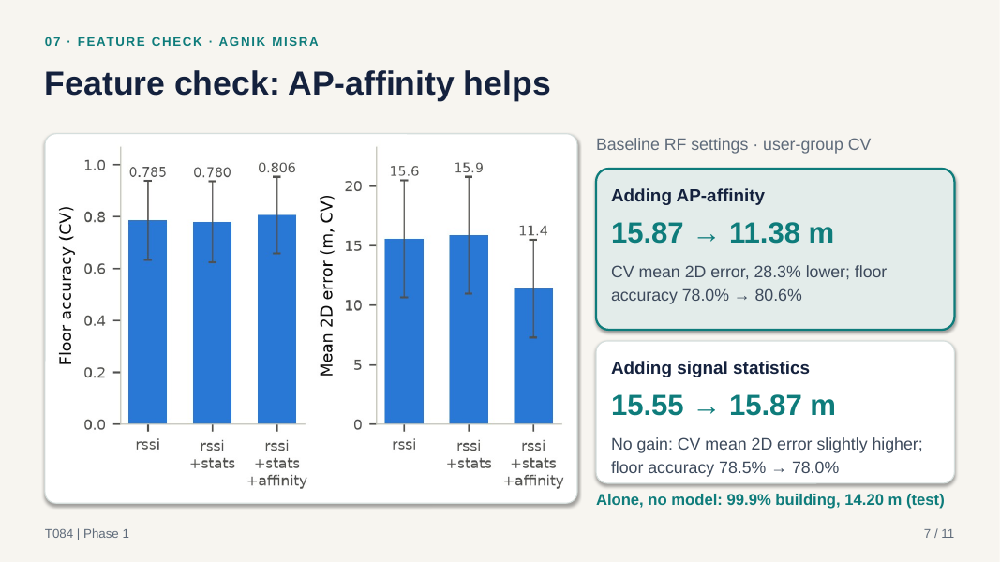

# Agnik Misra (2401010044): Slides 6, 7

**Your part:** the features (what the model gets as input), AP-affinity (our own idea), and the feature check.
**Time:** about 2 minutes.

---

## First, understand the idea (diagrams)

### From one scan to 475 input columns

### AP-affinity in 3 steps

### A small worked example (made-up numbers)

A new scan hears only two WAPs:

| WAP | Signal | Its learned profile | Weight |
|---|---|---|---|
| WAP A | −45 dBm (loud) | building 1, floor 2, at (10, 20) | **0.22** |
| WAP B | −80 dBm (weak) | building 1, floor 3, at (30, 40) | **0.02** |

The weight formula is `((signal + 105) / 105) ^ e`, so a loud WAP gets a much bigger weight. Here WAP A counts about **10 times more** than WAP B.

- **Building:** both WAPs are in building 1, so aff_b1 = 1.0.
- **Floor:** (0.22×2 + 0.02×3) / 0.24 ≈ **2.1**, so "probably floor 2".
- **Location:** (0.22×10 + 0.02×30) / 0.24 ≈ 11.7 and (0.22×20 + 0.02×40) / 0.24 ≈ 21.7, so "probably near (11.7, 21.7)".
- **Loudest known WAP:** A, at (10, 20).

So the model gets a ready-made hint: **"you are probably in building 1, floor 2, near (11.7, 21.7)"**. The raw RSSI columns alone cannot say that.

### Why there is no cheating (leakage)

The profiles are rebuilt **inside every CV fold** from the training part only. A test scan's true location is never used to build its own features.

### Feature check result

---

## Your script

> **Remember:** 3 feature types → AP-affinity = "where is each router?" → 15.87 → 11.38 m.

### Slide 6: Features (1 min)

> Thank you, Ansh. A model cannot read a scan directly.
> So we turn it into **features**, which are columns of numbers. We have 3 types:
> **1. RSSI:** the signal of each router, 464 columns.
> **2. Stats:** how many routers were heard, the strongest one, and the average. Just 3 columns.
> **3. AP-affinity, our own idea.**
> The problem: a signal tells how **loud** a router is, but not **where** it is.
> So first, we **learn where each router is**, using the training scans where we know the location.
> We only trust routers heard in at least **5 scans**.
> Then, for a new scan, we **average the places** of the routers it hears. **Louder ones count more**, because they are closer.
> This gives the model a hint: "you are **probably in this building, on this floor, near here**."
> It is learned **only from training data**, again in every fold, so there is **no cheating**.

### Slide 7: Feature check (45 sec)

> Did it help? To check fairly, we kept the **same model** and changed **only the features**.
> **With AP-affinity: error 15.87 → 11.38 m. That is 28% better.**
> Floor accuracy also went up, from **78% to 81%**.
> It helped in **all 5 folds**, not just on average.
> This was our **biggest gain** in the project.
> Honestly, **the stats did not help**. The error went slightly up.
> We kept them because the full set together was best.
> Now Kartikey will show the models.

---

## Words you should know

| Word | Simple meaning | Example / our number |
|---|---|---|
| **Feature** | One input column the model learns from | "Signal of WAP 12" is one feature |
| **Feature engineering** | Creating new, more useful columns from the raw data | We created AP-affinity |
| **Feature set** | A group of features used together | rssi / rssi+stats / rssi+stats+affinity |
| **RSSI features** | The raw signal strength columns | 464 columns |
| **n_heard** | How many WAPs the scan heard | 17 |
| **max_rssi** | The strongest reading in the scan; tells how close the nearest router is | −46 dBm |
| **mean_rssi** | The average of only the heard readings | −75 dBm |
| **AP-affinity** | Our feature: where the WAPs that a scan hears usually are | 8 columns |
| **Profile** | What we learned about one WAP: its building shares, average floor and average location | WAP A: building 1, floor 2, at (10, 20) |
| **Building shares** | What fraction of a WAP's (weighted) scans come from each building | 0.9 in building 1, 0.1 in building 2 |
| **Weighted average** | An average where some items count more than others | Loud WAPs count more |
| **Powed weight** | Our weight formula `((rssi + 105)/105)^e`, taken from the dataset's authors (2015) | About 0.27 at −40, 0.05 at −70, almost 0 at −100 |
| **e** | The math constant 2.718 used as the power | Makes loud signals count much more |
| **Min support = 5** | A WAP must be heard in at least 5 training scans to get a profile | Fewer scans would give an unreliable profile |
| **Strongest known WAP** | The loudest WAP in the scan that has a profile | Its location goes into 2 columns |
| **fit / transform** | fit = learn from training data; transform = apply what was learned to any data | Profiles are fit on training rows, then transform test scans |
| **Data leakage** | The answer sneaking into the input, which makes scores look fake-good | Avoided: profiles come from training rows only |
| **Nested feature sets** | Each set adds a block to the previous one | rssi ⊂ rssi+stats ⊂ rssi+stats+affinity |
| **Feature check** | Same model, change only the features, and compare the scores | Done with the Baseline RF |

### The 8 AP-affinity columns

| Column | Meaning |
|---|---|
| aff_b0, aff_b1, aff_b2 | How strongly the heard WAPs "belong" to building 0, 1 and 2 |
| aff_floor | The average floor of the heard WAPs |
| aff_lon, aff_lat | The average location (x, y) of the heard WAPs |
| aff_top_lon, aff_top_lat | The location (x, y) of the loudest known WAP |

## What you made / worked on

- **The feature code** (`src/indoorloc/features.py`):
  - `signal_stats`: the 3 statistics.
  - `APAffinity`: learns the profiles (fit) and makes the 8 columns (transform).
  - `FeatureBuilder`: puts together whichever feature set is asked for.
- **Notebook 02** (described below).
- **The feature check** (`results/metrics/feature_check.csv`) and its bar chart.

## Your notebook: 02 Feature engineering

| Section | What it shows | Main result |
|---|---|---|
| 1. Three feature sets | Builds the 3 sets from the training data | 464, 467 and 475 columns |
| 2. Signal statistics | n_heard, max_rssi and mean_rssi for 3 sample scans | They hear 17, 16, 15 WAPs |
| 3. AP-affinity profiles | How many WAPs get a profile, and the profile of the most-heard WAP | 414 WAPs have a profile |
| 4. AP-affinity of one test scan | The 8 columns of one random test scan next to its true answer | The hint points to the right building and nearly the right floor |
| 5. Feature check | Bar chart and table: the same model on the 3 sets | AP-affinity 15.87 → 11.38 m; stats no help |
| 6. The weight curve | How much each reading counts in AP-affinity | 0.27 at −40, 0.05 at −70, ~0 at −100 |
| 7. AP-affinity alone | Use the 8 columns directly on the test set, no model | 99.9% building, 77.3% floor, 14.2 m |

## Questions they may ask you

**Q: Explain AP-affinity in one line.**
A: It tells the model *where* the routers a scan hears usually are, so the model gets a location hint and not just signal strengths.

**Q: Is it cheating or leakage?**
A: No. Profiles are learned only from training rows, and rebuilt in every CV fold. A held-out or test scan's true location never enters its own features. We judge it only on held-out folds and the test set.

**Q: Why do loud signals count more?**
A: A loud router is probably close to you, so its location says more about where you are. A very weak one could be far away.

**Q: Why at least 5 scans?**
A: A profile built from 1 or 2 scans could be badly wrong. 5 is a simple, safe minimum.

**Q: What if a scan hears no WAP with a profile?**
A: It gets the training average values. This is very rare.

**Q: Why −105 in the formula?**
A: It is 1 dB below the weakest real training reading (−104). So even the weakest real signal gets a small positive weight, and "not heard" (−110) gets no weight.

**Q: Why the power e?**
A: It comes from the "powed" formula suggested by the dataset's own authors (Torres-Sospedra et al., 2015). We did not tune it.

**Q: The stats did not help. Why keep them?**
A: The feature sets were tested in order (rssi → +stats → +affinity), and the full set scored best. We did not test RSSI plus AP-affinity without the stats, and we say that honestly.

**Q: Is the gain real, or luck?**
A: It is real. AP-affinity lowered the error in all 5 folds; for example, from 24.53 to 18.35 m on the hardest fold.

**Q: How is this different from kNN?**
A: kNN compares whole scans with each other. AP-affinity learns about each router separately, and then combines them. It turns "which routers do I hear?" into "where am I probably?".

**Q: The brief said "add missingness indicators" and "scale RSSI". Why didn't you?**
A: Indicators: −110 already marks "not heard". A tree can split at "below −105", which means exactly "not heard", and `n_heard` counts the heard routers. So separate heard/not-heard columns add nothing for trees. Scaling: trees only use the order of the values, not their size, and all RSSI columns use the same unit (dBm), so kNN treats them fairly. Nothing is ever fitted on the test set. Scaling (fitted on training data only) **will be used in Phase 2**, because neural networks need it.
