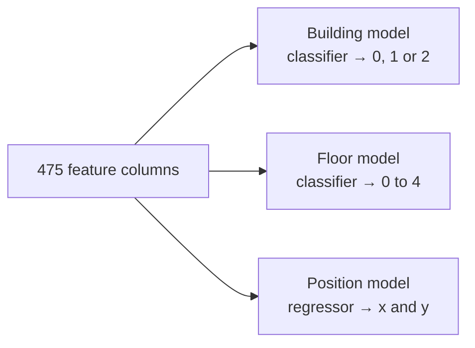
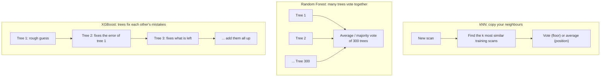
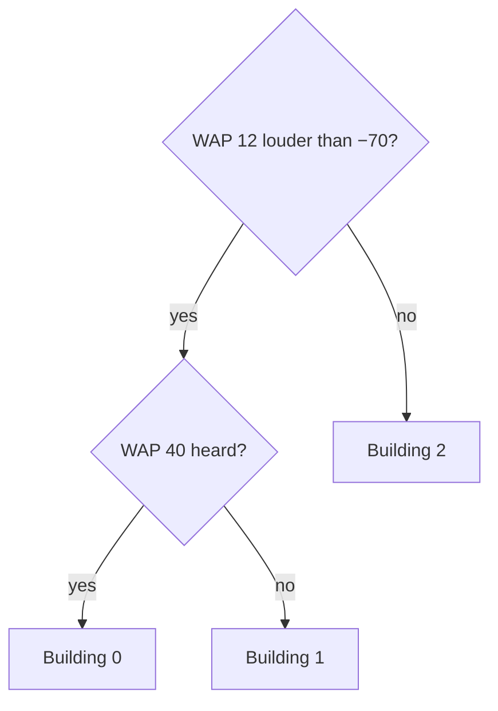
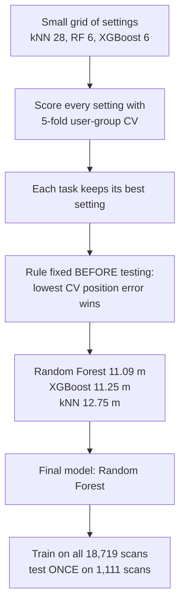

# Kartikey Gupta (2401010214): Slides 8, 9

**Your part:** the four models, how we tuned them, how we chose the final model, and the test results.
**Time:** about 1 minute.

---

## First, understand the idea (diagrams)

### Every method = 3 separate models

### How the 3 model types think

### One decision tree (a toy example)

A tree is just a list of yes/no questions. A **Random Forest** grows 300 trees, each on a random part of the data, and lets them vote.

### kNN toy example (k = 3)

| The 3 nearest training scans | Floor | Position |
|---|---|---|
| Scan A | 2 | (10, 20) |
| Scan B | 2 | (12, 21) |
| Scan C | 3 | (11, 25) |
| **kNN answer** | **2** (majority vote) | **(11, 22)** (average) |

### How we tuned and chose

---

## Your script

> **Remember:** 4 models × 3 tasks → small tuning → rule fixed first → Random Forest wins, 7.42 m.

### Slide 8: Models and tuning

> Thank you, Agnik. We tried **4 models**, each with **3 parts**: building, floor and position.
> **kNN** copies similar scans, **Random Forest** lets many trees vote, **XGBoost** adds trees that fix earlier mistakes.
> We tried a **few settings** for each, using fair cross-validation.
> The rule, fixed **before testing**, was **lowest error wins**, and **Random Forest** won.

### Slide 9: Test results

> We used the test set **only once**: 1,111 scans.
> **Random Forest:** building **100%**, floor **92%**, error **7.42 m**, against **12.52 m** for the baseline.
> **XGBoost** got the most floors right, **95%**, so **no model is best at everything**.
> Now Lokendra will show where the errors are.

---

## Words you should know

| Word | Simple meaning | Example / our number |
|---|---|---|
| **Model** | A program that learns from examples and then predicts | Random Forest |
| **Classifier** | A model that predicts a category | Building 0/1/2 |
| **Regressor** | A model that predicts a number | Position x, y |
| **Baseline** | A simple model to compare against; the bar to beat | RF, 300 trees, default settings: 12.52 m |
| **kNN (k-Nearest Neighbours)** | Find the k most similar scans and copy their answer | k = 3, majority vote |
| **Distance (euclidean / manhattan)** | How kNN measures "similar". Euclidean = straight line; manhattan = the sum of the differences | Both were tried |
| **weights (uniform / distance)** | In kNN, whether all neighbours count equally, or closer ones count more | Position used "distance" |
| **Decision tree** | A chain of yes/no questions that ends in an answer | "WAP 12 > −70? → yes → ..." |
| **Random Forest** | Many trees, each trained on random rows and random columns, that vote together (Breiman, 2001) | 300 trees |
| **Bagging** | Training many models on random parts of the data and averaging them; the idea behind Random Forest | — |
| **Boosting** | Adding models one by one, each fixing the earlier errors | XGBoost |
| **XGBoost** | A fast, popular boosting library (Chen & Guestrin, 2016) | 300–600 trees |
| **Hyperparameter / setting** | A choice made *before* training; not learned from the data | k in kNN, tree depth |
| **max_features** | In a forest, how many columns each split may look at | sqrt, 0.2, 0.5 |
| **min_samples_leaf** | The smallest number of scans allowed at the end of a branch | 1 or 4 |
| **max_depth** | How many questions deep an XGBoost tree may go | 4, 6, 10 |
| **n_estimators** | The number of trees | 300 or 600 |
| **learning rate** | How big each XGBoost correction step is (fixed by us) | 0.1 |
| **Grid search / tuning** | Trying every combination from a small list and keeping the best | 28 + 6 + 6 settings |
| **Accuracy** | The % of scans with the correct answer | Building 100%, floor 92.2% |
| **2D error** | The straight-line distance between the predicted and the true spot | 7.42 m on average |
| **Mean vs median** | Mean = the average, pulled up by big misses. Median = the middle value | 7.42 m vs 5.34 m |
| **MAE x / y** | The average error in the x direction and in the y direction separately | 4.77 m and 4.64 m |
| **Final-model rule** | How we pick the winner, decided *before* seeing the test | Lowest CV mean 2D error |

### What we tuned

| Model | Features | Settings tried | Count |
|---|---|---|---|
| Baseline RF | rssi + stats | none (300 trees, defaults) | 1 |
| kNN | rssi | k = 1, 3, 5, 7, 9, 11, 15 × weights × distance | 28 |
| Random Forest | rssi + stats + affinity | max_features (sqrt, 0.2, 0.5) × min_samples_leaf (1, 4) | 6 |
| XGBoost | rssi + stats + affinity | max_depth (4, 6, 10) × n_estimators (300, 600) | 6 |

### The settings that won

| Model | Building | Floor | Position |
|---|---|---|---|
| kNN | k = 1 | k = 5, manhattan | k = 3, distance weights |
| Random Forest | sqrt, leaf 1 | 0.5, leaf 4 | 0.5, leaf 1 |
| XGBoost | depth 4, 300 trees | depth 4, 300 trees | depth 10, 600 trees |

## What you made / worked on

- **The model code** (`src/indoorloc/models.py`): one wrapper that builds the 3 task models for any model type.
- **Cross-validation and tuning** (`src/indoorloc/pipeline.py`): makes the folds, runs CV and does the grid search.
- **The main script** (`scripts/run_experiments.py`): runs every experiment in order, in about 26 minutes.
- **The results:** `cv_results.csv`, `test_results.csv`, `tuning/best_params.json` and one predictions file per model.

## Your notebook: 03 Models & evaluation (sections 1–4)

The notebook does **not** train the models, because that takes 26 minutes. It only reads the saved results from the `results/` folder.

| Section | What it shows | Main result |
|---|---|---|
| 1. Four models | Each model's features and the best settings found | The table above |
| 2. One tuning table | The 6 Random Forest settings for position, with their CV error | max_features 0.5, leaf 1 wins |
| 3. CV results + final model | The CV scores of all models and the rule | Random Forest 11.09 m wins |
| 4. Test results | The test table + a chart of CV vs test for each model | RF 7.42 m, XGBoost floors 95.2% |

(Sections 5–7 are Lokendra's part.)

## Questions they may ask you

**Q: Why these models?**
A: kNN is the classic fingerprinting method, so it is the natural one to try. Random Forest and XGBoost are strong, well-known models for table data. All three are easy to explain.

**Q: Why three separate models instead of one?**
A: It is the simplest approach: classification for building and floor, regression for position, each with its own best settings. The downside is that they share nothing, which is the Phase 2 gap.

**Q: XGBoost gets more floors right. Why choose Random Forest?**
A: We fixed the rule *before* testing: the lowest CV position error. Random Forest won, with 11.09 against 11.25 m. Changing the choice after seeing the test would mean choosing on the test set, which is cheating. We still report XGBoost's 95.2% openly.

**Q: Why such small grids?**
A: Every setting costs a full 5-fold cross-validation run, so small grids keep the work fast and easy to explain.

**Q: Why are the 300 trees not tuned?**
A: More trees make a forest slower, but not worse. 300 is enough to be stable.

**Q: Why is kNN worse than the trees?**
A: kNN used only the raw RSSI. The trees also had AP-affinity, so part of the gap may come from the features, not the model.

**Q: Why is the mean error bigger than the median?**
A: A few big misses, mostly scans with the wrong floor, pull the mean up. The median is the middle scan: 5.34 m, against a mean of 7.42 m.

**Q: What is the difference between Random Forest and XGBoost?**
A: Random Forest grows trees **independently**, in parallel, and averages them. XGBoost grows trees **one after another**, each fixing the earlier errors.

**Q: What does 7.42 m mean in real life?**
A: The dataset uses map meters; one map meter is about 0.77 real meters, so 7.42 is about 5.7 m on the ground. That is roughly the size of a room.
