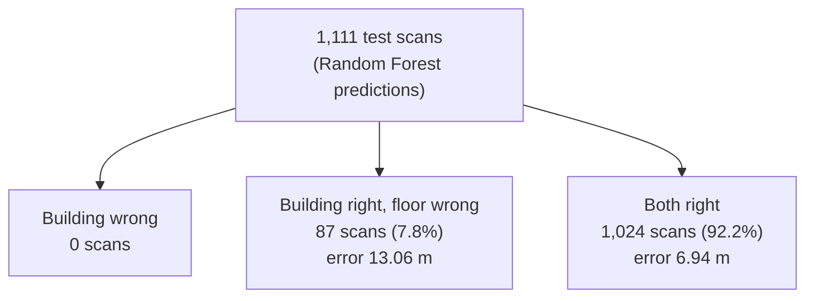
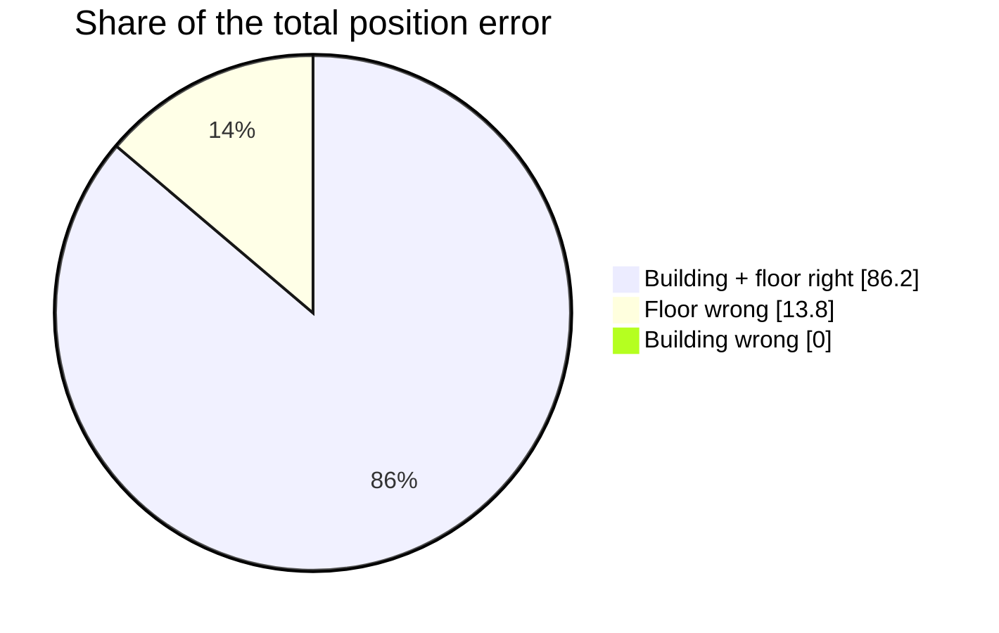
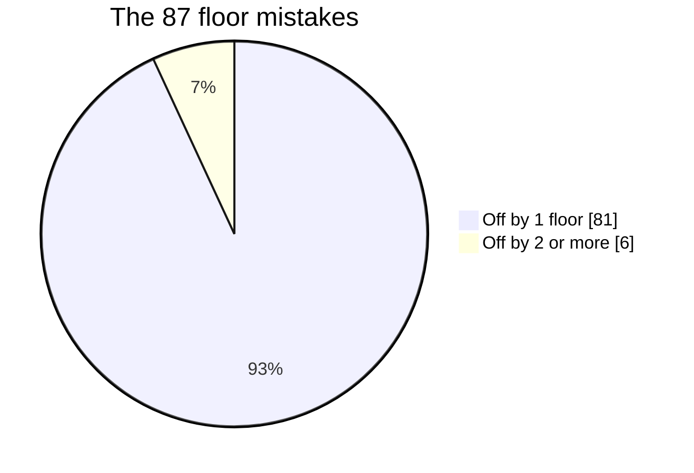
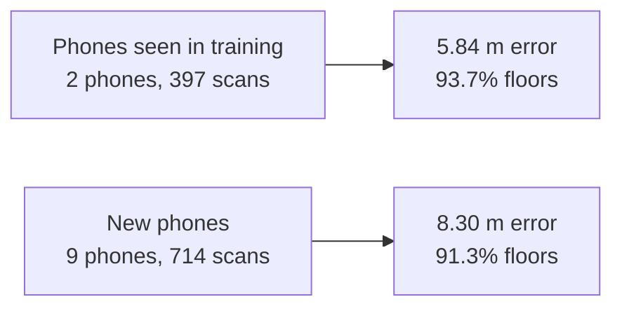
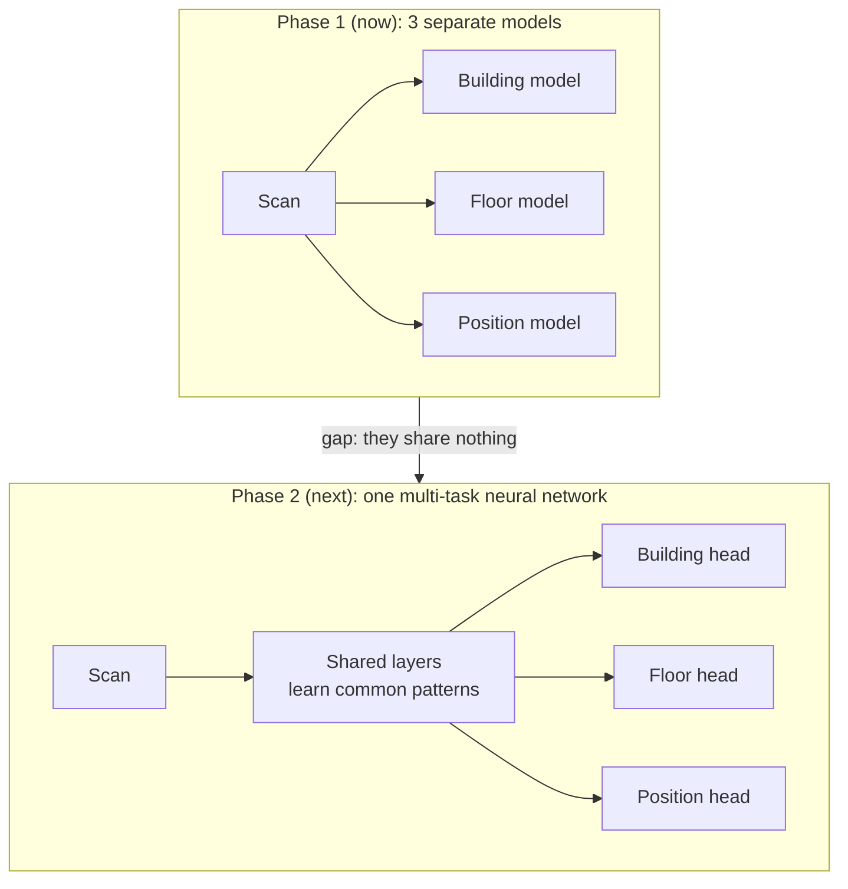
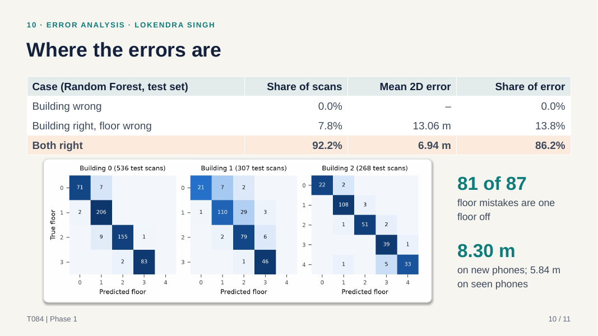
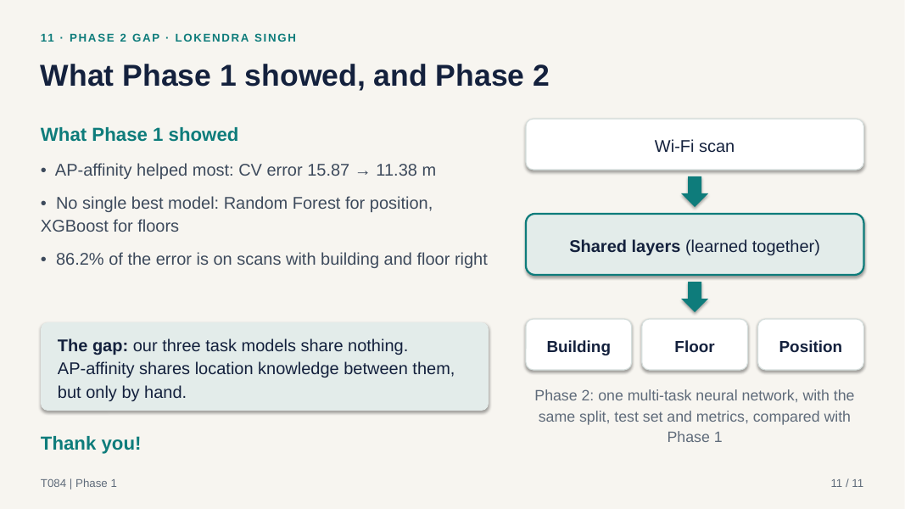

# Lokendra Singh (2401010254): Slides 10, 11

**Your part:** where the final model still makes mistakes (error analysis), the gap, Phase 2, and the closing.
**Time:** about 2 minutes.

---

## First, understand the idea (diagrams)

### Splitting the test scans into 3 cases

### Where the total error comes from

**Lesson:** the floor mistakes are costly, but rare. Most of the error comes from the **fine position** on the correct floor.

### Floor mistakes are small

### Seen vs new phones

### Phase 1 vs Phase 2

---

## Your script

> **Remember:** building never wrong → floor mistakes rare and only 1 floor off → main problem is exact position → Phase 2 = one shared network.

### Slide 10: Where the errors are (1 min)

> Thank you, Kartikey. A total score does not tell us **what to fix**.
> So we looked at **where** our Random Forest still goes wrong.
> **The building is never wrong.** Zero mistakes.
> **The floor is wrong only 8% of the time.**
> Those cases have a bigger error, **13 m**, but they are rare.
> And **81 of 87 floor mistakes are just one floor off**, because nearby floors hear similar routers.
> The surprise: **86% of the error** is when the building and floor are **already right**.
> So the main problem is the **exact position on the right floor**.
> Also, **new phones are harder**: 8.30 m, against 5.84 m on known phones, because phones read signals differently.

### Slide 11: Phase 2 and closing (1 min)

> So, what did we learn?
> **One:** AP-affinity, our own idea, helped the most.
> **Two:** no model is best at everything. Random Forest is best for position, XGBoost for floors.
> **Three:** most of the error is the exact position.
> **The gap:** our 3 models **do not share** anything, but the tasks are related.
> Knowing the floor helps find the position, and the other way round.
> **Phase 2:** **one neural network** with **shared layers** and **3 outputs**: building, floor and position.
> So the tasks can **learn from each other**.
> Same data, same test, same scores, so the comparison is **fair**.
> **Thank you!** We are happy to take questions.

---

## Words you should know

| Word | Simple meaning | Example / our number |
|---|---|---|
| **Error analysis** | Looking at *where* and *why* the model is wrong, not just the total score | Our 3-case breakdown |
| **Error breakdown** | Splitting the scans into cases and measuring each case | Building wrong / floor wrong / both right |
| **Share of scans** | What % of the scans fall in a case | Floor wrong: 7.8% |
| **Share of error** | What % of the *total* error comes from a case | Both right: 86.2% |
| **Confusion matrix** | A table of true vs predicted classes; the diagonal = correct | True floor 1, predicted floor 2: 29 scans in building 1 |
| **Floor confusion** | The confusion matrix for floors, one per building | Most mistakes are next to the diagonal (±1 floor) |
| **Seen phone** | A phone model that was also in training | 2 phones, 397 test scans |
| **New phone** | A phone never seen in training | 9 phones, 714 test scans |
| **Device heterogeneity** | Different phones read the same signal differently | Why new phones are harder |
| **Error map** | The campus map with each prediction coloured by its error | A few large errors in building 2 |
| **Neural network** | A model made of layers of simple units that learn patterns | Phase 2 |
| **Multi-task learning** | One model learning several related tasks together (Caruana, 1997) | Building + floor + position |
| **Shared layers** | The part of the network that all three tasks use together | Learns common patterns once |
| **Output head** | A small final part that gives one answer | Building head, floor head, position head |
| **Phase 2** | The next part of the course: deep learning, compared fairly with Phase 1 | Same split, test and metrics |

### Your key numbers (Random Forest, test set)

| Case | Scans | Share of scans | Mean error | Share of total error |
|---|---:|---:|---:|---:|
| Building wrong | 0 | 0% | – | 0% |
| Building right, floor wrong | 87 | 7.8% | 13.06 m | 13.8% |
| Both right | 1,024 | 92.2% | 6.94 m | 86.2% |

| Phones | Scans | Floor accuracy | Mean error |
|---|---:|---:|---:|
| Seen in training (2 phones) | 397 | 93.7% | 5.84 m |
| New (9 phones) | 714 | 91.3% | 8.30 m |

## What you made / worked on

- **The metrics code** (`src/indoorloc/metrics.py`): the error of each scan, the 3-case breakdown, seen vs new phones, and floor confusion.
- **The figures** (`src/indoorloc/plots.py`): 7 charts, including the floor confusion and the error map.
- **The error analysis results:** `error_breakdown.csv`, `per_phone.csv` and `floor_confusion.csv`.
- **The Phase 2 plan** and the report's conclusion.

## Your notebook: 03 Models & evaluation (sections 5–7)

The notebook only reads saved results; it does not train anything.

| Section | What it shows | Main result |
|---|---|---|
| 5. Where the error comes from | The 3-case table + the seen vs new phones table | 0 building errors; 86.2% of the error with both right |
| 6. Floor confusion + error map | True vs predicted floor for each building, and a map of the errors | Mistakes are ±1 floor, mostly in building 1 |
| 7. The Phase 2 gap | A short text on why one shared network is next | No model is best at all tasks |

(Sections 1–4 are Kartikey's part.)

## Questions they may ask you

**Q: What is the main problem left?**
A: Fine position. 86% of the error is on scans where the building and floor are already right.

**Q: Why is a wrong floor so costly?**
A: The position model gets confused too, because floors stacked on top of each other hear similar routers. The error is 13.06 m, against 6.94 m when everything is right.

**Q: Why are most floor mistakes only one floor off?**
A: Wi-Fi passes through ceilings, so floors right next to each other hear almost the same routers. Floors further apart sound more different.

**Q: Why are new phones worse?**
A: Different phones have different antennas and chips, so the same spot can "look" slightly different to a new phone.

**Q: Where do most floor mistakes happen?**
A: In building 1: 51 of the 87. The most common one is floor 1 predicted as floor 2 (29 scans).

**Q: What exactly will Phase 2 change?**
A: Instead of three separate models, one neural network with shared layers learns all three tasks together. We will compare it with Phase 1 using the same split, test set and metrics.

**Q: Why do you think multi-task will help?**
A: The tasks are related. In Phase 1, AP-affinity shared location knowledge by hand and gave our biggest gain. A shared network can learn that sharing by itself. Kim et al. (2018) already trained one network like this on the same dataset.

**Q: What does the error map show?**
A: Most predictions are close. A few in building 2 land between corridors, where no scan was ever taken. The model probably averages two places it cannot tell apart.

**Q: If you had more time in Phase 1, what would you try?**
A: Ways to handle new phones better, and testing RSSI plus AP-affinity without the signal stats. But we kept Phase 1 simple on purpose.

**Q: Write the error formulas.**
A: For scan i, with true position (xᵢ, yᵢ) and prediction (x̂ᵢ, ŷᵢ):
- **2D error** `eᵢ = √((x̂ᵢ − xᵢ)² + (ŷᵢ − yᵢ)²)`, the straight-line distance. The mean 2D error is the average of eᵢ over all scans.
- **MAE x** `= (1/N) Σ |x̂ᵢ − xᵢ|`, and the same for y.
