# Common Summary, Phase 2: what we built (read this first)

**Project 9: Indoor Location Prediction Using Wi-Fi Signals (Phase 2: deep learning)**
Team T084 · Section D · Newton School of Technology, Rishihood University
Code: https://github.com/Jitmisra/T084-wifi-indoor-positioning

---

## 1. Phase 2 in one line

We trained **one neural network** that guesses the **building**, the **floor** and the **position (x, y)** of a phone together, from one Wi-Fi scan, and compared it fairly with our Phase 1 models.

## 2. Why a new model?

- In Phase 1 every method used **three separate models** (building, floor, position). They shared nothing, even though all three describe the same place.
- **Multi-task learning** (Caruana, 1997) trains related tasks **together**, so what one task learns can help the others.
- The project brief asks exactly for this: **one shared trunk** (shared layers) with **three heads** (output layers).

## 3. The big picture

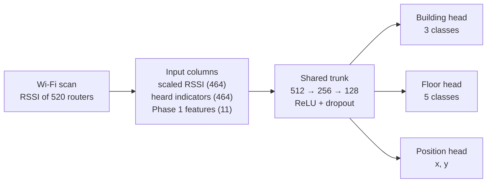

- **Trunk** = the shared layers. All three heads read the same 128 numbers.
- **Head** = a small output layer for one task.
- **939 input columns** per scan: 464 + 464 + 11.

## 4. Step by step (what we did, and why)

| Step | What we did | Why |
|---|---|---|
| 1. Same data | Same cleaned 18,719 training scans, same 1,111 test scans, same 5 user-group folds as Phase 1 | So Phase 1 and Phase 2 are compared fairly |
| 2. Scale the signal | Each heard reading becomes (rssi + 105) / 105, a number from 0 to 1; "not heard" = 0 | Networks learn badly from big, mixed numbers |
| 3. Heard indicators | One extra column per router: 1 = heard, 0 = not heard | So "not heard" is never mixed up with "very weak" (the brief asks for this) |
| 4. Phase 1 features | The 3 signal statistics and 8 AP-affinity columns go in too (**hybrid 1**) | A ready-made location hint from Phase 1 |
| 5. Training-only scaling | Every number used for scaling is learned from training scans only | The brief says: do not normalize the test data separately |
| 6. One network | Shared trunk 512 → 256 → 128, three heads | The design the brief asks for |
| 7. One loss | Loss = building loss + floor loss + λ × position loss | One number to make smaller; λ balances the tasks |
| 8. Regularization | Dropout 0.2, weight decay 0.01, hide 10% of heard routers in every batch | So the network does not memorize the training scans |
| 9. Tuning | λ = 30, 100 or 300, chosen by user-group CV → **300** | λ decides how much the shared layers care about position |
| 10. Ablation | Remove one part at a time and measure the change | To see which parts really help |
| 11. Blend (**hybrid 2**) | Average the Random Forest's and the network's answers, one weight per task, chosen by CV | Trees and networks make different mistakes |
| 12. Test once | Every model tested on the 1,111 test scans only at the end | An honest final score |

## 5. The two hybrids (picture)

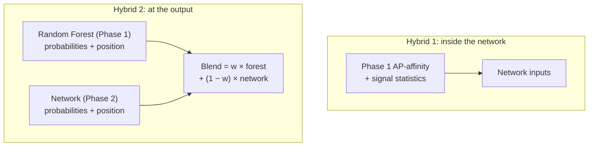

- **Hybrid 1 did not help** (cross-validation 9.21 m with it, 9.17 m without: no real difference). The network learns where the routers are by itself.
- **Hybrid 2:** cross-validation chose forest weights **0.8** (building), **1.0** (floor: the forest alone) and **0.1** (position). The blend beats both models in cross-validation on position (**9.14 m**) and makes the network better on the test set (**8.10 m**, **92.2%** of floors), but the Random Forest alone is still better on position (**7.42 m**).

## 6. Results on the test set (1,111 scans, used only at the end)

| Model | Building | Floor | Mean error | Median error |
|---|---:|---:|---:|---:|
| Random Forest (Phase 1) | 100% | 92.2% | **7.42 m** | 5.34 m |
| XGBoost (Phase 1) | 100% | **95.2%** | 7.86 m | 6.19 m |
| MLP (Wi-Fi inputs only) | 100% | 90.9% | 8.44 m | 6.33 m |
| Three single-task networks | 100% | 94.1% | 8.03 m | 5.75 m |
| **Hybrid MLP (our Phase 2 network)** | 99.9% | 90.8% | 8.32 m | 6.10 m |
| Blend: Random Forest + network | 100% | 92.2% | 8.10 m | 5.92 m |

- **Five seeds** (five trainings with different random starts): 8.21 ± 0.06 m, 91.7 ± 0.7% of floors. So the result does not depend on luck.
- **Honest result:** in cross-validation the network was much better than the Random Forest (9.21 against 11.09 m), but **on the test set the Random Forest is better** (7.42 against 8.32 m). Our guess (not tested): most test scans are close to training spots, where a forest can reuse the training scans almost directly.

## 7. Ablation study (cross-validation, one change at a time)

| Change | Mean error | Change | Meaning |
|---|---:|---:|---|
| Full hybrid MLP | 9.21 m | – | the reference |
| No dropout, no weight decay | 10.28 m | **+1.08 m** | regularization helps most |
| No heard indicators | 9.79 m | **+0.58 m** | indicators help position (but floors are better without them: 84.6% vs 78.8%) |
| No hidden routers | 9.37 m | +0.16 m | at the level of chance |
| No Phase 1 features | 9.17 m | −0.04 m | no effect |
| Three single-task networks | 8.90 m | −0.30 m | better, but 3× the weights |

**Chance level:** the same network trained with 3 seeds gives 9.12 ± 0.11 m. The difference of two single runs moves by about 0.16 m just by chance, so changes smaller than that mean nothing.

## 8. Where the errors are (our network, test set)

- The building is wrong for **1** scan.
- The floor is wrong for **102** scans, and **100** of them are only one floor off.
- **85.4%** of the total error is on scans with building and floor right: fine position is still the main problem.
- New phones are harder: **9.27 m**, against **6.62 m** on the 2 phones seen in training.

## 9. Tech we used (new in Phase 2)

| What | Tool | Used for |
|---|---|---|
| Neural network | PyTorch | The network, the loss, AdamW, the cosine schedule |
| Network code | `src/indoorloc/dl.py` | Inputs, network, training, cross-validation by epochs |
| Blend code | `src/indoorloc/hybrid.py` | Random Forest + network blend |
| Experiments | `scripts/run_dl.py` (`make run2`) | Tuning, ablation, seeds, test, blend, figures |
| Notebooks | 04 and 05 | The network; Phase 1 vs Phase 2 |
| Tests | pytest | 44 tests in total (Phase 1 + Phase 2) |

Every file, setting, number and figure of the code is explained, with links to the exact lines, in [code_explained](../../code_explained/README.md).

## 10. Who presents what (Phase 2)

| Slides | Person | Topic |
|---|---|---|
| 1–2 | Agnik Misra | Opening; Phase 1 → Phase 2, the literature and the gap |
| 3–4 | Ansh | The network's inputs, regularization and training |
| 5–6 | Gauri Mehrotra | The two hybrids, and whether they help |
| 7–8 | Kartikey Gupta | The network and its loss, test results |
| 9–10 | Lokendra Singh | Ablation study; where the errors are, and what we learned |

## 11. Numbers everyone should know

- **939** input columns: 464 scaled RSSI + 464 heard indicators + 11 Phase 1 features
- Network: **512 → 256 → 128**, three heads; **646,794** weights (three single-task networks: 1,937,802)
- Training: AdamW, batch **256**, **200** epochs, learning rate **0.001 → 0** (cosine), dropout **0.2**, weight decay **0.01**, hidden routers **10%**
- Tuned: **λ = 300** (30 and 100 also tried)
- Test: network **8.32 m**, floor **90.8%**; Random Forest **7.42 m**, **92.2%**
- Seeds: **8.21 ± 0.06 m**

## 12. Five questions anyone may get

1. **Why one network for three tasks?** The tasks describe one place, so shared layers can learn things that help all three; the brief asks for it, and it needs a third of the weights of three networks.
2. **Why scale the readings?** A network learns badly when inputs have big, mixed ranges; (rssi + 105) / 105 puts every reading between 0 and 1.
3. **Why heard indicators?** They tell the network directly which routers are missing, so "not heard" is never confused with "heard very weakly".
4. **Did the network beat Phase 1?** In cross-validation yes (9.21 vs 11.09 m), on the test set no (8.32 vs 7.42 m). We report both honestly.
5. **Is anything tuned on the test set?** No. λ, the blend weights and every choice were made with user-group cross-validation; the test set was used only at the end.

## 13. All 10 slides

| | |
|---|---|
| 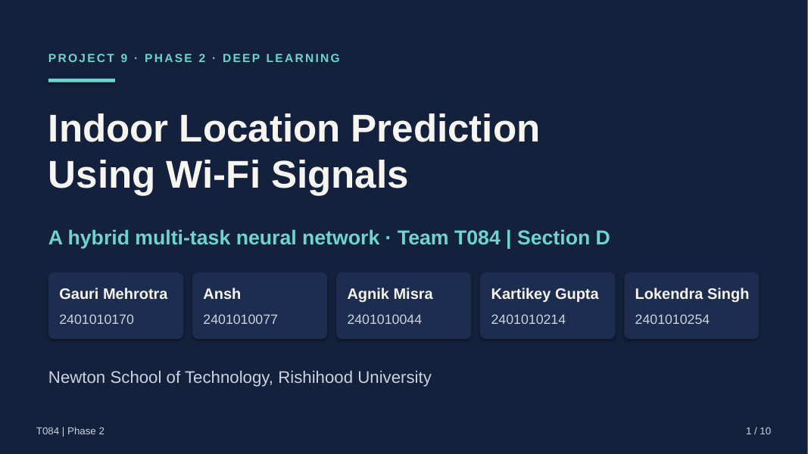 | 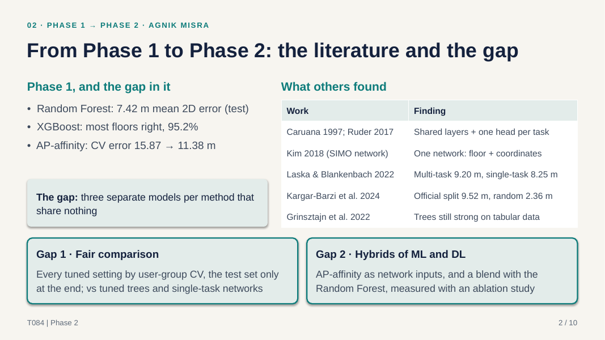 |
| 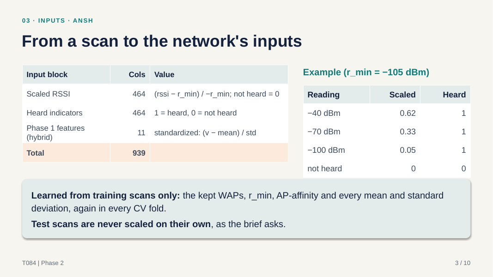 | 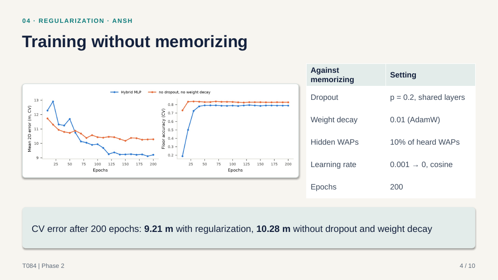 |
| 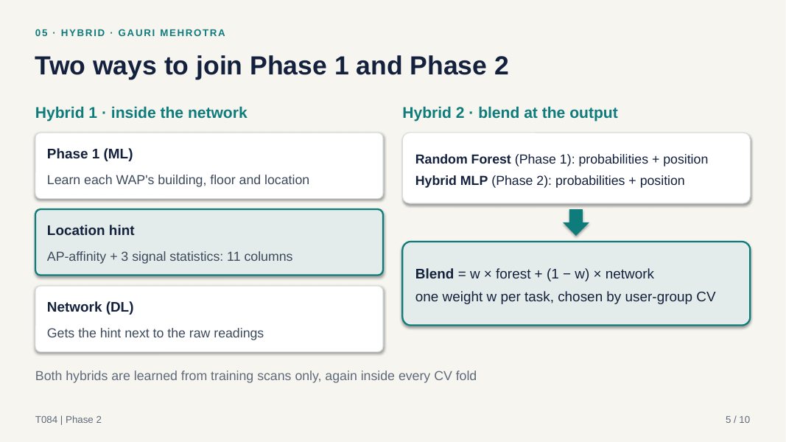 | 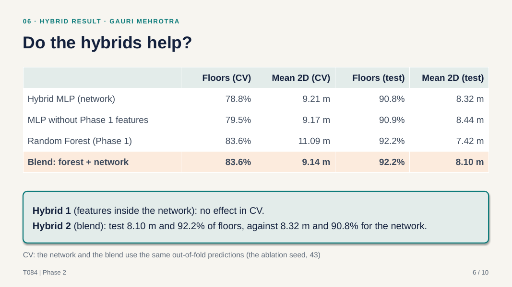 |
| 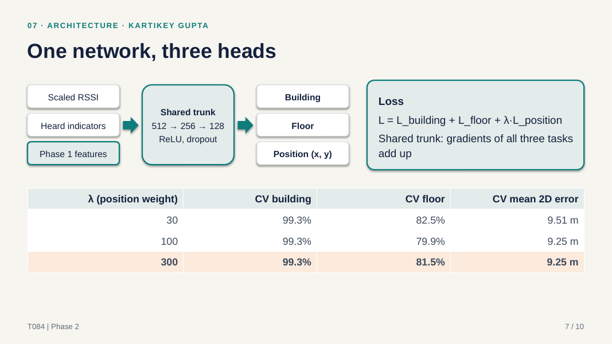 | 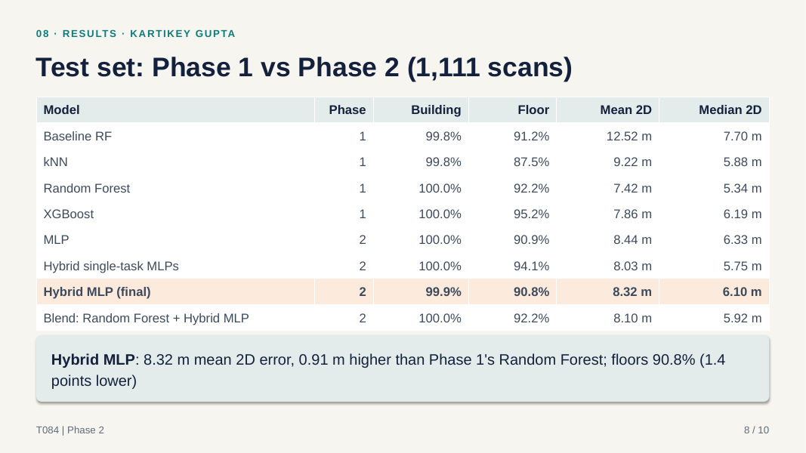 |
| 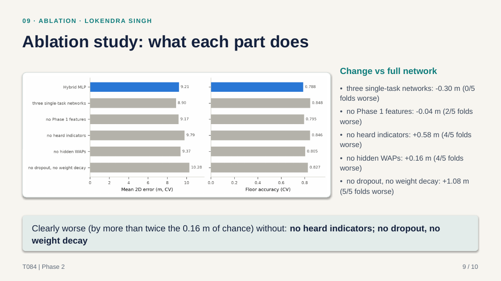 | 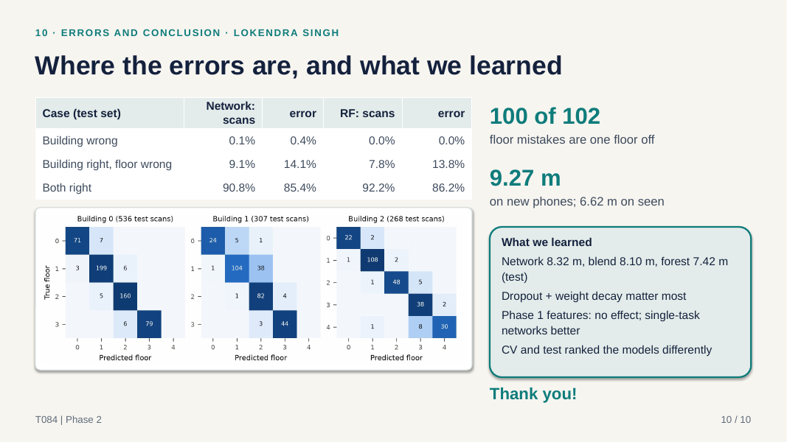 |
