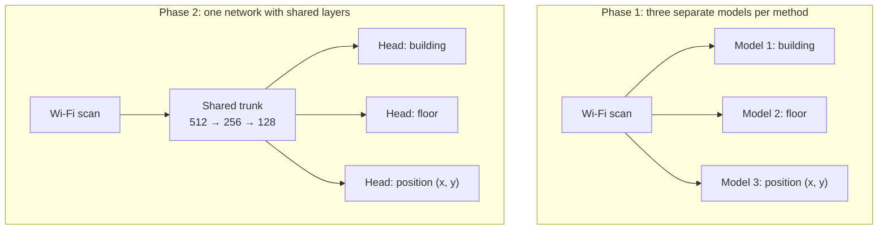
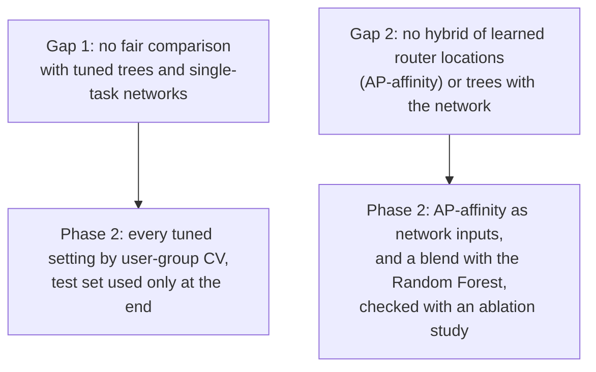
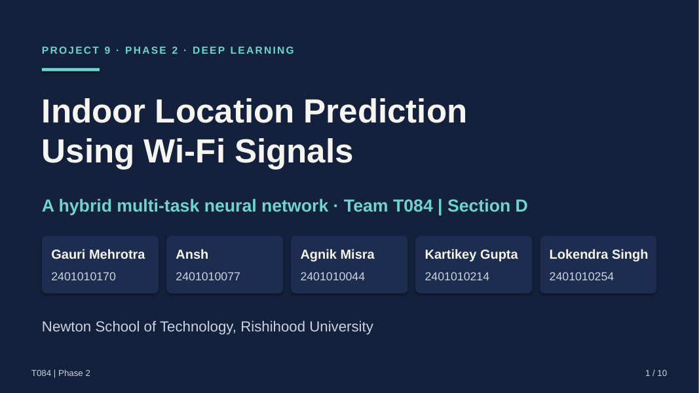
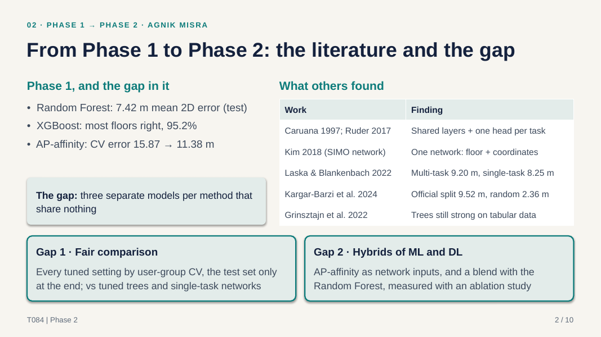

# Agnik Misra (2401010044): Phase 2 slides 1–2

**Your part:** opening the talk, the step from Phase 1 to Phase 2, what other researchers did with deep learning (the literature), and our two gaps.
**Time:** about 2.5 minutes. Speak slowly; you do not need to read every name on the slide.

---

## First, understand the idea (diagrams)

### Phase 1 vs Phase 2

- **Phase 1:** each method (for example the Random Forest) trained **3 separate models**. They got the same columns, but each one learned **alone**.
- **Phase 2:** **one network**. All 3 heads read **the same 128 numbers** from the shared trunk.
- One shared network has **646,794** weights. Three separate networks need **1,937,802**, about 3 times as many.
- The inputs: scaled RSSI (464) + heard indicators (464) + Phase 1 features (11) = **939** columns. Ansh explains them on the next slides.

### Multi-task learning: the idea

**Multi-task learning** = learn related tasks **together**, with shared layers, so that what one task learns helps the others (Caruana, 1997).

A tiny made-up example: a scan hears **router A** very loudly. In training, router A is heard mostly in building 1, on floor 2.

| Task | What router A tells it |
|---|---|
| Building | "probably building 1" |
| Floor | "probably floor 2" |
| Position | "probably near router A" |

- **Phase 1:** the 3 models learned **separately**. AP-affinity gave all three this kind of hint, but we **built it by hand**.
- **Phase 2:** the shared layers can **learn** such facts **once**, and all 3 heads use them.
- **How, in our code:** total loss = building loss + floor loss + **λ** × position loss (λ = **300**). The shared trunk changes to make the **total** smaller, so every task shapes it.

**Does sharing always help? No.** On our dataset (Laska and Blankenbach, 2022, average of 10 runs):

| Their network | Mean 2D error |
|---|---:|
| Shared (multi-task) network | **9.20 m** |
| Single-task position network | **8.25 m** |

We found the same: three single-task networks beat our shared one (test: **8.03 m** against **8.32 m**).

### Why the papers' numbers cannot be compared directly

| Problem | Example |
|---|---|
| A different split | The same network: **9.52 m** on the official split, but **2.36 m** after a random re-split (Kargar-Barzi et al., 2024) |
| Settings chosen on the test file | Li and Kim (2026) tuned part of their system on the file they report as the test set |
| Best of many runs | Kim (2018) reports the best of **20** runs |
| Another dataset | Kim (2018) used the TUT dataset, not UJIIndoorLoc |
| Another error | Some papers report a **3D** error; we report the **2D** error |

- We saw the same trap in **Phase 1**: a random split promised **3.67 m**, but the real test gave **12.52 m** (Baseline RF).
- A review (Alhomayani and Mahoor, 2020) says the field has **no common way to evaluate**.
- So we compare our network **only with our own Phase 1 models**: same folds, same test scans, same metrics.

### Our two gaps, and what Phase 2 found

What we found (your teammates show it, but you must know it):

- **Gap 1:** in CV the network beat the Random Forest (**9.21 m** against **11.09 m**). On the test set the forest won (**7.42 m** against **8.32 m**). The best network on the test set: the three single-task networks (**8.03 m**).
- **Gap 2:** **9.21 m** with AP-affinity, **9.17 m** without. Chance alone moves a difference by about **0.16 m**, so: **no real difference**.
- The blend of the forest and the network (hybrid 2): **8.10 m** and **92.2%** of floors on the test set: better than the network (8.32 m), but the forest alone is still better on position (7.42 m).

---

## Your script

> **Remember:** Phase 1 had 3 separate models → papers say one shared network can help → but it does not always help, and papers are hard to compare → our 2 gaps.

### Slide 1: Title and team (30 sec)

> Good morning. We are **Team T084**, and our project is **finding a phone's location indoors using Wi-Fi signals**.
> I am Agnik, and with me are Gauri, Ansh, Kartikey and Lokendra.
> In Phase 1 we used classical machine learning. Now, in **Phase 2**, we use **deep learning**.
> We build **one neural network** that guesses the **building, the floor and the position** at the same time.

### Slide 2: From Phase 1 to Phase 2: the literature and the gap (2 min)

> In Phase 1, our best model was the **Random Forest**, with an average error of **7.42 meters**.
> But we used **three separate models**, one each for building, floor and position. They did not share anything.
> Research says that **related tasks can help each other** if one network learns them together. This is called **multi-task learning**.
> But it does not always work. On our same dataset, one study found that **separate networks did better** than a shared one.
> Results in papers are also **hard to compare**. The same network got 9.5 meters on one data split and 2.4 meters on another.
> So we found **two gaps**. **First**, a **fair comparison**: we tune everything without touching the test set, and test only once at the end.
> **Second**, **mixing our Phase 1 work with the network**, and checking honestly if it helps.
> Now Ansh will show how a Wi-Fi scan becomes the network's input.

---

## Words you should know

| Word | Simple meaning |
|---|---|
| **Multi-task learning (MTL)** | Learning related tasks together in one model, so they can help each other (Caruana, 1997). Our 3 tasks: building, floor, position |
| **Inductive bias** | A built-in hint that pushes a model towards some answers. In MTL, the other tasks give this hint |
| **Single-task network** | A network for one task only. "Three single-task networks" = one per task, nothing shared |
| **MLP (multilayer perceptron)** | The basic deep network: layers of units, each layer fully connected to the next. Ours is an MLP |
| **Shared trunk** | The hidden layers that all tasks use. Ours: 512 → 256 → 128 |
| **Head** | A small output layer for one task. Ours: building (3 classes), floor (5 classes), position (x, y) |
| **Hard parameter sharing** | Shared hidden layers + one head per task (Ruder, 2017). This is our design |
| **SIMO network** | "Single input, multiple outputs": one scan in, several answers out (Kim, 2018) |
| **Loss, loss weight (λ)** | The loss says how wrong the network is; training makes it smaller. λ says how much the position loss counts in the total. Ours: λ = 300, chosen by CV |
| **Official split** | The dataset's own training file and test file. We use it: 1,111 test scans |
| **Random re-split** | Mix all scans and cut them again at random. Too easy: 2.36 m instead of 9.52 m |
| **2D error** | Straight-line distance on the map between our guess and the truth. Some papers use a 3D error instead |
| **Tuned on the test file** | Settings chosen by looking at test scores. The test score is then too good to trust |
| **Tuned trees** | Our Phase 1 Random Forest and XGBoost, with settings chosen by user-group CV |
| **User-group CV** | Cross-validation that holds out whole users with their phones (5 folds, 16 groups) |
| **Tabular data** | Data in a table of rows and columns. Trees are strong on it (Grinsztajn, 2022) |
| **Ablation study** | Remove one part at a time and measure what changes |
| **Hybrid** | Phase 1 + Phase 2 together: our Phase 1 features as network inputs, and a blend of the Random Forest and the network |
| **Preprint** | A paper put online but not peer-reviewed (not yet checked by other scientists). We mark them, e.g. Ruder (2017) |
| **Literature matrix** | Our table of papers: method, data, how they tested, their numbers, and where each number is in the paper |
| **Research gap** | A useful question that no study we found has answered yet |

## What you made / worked on

| File | What it does |
|---|---|
| `docs/literature_review_phase2.md` | The Phase 2 literature review in 6 short parts: multi-task learning, deep networks for Wi-Fi, inputs, training, trees vs networks, and the gap |
| `docs/literature_matrix_phase2.csv` | One row per paper (**20** rows): method, dataset, how they tested, their numbers, and where in the paper each number is |
| `report/main_phase2.tex` | The frame of the Phase 2 report: title, authors and the order of the sections (IEEE template) |
| `report/sections/phase2/abstract.tex` | All of Phase 2 in one paragraph (IEEE rule: no citations, no math) |
| `report/sections/phase2/introduction.tex` | Phase 1 in short, the gap, what the brief asks, and our **3 contributions**: two hybrids, an ablation study, a fair comparison |
| `report/sections/phase2/related_work.tex` | The literature in 4 short parts, then our gap |
| `report/references.bib` (Phase 2 part) | **20** new references (papers, a book, PyTorch) and **7** from Phase 1 used again |
| `README.md` (Phase 2 parts) | The Phase 2 results table, "Method in short" and "The brief, item by item" (each brief item → its code → its result file) |
| Slides 1–2 | Title; Phase 1 → Phase 2, the literature and the gap |

## Your notebook

No notebook section. (If they ask: notebook **04** shows the network, notebook **05** compares Phase 1 and Phase 2.)

## Questions they may ask you

**Q:** What is multi-task learning, and why should our three tasks help each other?
A: It means learning related tasks together in one model, with shared layers, so that what one task learns helps the others (Caruana, 1997). Building, floor and position all describe one place: the routers that tell you the building also tell you the floor and the position. So the shared layers can learn this once, for all three heads.

**Q:** How does the sharing really work in your network?
A: The total loss is building loss + floor loss + λ × position loss, with λ = 300. Training changes the shared trunk to make this total smaller, so all three tasks push on the same layers. That is how what one task learns reaches the others.

**Q:** What is "hard parameter sharing", and why is it good?
A: It is Ruder's (2017) name for our design: shared hidden layers, and one output layer per task. The shared layers must work for every task, so Ruder says it "greatly reduces the risk of overfitting". But it can fail when the tasks are not closely related.

**Q:** Does multi-task learning always help?
A: No. On UJIIndoorLoc, Laska and Blankenbach (2022) found a single-task position network (8.25 m) better than a shared one (9.20 m). We found the same: three single-task networks beat our shared one, 8.90 against 9.21 m in CV and 8.03 against 8.32 m on the test set. (Their own multi-task grid model was best, 7.32 m, so the design matters.)

**Q:** The single-task networks were better. Why is your final network the shared one?
A: The brief asks for one shared network with three heads, so we fixed it as our Phase 2 model before testing. The single-task networks were tested next to it, so the comparison is honest. The shared one also needs about a third of the weights: 646,794 against 1,937,802.

**Q:** Your network got 8.32 m, Laska's shared network 9.20 m. So you are better?
A: We do not claim that. Their setup is different: another network, the average of 10 runs, and no tuning split is described. So we compare only with our own Phase 1 models, on the same folds, test scans and metrics.

**Q:** Why can't you compare numbers from different papers?
A: The protocol changes the number a lot: one network got 9.52 m on the official split, but 2.36 m after a random re-split (Kargar-Barzi et al., 2024). Papers also tune on the test file, report the best of many runs, or use 3D errors or another dataset. A review (Alhomayani and Mahoor, 2020) calls the lack of a common way to evaluate a main problem.

**Q:** Why does a random re-split give such a low error?
A: When all scans are mixed and cut at random, almost identical scans of the same spot land on both sides, so the test becomes too easy. We saw this in Phase 1: random CV promised 3.67 m, but the real test gave 12.52 m (Baseline RF). That is why we keep the official test file and split by user.

**Q:** What is your gap, in simple words?
A: Gap 1: we found no study that compares a multi-task network fairly with tuned trees and with single-task networks. "Fairly" means every tuned setting chosen by user-group CV, and the test set used only at the end. Gap 2: we found no study that joins learned router locations (our AP-affinity) or a tree model (the blend with the Random Forest) with a multi-task network, and measures with an ablation whether this helps.

**Q:** Did you fill the gaps? What did you find?
A: Yes, and we report the answers honestly, even where they are "no". Gap 1: CV ranked the network ahead of the Random Forest (9.21 against 11.09 m), but on the test set the forest won (7.42 against 8.32 m). Gap 2: the AP-affinity inputs made no real difference (9.21 m with them, 9.17 m without). The blend: 8.10 m and 92.2% of floors on the test set, better than the network but not than the forest on position.

**Q:** Why did you cite a paper on table data (Grinsztajn, 2022)?
A: It found that trees still beat neural networks on typical tabular data (45 datasets). But it left out signal data and missing values, so Wi-Fi scans fall outside it: it only warns that a network may not beat our forest. So we compared them on equal terms, and on the test set the forest did win (7.42 against 8.32 m).

**Q:** Li and Kim (2026) is the closest to your design. What is different?
A: The idea is the same: a shared trunk, three heads and a strong position weight (12.0 for position, against 0.4 and 0.8). But they tuned part of their system on the file they report as their test set, so their result is optimistic. The best weights depend on the units of each task (Kendall et al., 2018), so we did not copy theirs. We chose λ = 300 from 30, 100 and 300 by user-group CV.

**Q:** Slide 2 shows a gap in Phase 1 and two gaps in the papers. What is the difference?
A: The first gap is in our own Phase 1: three separate models that share nothing. The two other gaps are in the research papers: no fair comparison, and no hybrid of learned router locations or trees with a multi-task network. Phase 2 answers all of them: one shared network, tested fairly, with AP-affinity as inputs and a blend with the Random Forest.

**Q:** How do you know the papers' numbers are right?
A: Every paper was checked against its publisher record or its arXiv page. Papers that are not peer-reviewed are marked as preprints, for example Ruder (2017). In the literature matrix, every number has its place in the paper, for example Table 8 for Laska's 8.25 m.
