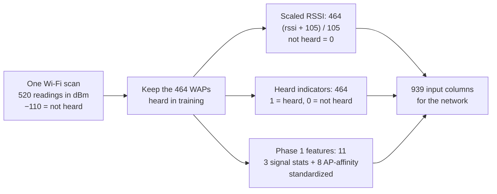
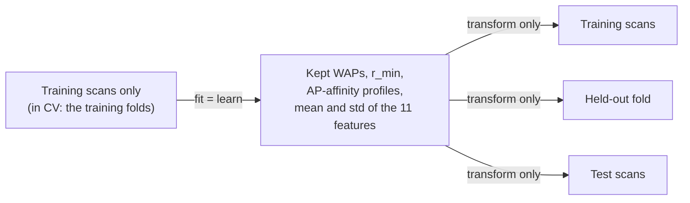
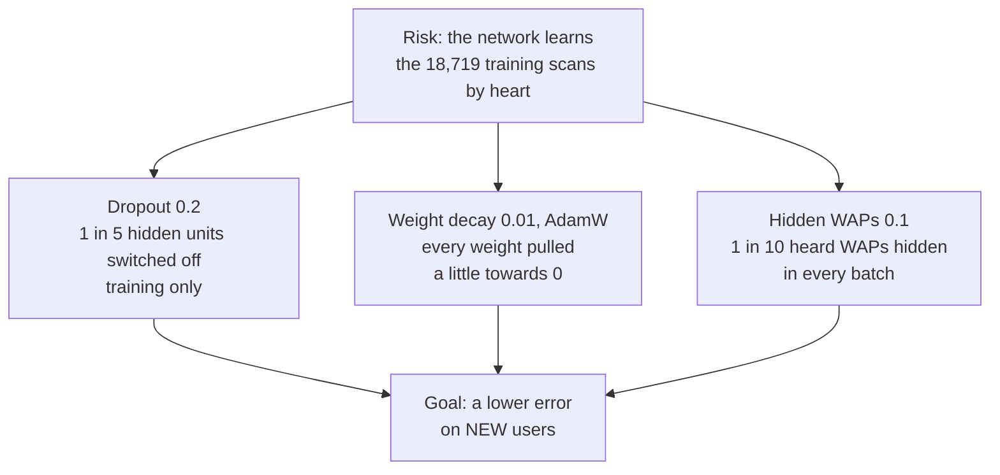
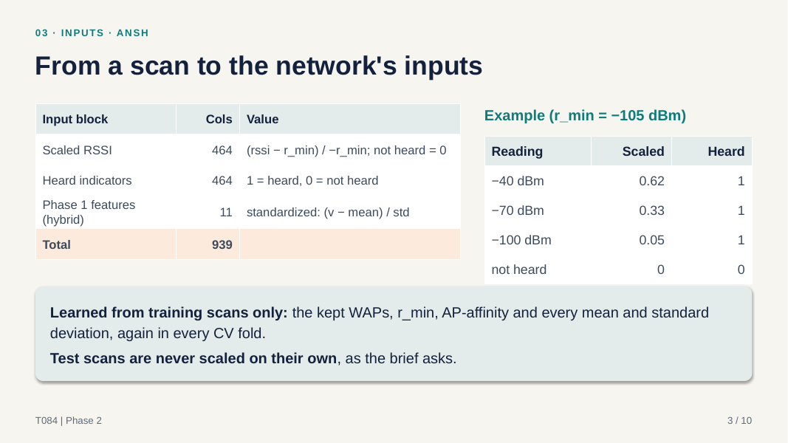
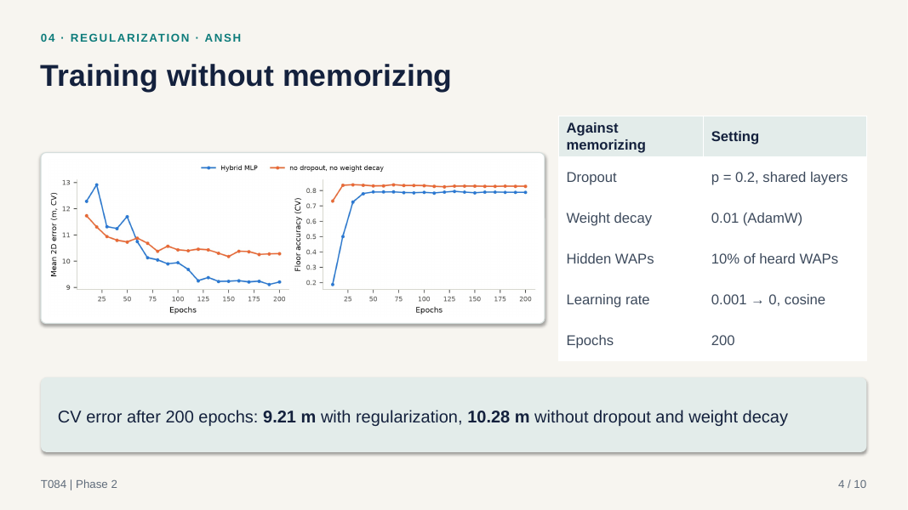

# Ansh (2401010077): Phase 2 slides 3–4

**Your part:** the network's inputs (how one scan becomes 939 numbers, learned from the training scans only) and its regularization (how we stop the network from memorizing the training scans).
**Time:** about 3 minutes (1.5 minutes per slide).

---

## First, understand the idea (diagrams)

### From one scan to 939 numbers

A tiny worked example (the numbers on slide 3):

| Reading | Scaled RSSI = (rssi + 105) / 105 | Heard indicator |
|---|---:|---:|
| −40 dBm (strong) | 65 / 105 = **0.62** | 1 |
| −70 dBm | 35 / 105 = **0.33** | 1 |
| −100 dBm (weak) | 5 / 105 = **0.05** | 1 |
| −104 dBm (weakest in training) | 1 / 105 = about **0.01** | 1 |
| not heard | **0** | **0** |

- Look at the last two rows: 0.01 and 0 look almost the same. The **indicator** (1 or 0) shows the difference clearly.
- **−105** is 1 dB below the weakest training reading (−104 dBm), so even the weakest real signal counts a little.
- A real scan (notebook 04, section 2): the first test scan hears only **1** of the 464 WAPs. Its −91 dBm becomes **0.133** with indicator 1. The other 463 WAPs get 0 and 0.
- The MLP without Phase 1 features gets 464 + 464 = **928** columns.

### Learned from the training scans only

- On all **18,719** training scans, fit gives **464** WAPs and r_min = **−105 dBm**.
- In cross-validation, fit runs **again in every fold**, so held-out users never shape their own inputs.
- **Tiny example (notebook 04, section 3):** after scaling, every Phase 1 column has mean **0.00** on the training scans, but n_heard has mean **−0.31** on the test scans. That is real: test scans hear fewer of the known WAPs. Scaling the test set on its own would push it back to 0 and hide this.

### Three brakes against memorizing

- **Hidden WAPs, tiny example:** a scan hears 18 WAPs. In one batch, about 2 of them are set to "not heard" (scaled RSSI 0, indicator 0). In the next epoch, a different random 2.
- Notebook 04, section 4: of **17,213** heard readings in the first 1,000 training scans, **15,472** stay heard (**10.1%** hidden). Predictions never hide anything.
- **Learning rate (cosine curve):** **0.001** at the start → **0.0005** after epoch 100 → **0** after epoch 200. It gets a little smaller after every batch. Big steps first, small steps at the end.

### What the learning curves show (the plot on slide 4)

CV mean 2D error and floor accuracy during one 200-epoch run (mean of the 5 folds):

| After epoch | 10 | 50 | 100 | 150 | 200 |
|---|---:|---:|---:|---:|---:|
| Error, **with** dropout + weight decay (blue) | 12.28 m | 11.70 m | 9.94 m | 9.24 m | **9.21 m** |
| Error, **without** them (orange) | 11.73 m | 10.73 m | 10.43 m | 10.17 m | **10.28 m** |
| Floors, with | 18.7% | 79.0% | 78.8% | 78.5% | 78.8% |
| Floors, without | 73.1% | 83.0% | 83.2% | 82.8% | 82.8% |

- Without dropout and weight decay, the network is better at first, then it **stops improving** (between 10.17 and 10.57 m from epoch 80 on).
- With them, it keeps improving and ends **1.08 m better**, in **all 5 folds**.
- Honest point: without them, **more floors** are right (82.8% against 78.8%).
- Careful: the learning rate depends on the whole run, so the point at epoch 100 is **not** what a 100-epoch training would give.

---

## Your script

> **Remember:** scan → 939 columns (464 + 464 + 11) → learned from training scans only → 3 brakes → 9.21 m with dropout + weight decay, 10.28 m without.

### Slide 3: From a scan to the network's inputs (1.5 min)

> Thank you, Agnik. Networks learn badly from **big, mixed numbers**, so first we turn every scan into small numbers.
> We keep the **same data and split as Phase 1**: **18,719** training scans and **1,111** test scans.
> **Block 1, scaled RSSI:** each heard reading becomes **(rssi + 105) / 105**, between **0 and 1**.
> So **−40 dBm becomes 0.62**, **−100 dBm becomes 0.05**, and **not heard becomes 0**.
> Why −105? It is **1 dB below the weakest training reading**, so even the weakest real signal counts a little.
> **Block 2, heard indicators:** one more column per WAP: **1 = heard, 0 = not heard**. So "very weak" is never mixed up with "not heard".
> **Block 3:** our **11 Phase 1 features**, standardized: minus the mean, divided by the standard deviation.
> In total: **464 + 464 + 11 = 939 columns** per scan.
> Every scaling number is **learned from the training scans only**, again **in every CV fold**.
> The test scans are **never scaled on their own**, as the brief asks.
> But a network can also **memorize** the training scans. Here is how we stop that.

### Slide 4: Training without memorizing (1.5 min)

> A big network can **learn the training scans by heart**, and then fail on new users. We use **three brakes**.
> **1. Dropout 0.2:** in training, each hidden unit is **switched off** with a **20%** chance, so the network cannot rely on one unit. When we predict, dropout is **off**.
> **2. Weight decay 0.01, with AdamW:** at every step, every weight is pulled **a little towards 0**. This keeps the model simple.
> **3. Hidden WAPs:** in every batch, we hide **10%** of the heard WAPs, like a new phone that **misses** some WAPs.
> And the **learning rate** starts at **0.001** and falls smoothly to **0** over **200 epochs**, on a cosine curve: big steps first, small steps at the end.
> The plot shows the CV error during training. **Blue** is our network. **Orange** is the same network **without dropout and weight decay**.
> Orange is better at first, but then it **stops improving**. After about **60 epochs**, blue is lower, and it stays lower.
> At the end: **9.21 m with** them, **10.28 m without**. That is **1.08 m** worse without them, in **all 5 folds**.
> To be honest, the **hidden WAPs** changed the error by only **0.16 m**. That is the **level of chance**.
> Now Gauri will show our **two hybrids** of Phase 1 and Phase 2.

---

## Words you should know

| Word | Simple meaning |
|---|---|
| **Input column** | One number the network gets for a scan. We give it **939** per scan. |
| **RSSI (dBm)** | How strong a WAP's (router's) signal is. Closer to 0 is stronger: −40 is strong, −100 is weak. |
| **Scaling** | Changing numbers into a small range, here 0 to 1. |
| **Scaled RSSI** | (rssi + 105) / 105. So −40 dBm → **0.62**, and "not heard" → **0**. |
| **r_min** | The −105 in the formula (on the slide: (rssi − r_min) / −r_min). It is **1 dB below** the weakest training reading, −104 dBm. |
| **Clipping** | Cutting a value so it stays between 0 and 1. A test reading weaker than −105 dBm becomes 0, never negative. |
| **Heard indicator** | A 0/1 column per WAP: **1 = heard, 0 = not heard**. Also called a missingness indicator. |
| **Phase 1 features** | Our 11 columns from Phase 1: 3 signal statistics + 8 AP-affinity columns. |
| **Standardize** | (value − mean) / standard deviation. The result is around 0, with a spread of 1. |
| **fit / transform** | fit = learn the numbers, from training scans only. transform = use them on any scans. |
| **Data leakage** | Test information sneaking into training or into the inputs, so the score looks better than it really is. |
| **Overfitting** | Learning the training scans by heart (memorizing), and then doing worse on new users. |
| **Regularization** | Anything that stops memorizing, so the error on **new** scans goes down. |
| **Hidden unit** | One number inside a shared layer. The layers have 512, 256 and 128 of them. |
| **Dropout** | In training only, each hidden unit is set to 0 with probability **0.2**. |
| **Weight decay** | At every step, every weight is pulled a little towards 0 (**0.01**). |
| **Adam / AdamW** | Adam updates the weights, with its own step size for each weight. AdamW = Adam + weight decay as a separate step. |
| **Learning rate** | How big each update step is. Ours starts at **0.001**. |
| **Cosine schedule** | The learning rate falls along half a cosine wave, from 0.001 to **0**. |
| **Epoch / batch** | Epoch = one pass over all training scans (**200** in total). Batch = **256** scans; one step per batch. |
| **Hidden WAPs** | In every training batch, **10%** of the heard WAPs are marked "not heard". |
| **Learning curve** | The CV error after every 10 epochs, drawn as a line. |
| **train / eval mode** | `net.train()`: dropout on, for training. `net.eval()`: dropout off, for predicting. |
| **Chance level** | How much two runs differ just by luck (the random seed): about **0.16 m** in CV. |

## What you made / worked on

| File or function | What it does |
|---|---|
| `NetworkInputs.fit` (`src/indoorloc/dl.py`) | Learns from the training scans only: the kept WAPs (**464**) and r_min (**−105 dBm**). Its hybrid block (Gauri's part) also learns AP-affinity and the mean and std of the 11 Phase 1 features. |
| `NetworkInputs.transform` | Makes the input columns of any scans: scaled RSSI (clipped to 0–1, not heard = 0), heard indicators, standardized Phase 1 features: **939** in total. |
| `hide_waps` (`src/indoorloc/dl.py`) | Training only: hides each WAP of a batch with probability 0.1 (scaled RSSI and indicator set to 0). The Phase 1 columns stay the same. Rate 0 changes nothing. |
| `DL_FIXED` (`src/indoorloc/config.py`) | The fixed training settings: dropout **0.2**, weight decay **0.01**, learning rate **0.001**, hidden WAPs **0.1** (`hide_wap_rate`). |
| `test_inputs_by_hand` (`tests/test_dl.py`) | A tiny case worked out by hand: with r_min = −101, −40 and −100 dBm give 61/101 and 1/101; not heard gives 0 and 0; a weaker test reading gives 0, never negative. |
| `test_input_columns_and_training_statistics` | The number of columns is right for every choice; the 11 Phase 1 columns have mean 0 on training scans, but not on test scans. |
| `test_hidden_waps_only_change_wap_columns` | Rate 1 hides every WAP, rate 0 hides none, rate 0.5 about half; the Phase 1 columns never change. |
| `test_dropout_is_on_again_after_a_prediction_during_training` | After a prediction in the middle of training (the CV check), the next epochs train with dropout on again. |
| `learning_curves.csv` and figure `dl_learning_curves` | CV error and floor accuracy every 10 epochs, with and without dropout and weight decay (the plot on slide 4). |
| Report | "Data and Network Inputs" (`report/sections/phase2/inputs.tex`) and the Method part "Training and Regularization". |

## Your notebook: 04, sections 1–4 and 8

| Section | What it shows | Key result |
|---|---|---|
| 1. Input columns | `NetworkInputs` fitted on the training scans, then the test scans transformed | **464** WAPs, r_min = **−105 dBm**, **939** columns (464 + 464 + 11) |
| 2. One scan, as the network sees it | The first test scan: dBm, scaled value and indicator of each heard WAP | It hears only **1** of the 464 WAPs: **−91 dBm → 0.133**; the other 463 get 0 and indicator 0 |
| 3. Scaled with training numbers only | Mean of the 11 standardized Phase 1 columns on training and on test scans | Training means **0.00**; test means are not (n_heard **−0.31**) |
| 4. Hidden WAPs (regularization) | `hide_waps` on the first 1,000 training scans | **17,213** heard readings → **15,472** stay heard (**10.1%** hidden); predictions never hide anything |
| 8. Learning curves | CV error and floor accuracy every 10 epochs, with and without dropout and weight decay (ablation runs, seed 43) | **9.94 m** after 100 epochs → **9.21 m** after 200; without them **10.28 m** (best **10.17 m** after 150) |

## Questions they may ask you

**Q: Why scale the readings? The Phase 1 trees used raw dBm.**
A: A tree only looks at the order of the values, so their size does not matter. A network multiplies every input by a weight and adds them up, and it learns badly from big, mixed numbers. So each reading becomes (rssi + 105) / 105, between 0 and 1, as Kargar-Barzi et al. (2024) also did. The 11 Phase 1 features have very different units (counts, dBm, shares, map positions), so each one is standardized instead.

**Q: Why −105 in the formula?**
A: It is r_min, 1 dB below the weakest training reading (−104 dBm). So the weakest real reading still gets a small value (1 / 105, about 0.01), and only "not heard" gets exactly 0. The code learns r_min from the training scans; nobody types it in. A test reading weaker than −105 dBm is clipped to 0, never negative (`test_inputs_by_hand` checks this).

**Q: "Not heard" is already 0. Why add heard indicators?**
A: Because a very weak reading is also almost 0 (−104 dBm gives about 0.01). The indicator says it directly: 1 = heard, 0 = missing. The brief asks for missingness indicators, and a 2026 preprint (Eftekharizadeh et al.) uses the same 0/1 mask. Without them, the CV error was **0.58 m** higher, in **4 of 5** folds.

**Q: But without the indicators, more floors were right. Why keep them?**
A: True: **84.6%** of floors without them, **78.8%** with them (CV). So they help position and cost floors, and we report both. They were part of the design from the start; the ablation only measures them. For the mean 2D error, our main measure, their gain (**0.58 m**) is much bigger than chance (about **0.16 m**).

**Q: Why not normalize the test set on its own?**
A: The network learned with the training numbers, so a test value must mean the same thing. In notebook 04 (section 3), the test mean of n_heard is **−0.31**, not 0, because test scans hear fewer of the known WAPs; scaling the test set on its own would hide that. In real use, scans come one at a time, so there is no "test mean" anyway. The brief also says so.

**Q: What exactly is learned from the training scans?**
A: The kept WAPs (**464** on all training scans), r_min (**−105 dBm**), the AP-affinity profiles, and the mean and standard deviation of the 11 Phase 1 features (and of x and y, for the position head). In cross-validation, all of it is learned again in every fold, from the training folds only. A WAP never heard in training has no column, so the network ignores it.

**Q: What does dropout do at test time?**
A: Nothing. Before predicting, the code calls `net.eval()`, so every unit is used and the answer is not random. In training, PyTorch switches each unit off with probability **0.2** and multiplies the others by 1 / (1 − 0.2) = **1.25**, so the numbers have the same size on average. After each CV check in the middle of training, `net.train()` turns dropout on again; `test_dropout_is_on_again_after_a_prediction_during_training` checks this.

**Q: What does weight decay do in AdamW? Why not plain Adam?**
A: At every step, every weight loses a tiny share of itself: PyTorch computes θ ← θ − η × (0.01 × θ + …), with the current learning rate η (at the start, 0.001 × 0.01 = 0.00001). Over thousands of steps, this keeps the weights small and the model simpler. AdamW does this as a separate step; in plain Adam it is mixed into the gradient and changed by Adam's step sizes, so it does not work as real weight decay (Loshchilov and Hutter, 2019). 0.01 is the default of PyTorch's AdamW.

**Q: Why hide WAPs? Its effect was only 0.16 m.**
A: A new phone, or the same phone on another day, misses some WAPs, and **9 of the 11** test phones are new. Hiding 10% of the heard WAPs in every batch teaches the network not to rely on any single WAP. But honestly, without it the CV error was only **0.16 m** higher, the size of chance (the full network with 3 seeds: **9.12 ± 0.11 m**), so we cannot say it helps. It was fixed in advance, costs nothing when predicting, and we report it as it is.

**Q: Is hiding WAPs the same as dropout?**
A: It is like dropout on the inputs, with two differences. It touches only the WAP columns (scaled RSSI and indicator both set to 0); the 11 Phase 1 columns stay as they are. There is no rescaling, so a hidden WAP looks exactly like a WAP that is not heard. Like dropout, it happens only in training.

**Q: Why a cosine learning rate?**
A: It starts at **0.001**, so the network learns fast at first, and falls smoothly to **0** by the last batch. So the last epochs make only small changes, and the result does not jump from epoch to epoch: the blue curve is bumpy at the start and almost flat at the end (**9.26 m** at epoch 120, **9.21 m** at epoch 200). It needs only the start value and the number of epochs.

**Q: Did you tune dropout, weight decay, the learning rate or the 200 epochs?**
A: No. They were fixed in advance in `config.py` (`DL_FIXED` and `DL_EPOCHS`). Only the position weight λ was tuned (30, 100 or 300), because a multi-task network depends strongly on it; every setting costs a full 5-fold CV of 200 epochs, so we kept the grid small. So none of these values was chosen by looking at the test set.

**Q: Without dropout and weight decay, more floors were right (82.8% against 78.8%). Does regularization really help?**
A: For position, clearly yes: **9.21 m** with it, **10.28 m** without, worse in **all 5** folds and far more than chance (about **0.16 m**). For floors in CV, the network without it was better, and ours also starts slowly (**18.7%** of floors after 10 epochs, against **73.1%**; it catches up to **79.0%** by epoch 50). We report both; the mean 2D error is our main measure.

**Q: Where is the overfitting in your plot? The orange line was best at epoch 150 (10.17 m). Why not stop there?**
A: The plot shows only the CV error, not the training error. Without dropout and weight decay, the network is better at first, but from epoch 80 on it stays between **10.17** and **10.57 m**, while ours keeps going down to **9.21 m**. With a cosine schedule, the point at epoch 150 is part of one 200-epoch run, not a 150-epoch training. And even 10.17 m is worse than 9.21 m.
