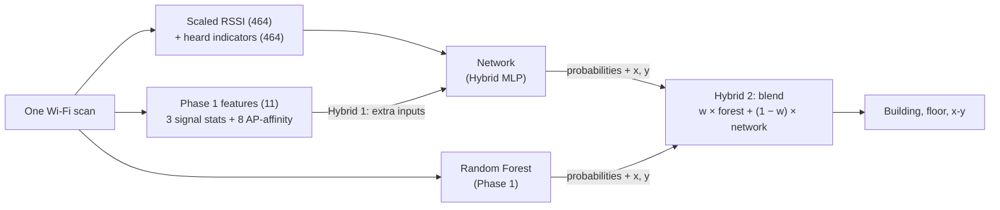
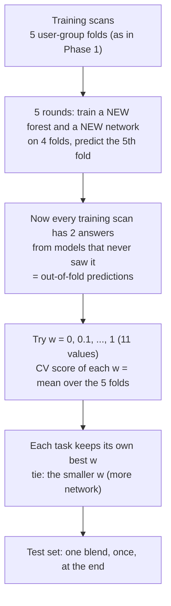
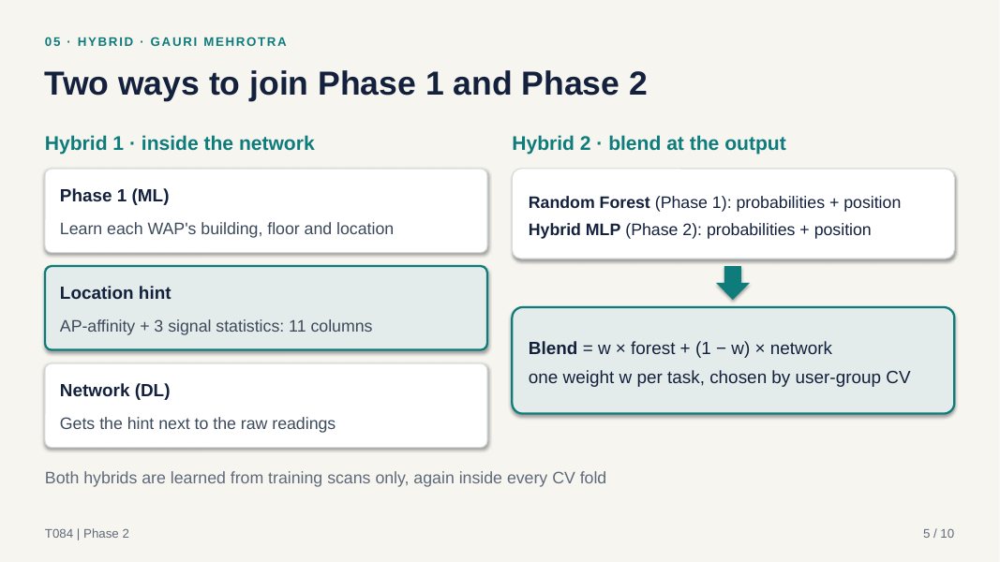
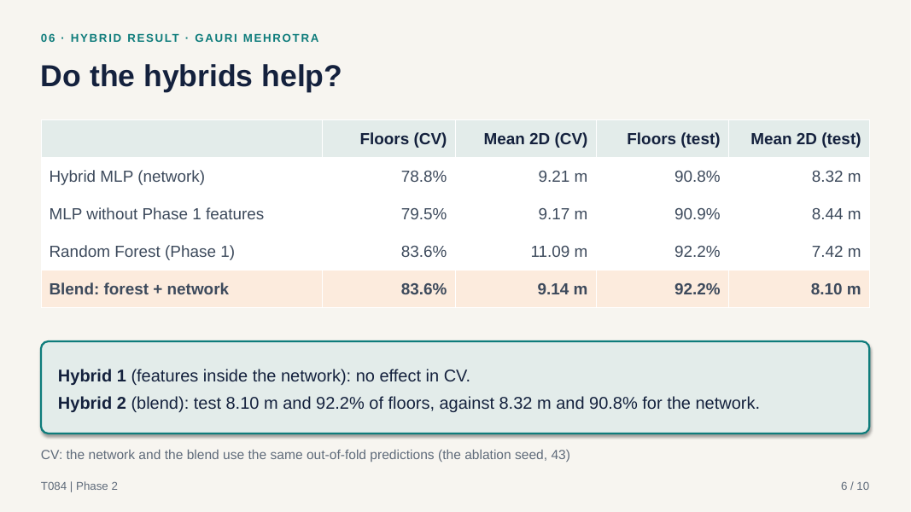

# Gauri Mehrotra (2401010170): Phase 2 slides 5–6

**Your part:** the two hybrids, the two ways we join Phase 1 and Phase 2: (1) our Phase 1 features as extra inputs of the network, (2) a blend of the Phase 1 Random Forest and the network. And: do they help?
**Time:** about 3 minutes.

---

## First, understand the idea (diagrams)

### The two hybrids: where Phase 1 joins Phase 2

- **Hybrid 1** joins at the **input**. The network gets our Phase 1 location hint next to the raw readings: 464 + 464 + 11 = **939** columns.
- **Hybrid 2** joins at the **output**. Two finished models, one weighted average. The network in the blend is our final Hybrid MLP, so the blend uses both hybrids.
- Both learn **only from training scans**, again inside **every CV fold**.

### Hybrid 1: the hint for one real scan (notebook 04, section 5)

The first test scan hears only **1** router (−91 dBm). AP-affinity turns it into a hint:

| | AP-affinity hint | True answer |
|---|---|---|
| Building | **1** | 1 |
| Floor | **1.28** (so "about floor 1") | 1 |
| Position | **23.8 m** from the true spot | – |

- A good start, but not exact. The network still has to make it better.
- 1.28 is an average of floors (of the training scans that hear this router), so it can fall between two floors.
- The 11 columns: `n_heard`, `max_rssi`, `mean_rssi` + `aff_b0`, `aff_b1`, `aff_b2`, `aff_floor`, `aff_lon`, `aff_lat`, `aff_top_lon`, `aff_top_lat`.
- Each column is **standardized**: (value − mean) / std, with the mean and std of the **training** scans only.
- **Did it help?** CV: **9.21 m with** the 11 columns, **9.17 m without**. Chance alone moves two runs by about **0.16 m**. So: **no effect**.

### Hybrid 2: the blend in one small example (made-up numbers, only to show the math)

Imagine only 2 floors, and w = 0.5 (half forest, half network):

| | Forest | Network | Blend: 0.5 × forest + 0.5 × network |
|---|---:|---:|---:|
| P(floor 1) | 0.60 | 0.30 | **0.45** |
| P(floor 2) | 0.40 | 0.70 | **0.55** |
| Floor answer | floor 1 | floor 2 | **floor 2** (the highest) |
| Position (x, y) | (10, 20) | (14, 24) | **(12, 22)** |

- The two models disagree. The network is **more sure** (0.70 against 0.60), so the blend says floor 2.
- For position we simply average x and y.
- **w = 0** gives the network alone, **w = 1** the forest alone. Our test checks both ends.

### How cross-validation chooses w (out-of-fold predictions)

- Trying a weight is **cheap**: all 11 weights reuse the same saved answers. Nothing is trained again.
- The network here uses **seed 43** (the ablation seed). So at **w = 0** the blend is exactly the ablation's full network: **9.21 m**, **78.8%** of floors.
- Chosen weights: **0.8** (building), **1.0** (floor), **0.1** (position). Cross-validation: **83.6%** of floors, **9.14 m**. Test set: **92.2%** of floors, **8.10 m**.

---

## Your script

> **Remember:** 2 places to join → hybrid 1: 11 Phase 1 columns as extra inputs → no effect (9.21 vs 9.17 m, chance 0.16 m) → hybrid 2: w × forest + (1 − w) × network, one w per task by CV → weights 0.8 / 1.0 / 0.1 → test 8.10 m: better than the network, not than the forest.

### Slide 5: Two ways to join Phase 1 and Phase 2 (1.5 min)

> Thank you, Ansh. In Phase 2 we did not throw Phase 1 away. We joined the two in **two places**.
> **Hybrid 1 is inside the network.** A raw reading says how **loud** a router is, but not **where** it is.
> In Phase 1, our **AP-affinity** already learned where each router is usually heard.
> So its **8 columns** and the **3 signal statistics**, **11 columns** in total, go into the network as **extra inputs**.
> Now the network gets a **location hint** next to the raw readings.
> **Hybrid 2 is at the output.** The Phase 1 **Random Forest** and our network each give **probabilities** for building and floor, and a **position**.
> The blend is a **weighted average**: **w × forest + (1 − w) × network**.
> **w = 0** means the network only. **w = 1** means the forest only. We try **0, 0.1, and so on, up to 1**.
> We choose **one w for each task**, by **user-group cross-validation**, never with the test set.
> Why a blend? Trees and networks make **different mistakes**, so an average can beat both.
> Both hybrids learn **only from training scans**, again in **every fold**. So, do they help?

### Slide 6: Do the hybrids help? (1.5 min)

> First, **hybrid 1**. We compared the **same network** with the Phase 1 features and without them.
> In cross-validation: **9.21 m with** them, **9.17 m without**. Only **0.04 m** apart.
> But two runs differ by about **0.16 m** just by chance. So hybrid 1 has **no effect**.
> On the test set the gap is also small: **8.32 m** with them, **8.44 m** without.
> Our guess, not tested: with **18,719** training scans, the network learns **by itself** where the routers are.
> Now **hybrid 2**, the blend. Cross-validation chose these forest weights: **0.8** for building, **1.0** for floor, and **0.1** for position.
> In cross-validation the blend reaches **83.6%** of floors and **9.14 m**, against **78.8%** of floors and **9.21 m** for the network alone.
> On the test set: the blend gets **92.2%** of floors and **8.10 m**. The network: **90.8%** and **8.32 m**. The forest: **92.2%** and **7.42 m**.
> So the blend makes the network **better**, but on position the **forest alone** is still the best on the test set.
> The weights were chosen **without the test set**. We used it **only once**, at the end.
> Now Kartikey will show the network itself, and all the test results.

---

## Words you should know

| Word | Simple meaning |
|---|---|
| **Hybrid** | A mix of two methods. Here: Phase 1 (classical machine learning) joined with Phase 2 (deep learning) |
| **Hybrid 1** | Our 11 Phase 1 columns go into the network as extra inputs |
| **Hybrid 2 (the blend)** | A weighted average of the Random Forest's answers and the network's answers |
| **Hybrid MLP** | Our final network: the 928 Wi-Fi columns + the 11 Phase 1 columns (939 inputs) |
| **MLP** | The same network with the Wi-Fi columns only (928 inputs), to measure hybrid 1 |
| **AP-affinity** | Our Phase 1 feature: where the routers a scan hears are usually heard (8 columns) |
| **Signal statistics** | 3 columns: how many routers are heard, the strongest reading, the mean reading |
| **Location hint** | What AP-affinity says: "probably this building, this floor, near here" |
| **Standardize** | (value − mean) / std, with the training mean and std, so a column is around 0 |
| **Probability** | How sure a model is about each class, from 0 to 1; all classes add up to 1 |
| **Softmax** | The step that turns the network's raw scores into probabilities |
| **Forest probability** | Each of the forest's 300 trees gives class shares; the forest averages them |
| **Argmax** | "Pick the class with the highest probability" |
| **Weighted average** | An average where one side counts more: w × a + (1 − w) × b |
| **Forest weight (w)** | The forest's share in the blend: 0 = network only, 1 = forest only |
| **Ensemble** | Several models joined to give one answer; our blend is one |
| **Out-of-fold prediction** | An answer for a training scan from a model that was trained without that scan's fold |
| **User-group CV** | Cross-validation where each fold holds whole users with their phones (5 folds, as in Phase 1) |
| **Ablation** | Remove one part, train again, and measure the change |
| **Chance level** | How much a score moves only by luck: about 0.16 m between two CV runs |
| **Seed** | The number that fixes the random start of training; same seed, same run |
| **Ablation seed (43)** | The seed of all ablation networks; also used for the blend's CV network |
| **Data leakage** | When answers from held-out or test scans sneak into training or into our choices |
| **Wide & Deep** | A model (Cheng et al., 2016) that trains a linear part on hand-made features together with a deep network, and adds their outputs |

### Your key numbers

| Model | Floors (CV) | Mean error (CV) | Floors (test) | Mean error (test) |
|---|---:|---:|---:|---:|
| Hybrid MLP (with Phase 1 features) | 78.8% | 9.21 m | 90.8% | 8.32 m |
| MLP (no Phase 1 features) | 79.5% | 9.17 m | 90.9% | 8.44 m |
| Random Forest (Phase 1) | 83.6% | 11.09 m | 92.2% | 7.42 m |
| Blend: forest + network | 83.6% | 9.14 m | 92.2% | 8.10 m |

- **Chance:** the full network with 3 seeds gives **9.12 ± 0.11 m** in CV, so two runs differ by about **0.16 m** just by luck.
- **Weights tried:** 0, 0.1, …, 1 (11 values). **Chosen:** **0.8** for building, **1.0** for floor (the forest alone), **0.1** for position.
- The networks' CV numbers come from the ablation runs (seed **43**).

## What you made / worked on

| File or function | What it does |
|---|---|
| `dl.NetworkInputs`, the hybrid block (`hybrid=True`) | `fit`: learns AP-affinity and the mean and std of the 11 Phase 1 columns, from the training scans only. `transform`: adds the 11 standardized columns after the 928 Wi-Fi columns |
| `NetworkInputs._phase1_features` | Makes the 11 columns with the Phase 1 code in `features.py`: `signal_stats` (3) and `APAffinity.transform` (8) |
| `DL_VARIANTS["mlp"]` in `config.py` | The same network without the Phase 1 features (`hybrid: False`), to measure hybrid 1 |
| `hybrid.forest_outputs` | The forest's probabilities for building and floor, and its position in meters; a class the forest never saw in training gets probability 0 |
| `hybrid.blend` | For each task: w × forest + (1 − w) × network. Building and floor: the most likely class wins. Position: x and y are averaged |
| `hybrid.out_of_fold_outputs` | In every fold: trains a new model on the other folds and keeps its answers for the held-out scans |
| `hybrid.weight_table` | The CV score of the blend for every w (mean over the 5 folds, as in Phase 1) |
| `hybrid.choose_weights` | One w per task: the best accuracy (building, floor) or the lowest mean 2D error (position); on a tie, the smaller w |
| `BLEND_WEIGHTS` in `config.py` | The 11 weights we try: 0, 0.1, …, 1 |
| `scripts/run_dl.py`, stage 6 | Reads Phase 1's tuned forest settings; makes out-of-fold answers (forest + seed-43 network); chooses w; trains the forest on all training scans and blends it with the final network on the test set, once. Writes `blend.csv`, `blend.json` and the `blend` test row |
| `tests/test_hybrid.py` (4 tests) | w = 0 and w = 1 give each model alone (w = 0.5 the middle position); forest probabilities line up with the classes; out-of-fold answers come from models that never saw the scan; `choose_weights` per task and on ties |
| `tests/test_dl.py` (2 tests) | `test_epoch_cross_validation_keeps_held_out_labels_away`: AP-affinity never uses held-out labels. `test_input_columns_and_training_statistics`: the 11 columns use training numbers only |
| Results | Rows `hybrid_mlp` and `mlp` of `ablation.csv` and `test_results.csv`; `blend.csv`, `blend.json` and the `blend` row |
| Report | Method: "Two Hybrids of Phase 1 and Phase 2"; Results: "The Hybrid Blend" |

## Your notebook

The notebooks train no network: they build the inputs and read saved results.

| Section | What it shows | Key result |
|---|---|---|
| Notebook 04, section 5: The hybrid part: Phase 1 features as inputs | The 8 AP-affinity columns of the first test scan (before standardizing), next to its true building, floor and position | The hint points to building **1** (true 1) and floor **1.28** (true 1), **23.8 m** from the true position: the network still has to refine it |
| Notebook 05, section 4: The hybrid blend: Random Forest + network | The forest weight chosen for each task, and the blend table (the CV score of every w from 0 to 1) | Weights 0.8 / 1.0 / 0.1; CV 83.6% and 9.14 m; test 92.2% and 8.10 m |

## Questions they may ask you

**Q:** What are your two hybrids?
A: Hybrid 1 joins at the input: the network gets our 11 Phase 1 columns (3 signal statistics + 8 AP-affinity) as extra inputs. Hybrid 2 joins at the output: blend = w × forest + (1 − w) × network, one w per task, chosen by user-group CV. We tried them because AP-affinity was our biggest Phase 1 gain (15.87 → 11.38 m in CV), and no Phase 1 model was best at every task.

**Q:** Is it leakage to put AP-affinity into the network?
A: No. AP-affinity uses labels, but only those of the training part: it is learned again in every CV fold (and from all training scans for the final network), and held-out and test scans are only transformed. A test (`test_epoch_cross_validation_keeps_held_out_labels_away`) shuffles the held-out labels, and that fold's profiles stay exactly the same.

**Q:** Hybrid 1 did not help. Why?
A: In CV the error was 9.21 m with the features and 9.17 m without, but chance alone moves two runs by about 0.16 m; without them the network was worse in only 2 of 5 folds. So there is no real effect. Our likely reason, which we did not test: with 18,719 training scans, the network learns by itself from the raw readings where the routers are. For the Phase 1 trees, the same hint helped a lot (15.87 → 11.38 m).

**Q:** Then why do you keep the Phase 1 features in the final network?
A: We fixed the final network before testing: the hybrid multi-task network. The ablation measures each part; it does not change the design afterwards. With or without the 11 columns the result is about the same (test: 8.32 against 8.44 m, inside the seed spread), and we report that honestly.

**Q:** Do the hidden WAPs also change the 11 Phase 1 columns?
A: No. When a router is hidden in a training batch, only its scaled RSSI and its indicator become 0; the 11 Phase 1 columns stay as they are. The test `test_hidden_waps_only_change_wap_columns` checks this.

**Q:** How is hybrid 1 different from Wide & Deep?
A: Wide & Deep (Cheng et al., 2016) trains a separate linear part on hand-made features together with a deep network, and adds their outputs. Our hybrid 1 is simpler: the hand-made features are just extra inputs of the same network, with no separate linear part. Our hybrid 2 is different again: the forest and the network are trained separately, and only their answers are averaged.

**Q:** What does "out-of-fold" mean, and why does it stop cheating?
A: We use the same 5 user-group folds: in each round, a new forest and a new network train on 4 folds and predict the 5th. After 5 rounds, every training scan has answers from models that never saw it, its user or its phone, just like new scans. On scans it was trained on, a model looks far too good (a forest can almost remember them), so weights chosen there would be wrong for new scans. Our test checks that no model ever predicts a scan it was trained on.

**Q:** Why one weight per task, and not one for all?
A: The two models are good at different things: in CV the network is better on position (9.21 against 11.09 m), the forest on floors (83.6% against 78.8%). So each task gets its own mix, as each task had its own settings in Phase 1. A task's answer uses only its own weight, and its score uses only that task, so the three choices do not disturb each other.

**Q:** Why average probabilities, and not the final answers?
A: Floors are classes, not amounts: the average of "floor 1" and "floor 3" is not "floor 2". With two models, a vote is a tie each time they disagree; probabilities break the tie, because the more sure model counts more. The mix still adds up to 1, and we pick the most likely class. Positions are numbers in meters, so we average x and y directly.

**Q:** Why do the blend's network answers use the ablation seed (43)?
A: The seed-42 runs won the tuning (λ = 300 was the best of 3 on these folds), and a winner is usually a bit lucky on those folds. Using them would make the network look better than it is, so the blend would lean too much towards it. With seed 43 the network is fair (it was even the weakest of our 3 CV seeds: 9.21 m against 8.99 and 9.16 m), and at w = 0 the blend is exactly the ablation's full network.

**Q:** Why not choose the weights on the test set?
A: Then we would pick the w that looks best on the very scans we report, so the test score would be too good and no longer honest. The test set must stay new, and is used only once, at the end. Li and Kim (2026) chose their blend weight on their test file, so their result is optimistic. Our test `test_choices_never_depend_on_the_test_set` shuffles the test labels, and `blend.csv` and `blend.json` stay exactly the same.

**Q:** How is your blend different from Li and Kim (2026)?
A: Their network is close to ours: a shared trunk, three heads and a strong position weight. But their blend averages a kNN position with the network's position, and the weight was chosen on the file they report as their test set. Ours blends the Random Forest and the network for all three tasks (probabilities for building and floor too), with weights chosen by user-group CV on out-of-fold predictions. Also, we found no study that gives a network learned router locations, like our AP-affinity.

**Q:** Why should a blend beat both models? Did it?
A: Trees and networks are biased towards different kinds of functions (Grinsztajn et al., 2022), so they make different mistakes, and in Phase 1 no model was best at every task. On tabular data, an ensemble of networks and XGBoost beat XGBoost alone (Shwartz-Ziv and Armon, 2022). And w = 0 and w = 1 are allowed, so CV can always pick one model alone. Did it help here? In cross-validation yes: 9.14 m, better than both models (network 9.21 m, forest 11.09 m). On the test set it made the network better (8.32 → 8.10 m), but not better than the forest (7.42 m).

**Q:** How did you get the blend's test score?
A: After CV chose the weights, we trained the forest (Phase 1's tuned settings) on all 18,719 training scans and took our final network (seed 42, 8.32 m). We blended their test answers once, with the chosen weights: 92.2% of floors and 8.10 m. The blend's CV score is the best of 11 weights on the same folds, so it is a little optimistic, like every tuned CV score; the test score is the honest one.
