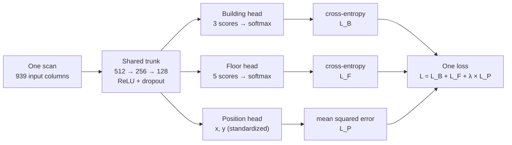
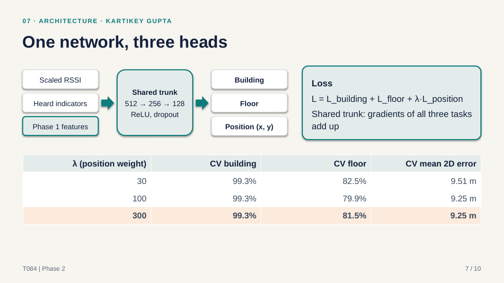
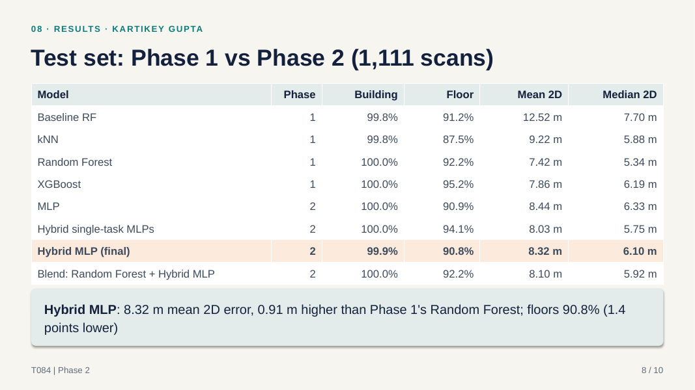

# Kartikey Gupta (2401010214): Phase 2 slides 7–8

**Your part:** the network itself (one shared trunk, three heads), its loss and the tuning of λ, and the test results: Phase 1 vs Phase 2.
**Time:** about 3 minutes.

---

## First, understand the idea (diagrams)

### 1. One network, three heads

- **Trunk** = the shared layers. All three heads read the same **128** numbers.
- **Head** = one small output layer for one task: 128 → 3 (building), 128 → 5 (floor), 128 → 2 (x, y).
- The position head gives standardized x and y. `predict()` turns them back into meters.
- Size: **645,504** weights in the trunk + **1,290** in the heads = **646,794**. Three separate networks would need **1,937,802** (about 3 times as many).

### 2. Softmax and cross-entropy (made-up numbers)

The building head gives 3 raw scores. **Softmax** turns them into probabilities: all positive, and together they make 1.

| | Building 0 | Building 1 | Building 2 |
|---|---:|---:|---:|
| Raw score | 2.0 | 0.5 | −1.0 |
| e^score | 7.389 | 1.649 | 0.368 |
| Probability = e^score / 9.406 (their sum) | **0.786** | 0.175 | 0.039 |

- The answer is the biggest probability: **building 0**.
- **Cross-entropy** = −ln(probability of the **true** class).
- If the truth is building 0: −ln(0.786) = **0.24**. Small loss: sure and right.
- If the truth is building 2: −ln(0.039) = **3.24**. Big loss: sure and wrong.

### 3. Why λ must be big (made-up numbers)

x is standardized with its training spread (**124.5 m**), y with **67.4 m**. So a **10 m** error is only about **0.1**. Squared, that is about **0.01**.

One scan, three parts of the loss:

| Part of the loss | λ = 1 | λ = 300 |
|---|---:|---:|
| Building: 90% on the true building, −ln(0.9) | 0.11 | 0.11 |
| Floor: 50% on the true floor, −ln(0.5) | 0.69 | 0.69 |
| Position: about 10 m off, so about 0.01, times λ | 0.01 | **3.00** |

- With λ = 1, position is almost invisible. The shared layers would learn mostly for building and floor.
- With a big λ, position counts too. **Tuning (CV):** λ = 30 → **9.51 m**, λ = 100 → **9.25 m**, λ = 300 → **9.25 m** (building **99.3%** for all three). 300 won by a tiny margin: a practical tie.
- **In training**, each loss sends a **gradient** back into the trunk. The trunk gets the **sum**: gradient of L_B + gradient of L_F + λ × gradient of L_P. So one update uses all three tasks.

### 4. CV and the test set disagree (real numbers)

Error = mean 2D error: the average distance between the guessed and the true spot.

| Model | CV error | Test building | Test floor | Test error | Test median |
|---|---:|---:|---:|---:|---:|
| Baseline RF (Phase 1) | 15.87 m | 99.8% | 91.2% | 12.52 m | 7.70 m |
| kNN (Phase 1) | 12.75 m | 99.8% | 87.5% | 9.22 m | 5.88 m |
| Random Forest (Phase 1) | 11.09 m | 100.0% | 92.2% | **7.42 m** | 5.34 m |
| XGBoost (Phase 1) | 11.25 m | 100.0% | **95.2%** | 7.86 m | 6.19 m |
| MLP, Wi-Fi inputs only (Phase 2) | 9.17 m | 100.0% | 90.9% | 8.44 m | 6.33 m |
| Three single-task networks (Phase 2) | **8.90 m** | 100.0% | 94.1% | 8.03 m | 5.75 m |
| **Hybrid MLP, our final network (Phase 2)** | 9.21 m | 99.9% | 90.8% | 8.32 m | 6.10 m |
| Blend: Random Forest + network | 9.14 m | 100.0% | 92.2% | 8.10 m | 5.92 m |

- **In CV**, all three networks have a smaller error than every Phase 1 model.
- **On the test set**, the Random Forest beats all three networks on position.
- All seven models have a smaller error on the test set than in CV. But the forest gains much more: **11.09 → 7.42 m**, against **9.21 → 8.32 m** for our network.
- Our guess (not tested): most test scans are close to training spots. There, a forest can reuse the training scans almost directly.

---

## Your script

> **Remember:** 939 inputs → one shared trunk, three heads → loss = building + floor + λ × position, λ = 300 → test: network 8.32 m, forest 7.42 m → CV and test disagree, and we say so.

### Slide 7: One network, three heads (1.5 min)

> Thank you, Gauri. Now, the network itself.
> Every scan gives **939** input columns. They go into a **shared trunk** of three layers: **512**, **256** and **128** units.
> Each layer uses **ReLU** and **dropout**. All three tasks share these layers.
> On top are **three heads**, one small output layer each: building, floor and position.
> Building and floor give **probabilities**, using **softmax**. Their loss is **cross-entropy**.
> Position gives **x and y**. Its loss is the **mean squared error**, on standardized coordinates.
> We add them into **one loss**: building + floor + **lambda** × position.
> Why lambda? A **10 m** error is only about **0.1** in standardized units. Without a big lambda, position would hardly count.
> We tried lambda = **30, 100 and 300** with user-group cross-validation. **300** won with **9.25 m**, practically tied with 100.
> The trunk is shared, so the **gradients of all three tasks add up** in it. Every task shapes the same layers.
> We train with **AdamW**, batches of **256**, **200** epochs and a cosine learning rate, in **PyTorch**.

### Slide 8: Test set: Phase 1 vs Phase 2 (1,111 scans) (1.5 min)

> Now the real exam: the **1,111 test scans**, used **only once**, at the end.
> The table has **four** Phase 1 models, **three** networks and the blend, all on the same scans.
> We fixed our final network **before** testing: the **hybrid MLP**, the design the brief asks for.
> It gets the building right **99.9%** of the time, the floor **90.8%**, with a mean error of **8.32 m**.
> Phase 1's Random Forest: **7.42 m** and **92.2%** of floors. So the forest is still **0.91 m** better.
> The best networks were the **three single-task networks**: **8.03 m** and **94.1%** of floors. The plain MLP got **8.44 m**.
> The blend of the forest and our network: **8.10 m** and **92.2%** of floors: better than the network, but not better than the forest on position.
> Is it luck? With **five seeds**, our network gets **8.21 m, plus or minus 0.06**. So the result is stable.
> Now the honest point. Cross-validation put the network **ahead** of the forest: **9.21 m against 11.09 m**.
> But on the test set, the **forest is ahead**. We report both, and we did **not** change our choice.
> Now Lokendra will show what each part of the network does, and where the errors are.

---

## Words you should know

| Word | Simple meaning |
|---|---|
| **Neural network (MLP)** | Layers of simple units. Each layer mixes the numbers from the layer before. MLP = multilayer perceptron, the basic kind |
| **Fully connected layer** | A layer where every unit sees every number from the layer before (`nn.Linear` in PyTorch) |
| **Shared trunk** | The layers that all three tasks use together: 512 → 256 → 128 units |
| **Head** | A small output layer for one task: building (3 outputs), floor (5), position (2) |
| **Multi-task learning** | Learning related tasks together in one network, so they can help each other (Caruana, 1997) |
| **Single-task network** | A network with one head, for one task only. We trained three of them, to compare |
| **Hybrid MLP / plain MLP** | Hybrid MLP = our final network, with the Phase 1 features as extra inputs (939 columns). Plain MLP = the same network without them (928 columns) |
| **ReLU** | max(0, a): a positive number stays, a negative one becomes 0 |
| **Dropout** | In training only, each hidden unit is switched off with probability 0.2 |
| **Softmax** | Turns a head's raw scores into probabilities: all positive, and together they make 1 |
| **Cross-entropy** | The loss for classes: −log(probability given to the true class), averaged over the batch |
| **Mean squared error (MSE)** | The loss for numbers: the average of the squared differences between guess and truth |
| **Standardized** | (value − training mean) / training standard deviation. The numbers end up near 0, with spread 1 |
| **Loss** | One number that says how wrong the network is. Training makes it smaller |
| **λ (lambda)** | The weight of the position loss in the total loss. We tried 30, 100 and 300, and chose 300 |
| **Gradient** | For every weight: which way to change it so that the loss goes down. `loss.backward()` computes it |
| **Weights** | The numbers the network learns (biases included): 646,794 in our network |
| **Epoch** | One pass over all training scans. We train for 200 |
| **Mini-batch** | A small group of scans for one update step: 256 scans |
| **Learning rate** | How big each update step is. Ours starts at 0.001 |
| **Cosine schedule** | The learning rate falls smoothly from 0.001 to 0, along a cosine curve, by the last batch |
| **AdamW** | Our optimizer: Adam (every weight gets its own step size) plus weight decay 0.01 (pulls every weight a little towards 0) |
| **Seed** | The start number for the random choices. Same seed → same starting weights, same batches, same network |
| **Checkpoint** | A moment in training when we score the held-out fold: every 10 epochs and at the end |
| **PyTorch** | The Python library we used to build and train the networks |
| **Mean / median 2D error** | Mean = the average straight-line distance between the guessed and the true spot. Median = the middle value |

## What you made / worked on

| File or function | What it does |
|---|---|
| `dl.MultiTaskMLP` (`src/indoorloc/dl.py`) | The network. The trunk is 3 × (Linear → ReLU → Dropout). Then one Linear head per task, with sizes from `OUTPUTS`: 3, 5, 2. `forward()` runs the trunk once, and every head reads the same 128 numbers |
| `dl.NeuralLocalizationModel.fit` | Sets the seed, learns the inputs, standardizes x and y with training numbers, builds the network, sets up AdamW and the cosine schedule, then trains for 200 epochs |
| `NeuralLocalizationModel._train_one_epoch` | One pass in random batches of 256: hide some WAPs, loss = building + floor + λ × position (`LOSSES`), `loss.backward()`, update, lower the learning rate a little |
| `NeuralLocalizationModel.outputs` / `predict` | Dropout off. Softmax gives the probabilities, and the most likely class wins. Positions go back into meters (× training std + training mean) |
| Single-task mode (`multitask=False`) | Three separate networks with one head each, same inputs and settings, each with its own AdamW |
| `dl.cross_validate_epochs` | One training run per fold, scored on the held-out fold every 10 epochs and at the end. The network and its inputs are fitted again in every fold |
| `scripts/run_dl.py` | Runs every Phase 2 stage in order: tuning → ablation → final network → test → seed check → blend → comparison → figures. `--quick` = a small check run that never uses the test set |
| `Makefile`: `run2`, `report2` | `make run2` runs `run_dl.py` (needs `make run` first; `QUICK=1` for the check run). `make report2` builds `report/main_phase2.pdf` |
| Requirements | PyTorch (`torch`) added, so `make setup` installs it |
| Your tests (`tests/test_dl.py`) | `test_network_heads` (3, 5 and 2 outputs; one shared trunk), `test_multitask_and_single_task_models_fit_and_predict` (1 or 3 networks; the loss goes down), `test_same_seed_gives_the_same_model`, `test_predicted_positions_are_turned_back_into_meters`, `test_quick_run_writes_every_result` |
| Your results (`results/phase2/`) | `tuning/hybrid_mlp.csv`, `tuning/best_params.json`, `metrics/test_results.csv`, `metrics/comparison.csv`, `metrics/final_model.json`, `predictions/`, figure `aml_vs_dl` |
| Report and slides | Method: the multi-task network, the loss, tuning. Results: tuning, and Phase 1 vs Phase 2. Slides 7–8 |

## Your notebook

Notebook 04, sections 6–7, and notebook 05, sections 2–3. The notebooks only read the saved results. No network is trained in them, so they run in seconds.

| Section | What it shows | Key result |
|---|---|---|
| 04 · 6. The network | The network with the tuned settings (its layers printed) and how many weights it has | **645,504** weights in the trunk, **1,290** in the three heads. Three single-task networks: **1,937,802**, about 3 times as many |
| 04 · 7. Tuning | The CV table for λ = 30, 100, 300 (mean and std over the 5 folds, 200 epochs each) | λ = **300** chosen: **9.25 m**, floors **81.5%**. Worst: **9.51 m** |
| 05 · 2. The final network | The three networks tested on the test set, their CV scores, and the rule fixed before testing | CV: MLP **9.17 m**, single-task **8.90 m**, hybrid MLP **9.21 m** → final: **Hybrid MLP** |
| 05 · 3. Test set: Phase 1 vs Phase 2 | All 8 models on the 1,111 test scans (building, floor, MAE x and y, mean and median error), and a chart of CV next to test | Hybrid MLP: **99.9%**, **90.8%**, **8.32 m** (median **6.10 m**). Random Forest **7.42 m** (**92.2%**). XGBoost floors **95.2%** |

## Questions they may ask you

**Q:** What does softmax do?
A: The building head gives 3 raw scores, the floor head 5. Softmax turns them into probabilities: p = e^score / (sum of all e^score), all positive and adding up to 1. The class with the biggest probability is the answer. In training, PyTorch's `CrossEntropyLoss` does the softmax inside; for predictions, `outputs()` calls `torch.softmax`.

**Q:** What is cross-entropy, and why use it?
A: It is −log(probability given to the true class), averaged over the batch. 90% on the true floor costs 0.11, but only 10% costs 2.30. So a sure but wrong answer is punished hard. It is the standard loss for classes, so we use it for building and for floor.

**Q:** Why mean squared error for position, and why standardized x and y?
A: Position is a number, not a class, so we use the squared difference between the guessed and the true x and y. Standardized targets are near 0 with spread 1, and a network trains well on that; `predict()` turns them back into meters. One side effect: y has a smaller spread (67.4 m against 124.5 m for x), so the loss counts a 1 m error in y about 3.4 times as much as in x.

**Q:** Why do you need λ, and why is it so big?
A: A 10 m error is only about 0.1 in standardized units, and squared that is about 0.01. A class loss is much bigger: 50% on the true floor already costs 0.69. With λ = 1, position would hardly count, and the shared layers would mostly serve building and floor. Multi-task results depend strongly on these weights (Kendall et al., 2018), so we tuned λ.

**Q:** λ = 100 and λ = 300 both give 9.25 m. Why 300?
A: 300 was lower by a tiny bit: 9.2499 against 9.2509 m, so it is practically a tie. Our rule says: the lowest CV position error wins (on a tie, the earlier value). λ = 30 found the most floors (82.5%), but its error was worse, 9.51 m. λ = 300 also beat λ = 100 on floors (81.5% against 79.9%).

**Q:** How do the three tasks share the trunk during training?
A: For each batch we add the three losses into one, L = L_B + L_F + λ × L_P, and call `loss.backward()` once. Each head sends its gradient back into the trunk, so the trunk gets the sum: gradient of L_B + gradient of L_F + λ × gradient of L_P. So every update of the shared weights uses all three tasks. This is how multi-task learning shares knowledge (Caruana, 1997).

**Q:** How many weights does the network have?
A: 646,794, biases included: 645,504 in the shared trunk and 1,290 in the three heads. The first layer alone has 939 × 512 + 512 = 481,280. Three single-task networks need three trunks: 1,937,802, about three times as many.

**Q:** The single-task networks were better in CV (8.90 m) and on the test set (8.03 m). Why is the shared network your final model?
A: We fixed it before testing (`DL_FINAL` in config.py): the brief asks for one shared trunk with three heads, so that design is our Phase 2 model. CV only chose its setting, λ. The other two networks are tested next to it to compare; switching after seeing the test would mean choosing on the test set. We report openly that single-task won, but it needs three times the weights.

**Q:** CV ranked your network ahead of the Random Forest (9.21 against 11.09 m), but the test set says the opposite (8.32 against 7.42 m). Why?
A: All seven models had a smaller error on the test set than in CV, but the forest gained much more (11.09 → 7.42 m; our network 9.21 → 8.32 m). Our guess, not tested: most test scans are close to training spots, where a forest can reuse the training scans almost directly, while CV holds out whole users, who also walked to other places. With only 16 user groups, the CV ranking itself is uncertain. CV is still the fair way to choose, so we kept our choice and report both results.

**Q:** Is 8.32 m just luck?
A: No. We trained the final network with five seeds (42 to 46): 8.21 ± 0.06 m and 91.7 ± 0.7% of floors. Our reported run (seed 42) is the weakest of the five, so 8.32 m is a little pessimistic. Even the best seed (8.17 m) is behind the forest's 7.42 m.

**Q:** Why AdamW and a cosine learning rate?
A: AdamW is Adam, which gives every weight its own step size, plus weight decay (0.01), which pulls every weight a little towards 0 at each step. The cosine schedule lowers the learning rate smoothly from 0.001 to 0 by the last batch (0.0005 halfway). So the last epochs make only small changes, and the result does not jump from epoch to epoch. The test `test_position_weight_and_cosine_schedule` checks this curve.

**Q:** Why 512 → 256 → 128, and 200 epochs? Did you tune them?
A: No, they were fixed in advance, because every setting costs a full 5-fold CV of 200 epochs. The width halves at each layer, a size like other networks on this dataset (512–512 in Laska and Blankenbach 2022, 1024–512–256 in Li and Kim 2026). We tuned only λ, the one setting that only a multi-task network has.

**Q:** On slide 7 the network has 9.25 m in CV, but you also say 9.21 m. Which is right?
A: Both. It is the same network with λ = 300, trained with different seeds. The tuning used seed 42; the ablation and the CV comparison use seed 43, so the reference is not the very run that won the tuning. With seeds 43, 44 and 45 it gives 9.12 ± 0.11 m, so such small differences are just chance.

**Q:** What does your `cross_validate_epochs` do?
A: It trains one network per fold and scores the held-out fold every 10 epochs and after the last one, with a function that runs after each epoch. So one training run gives a whole learning curve, not just one number. The network and its inputs are fitted again in every fold, so held-out scans never shape their own inputs. The tuning uses the score after the last epoch (200).
