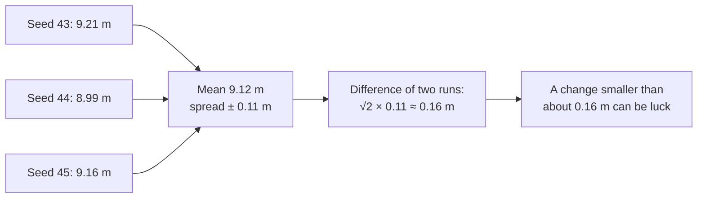
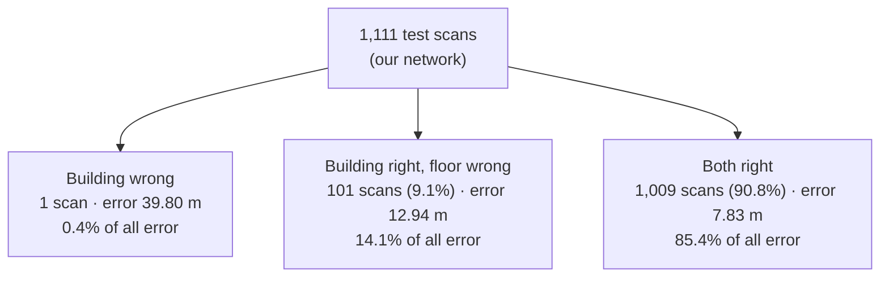
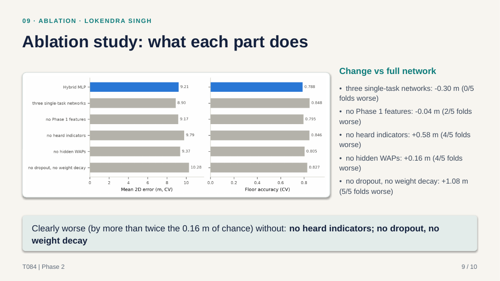
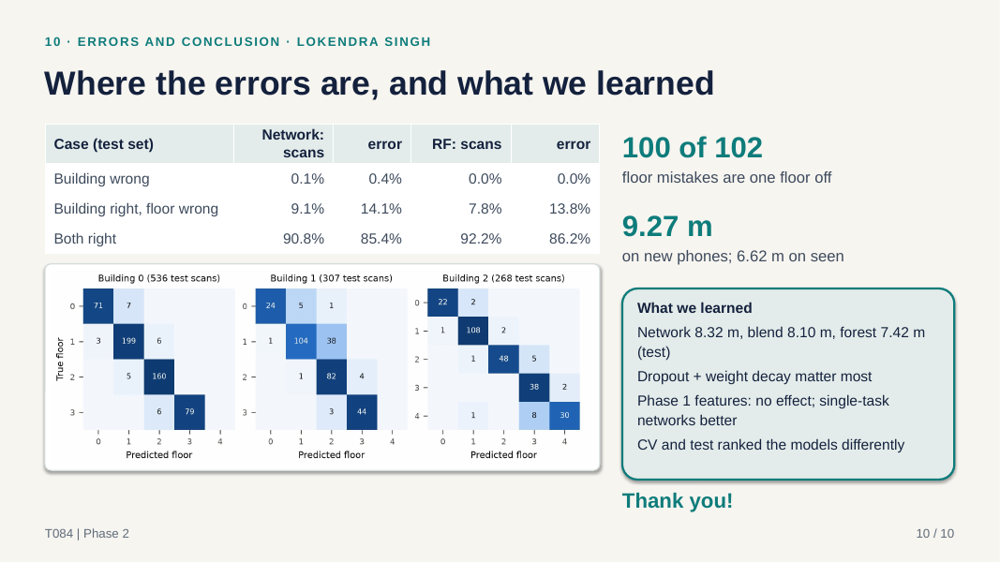

# Lokendra Singh (2401010254): Phase 2 slides 9–10

**Your part:** the ablation study (which parts of the network really help), where the errors are, and the conclusion. This is the hardest part, so learn the "why" answers well.
**Time:** about 3.5 minutes.

---

## First, understand the idea (diagrams)

### 1. The ablation study: remove one part at a time

We take our full network, remove **one** part, train it again and compare. Same 5 user-group folds, same settings (λ = **300**, **200** epochs), same seed (**43**). So only that one part changes.

All numbers here are from **cross-validation** (CV), not from the test set.

| Network (CV) | Mean error | Change | Folds worse | Floors | What it means |
|---|---:|---:|---:|---:|---|
| **Full network** (the reference) | **9.21 m** | – | – | 78.8% | – |
| No dropout, no weight decay | 10.28 m | **+1.08 m** | 5 of 5 | 82.8% | Clearly worse: this part helps the most |
| No heard indicators | 9.79 m | **+0.58 m** | 4 of 5 | 84.6% | Worse position, but more floors right |
| No hidden WAPs | 9.37 m | +0.16 m | 4 of 5 | 80.5% | At the level of chance: not sure |
| No Phase 1 features | 9.17 m | −0.04 m | 2 of 5 | 79.5% | No effect |
| Three single-task networks | 8.90 m | **−0.30 m** | 0 of 5 | 84.8% | Better on every task, but 3 times the weights |

- **+** means a bigger error (worse). **−** means a smaller error (better).
- **Folds worse** = in how many of the 5 folds the variant's error is bigger than the full network's error **on the same fold**.
- 5 of 5 = every fold agrees. 2 of 5 = mixed, like a coin flip.

### 2. Real change, or just luck?

Every row above comes from **one** seed. A different seed gives slightly different starting weights, dropout, batch order and hidden WAPs, so the score moves a little. We measured how much:

- One run has a luck of about **± 0.11 m**.
- A difference uses **two** runs, so it carries **two** lucks. They do not simply add up (sometimes they cancel). The rule from statistics: spread of a difference = **√2 × 0.11 ≈ 0.16 m** (√2 ≈ 1.41).
- How to read the changes:
  - **Much bigger than 0.16 m, worse in most folds** → real: no dropout, no weight decay (**+1.08 m**, 5 of 5); no heard indicators (**+0.58 m**, 4 of 5).
  - **About 0.16 m** → at chance level, we cannot be sure: no hidden WAPs (**+0.16 m**).
  - **Much smaller than 0.16 m** → nothing: no Phase 1 features (**−0.04 m**, 2 of 5).

### 3. Where the errors are (test set, our network)

- This is the **hierarchical error breakdown**: first the building, then the floor, then the position.
- **Share of error**, worked out: 1,009 scans × 7.83 m ÷ (1,111 scans × 8.32 m) ≈ 7,900 ÷ 9,240 ≈ 85% (exactly **85.4%**).
- **Lesson:** most of the error is the **exact position on the right floor**. Phase 1's Random Forest was the same (**86.2%**).
- Floor mistakes: **102** scans in all (the 101 above + the 1 with the wrong building). **100** of them are only **one floor off**.
- Tiny example from the floor confusion matrix (building 1, true floor 1, **143** scans): **104** right, **38** put on floor 2, **1** put on floor 0.

### 4. Seen phones vs new phones (test set)

| Test scans from | Scans | Our network | Random Forest (Phase 1) |
|---|---:|---:|---:|
| 2 phones seen in training | 397 | 6.62 m | 5.84 m |
| 9 new phones | 714 | **9.27 m** | **8.30 m** |

Both models are worse on new phones. A new phone measures the same router a bit stronger or weaker (another antenna and chip). And **714** of the **1,111** test scans come from new phones.

---

## Your script

> **Remember:** one change at a time → luck is about 0.16 m → dropout + weight decay help most → most error is the exact position → new phones are harder → honest lessons → thank you.

### Slide 9: Ablation study: what each part does (1.5 min)

> Thank you, Kartikey. Which parts of our network really help? We ran an **ablation study**.
> We remove **one part at a time** and train again, with the same folds, settings and seed.
> The full network scores **9.21 m** in cross-validation.
> But first, how big is luck? With **3 seeds**, the full network gives **9.12 ± 0.11 m**.
> So two runs can differ by about **0.16 m** just by chance.
> **No dropout, no weight decay: +1.08 m**, worse in **all 5 folds**. This part helps the most.
> **No heard indicators: +0.58 m.** But, honestly, floors are better without them: **84.6%** against **78.8%**.
> **No hidden WAPs: +0.16 m.** That is the size of chance, so we cannot be sure.
> **No Phase 1 features: −0.04 m.** No effect.
> **Three single-task networks: −0.30 m** and **6.0** more floor points, but **3 times** the weights.
> Now let us see where the errors are.

### Slide 10: Where the errors are, and what we learned (2 min)

> Here we split the **1,111 test scans** of our network into 3 cases. The **building** is wrong for only **1 scan**.
> The **floor** is wrong for **102 scans**, and **100** of them are just **one floor off**: floors next to each other hear **almost the same routers**.
> The big point: **85.4%** of all the error is on scans where building and floor are **right**. So the main problem is the **exact position**. Phase 1 was the same: **86.2%**.
> Also, **new phones are harder**: **9.27 m**, against **6.62 m** on the 2 phones seen in training.
> So, what did we learn? Our **one shared network** gets **8.32 m** and **90.8%** of floors on the test set. With **5 seeds**: **8.21 ± 0.06 m**, so it is not luck.
> The **blend** with the Random Forest gets **8.10 m** and **92.2%** of floors. But, honestly, the **Random Forest alone** is still best on position: **7.42 m**.
> Three honest lessons. **One:** the Phase 1 features did not help inside the network.
> **Two:** three single-task networks beat the shared one.
> **Three:** cross-validation and the test set **ranked the models differently**.
> We kept the fair rules: user-group CV, and the test set used **only at the end**.
> **Thank you!** We are happy to take questions.

---

## Words you should know

| Word | Simple meaning |
|---|---|
| **Ablation study** | Remove one part of the model at a time, train again, and see how much the score changes |
| **Variant** | One changed copy of the network: one part removed or changed |
| **Full network** | Our network with all its parts (the Hybrid MLP). The reference: 9.21 m in CV |
| **Seed** | The start number for all random choices: starting weights, dropout, batch order, hidden WAPs. Same seed = same result |
| **Ablation seed** | Seed **43**. All 6 ablation networks use it, so only the one change differs |
| **Chance level** | How much a score moves only because of the seed: about **0.16 m** between two runs |
| **± (standard deviation)** | How far the values usually are from their mean: 9.12 **±** 0.11 m |
| **√2 rule** | A difference of two runs carries two lucks, so its spread is √2 ≈ 1.41 times the spread of one run |
| **Folds worse** | In how many of the 5 folds the variant's error is bigger than the full network's, on the same fold |
| **Regularization** | Tricks that stop the network from memorizing the training scans |
| **Dropout** | In training, each hidden unit is switched off with probability 0.2 |
| **Weight decay** | Pulls every weight a little towards 0 at each step (0.01, in AdamW) |
| **Hidden WAPs** | In each training batch, 10% of the heard routers (WAPs) are marked "not heard" |
| **Heard indicator** | One extra column per router: 1 = heard, 0 = not heard |
| **MLP (Wi-Fi inputs only)** | The network without the Phase 1 features. It is the "no Phase 1 features" row |
| **Single-task network** | A network that learns only one task. We trained three: building, floor, position |
| **Percentage point** | The gap between two percentages: 84.8% − 78.8% = 6.0 points |
| **Learning curve** | The CV score after every 10 epochs of training, drawn as a line |
| **Hierarchical error breakdown** | Split the test scans into 3 cases: building wrong / floor wrong / both right |
| **Share of error** | What part of the total error comes from one case: 85.4% from "both right" |
| **Confusion matrix** | A table of true floor (rows) against predicted floor (columns). The diagonal = correct |
| **Seen / new phone** | A phone model that is / is not in the training data. Test set: 2 seen, 9 new |
| **Device heterogeneity** | Different phones measure the same signal a bit differently |
| **Seed check** | Train the same network with several seeds and look at the spread |

## What you made / worked on

| File or function | What it does |
|---|---|
| `config.DL_VARIANTS` (`src/indoorloc/config.py`) | The 6 networks of the ablation: the full network first, then 5 that each change one thing (`multitask`, `hybrid` or `indicators` switched off, `hide_wap_rate` set to 0, or `dropout` and `weight_decay` set to 0) |
| `config.DL_ABLATION_SEED = 43` | The new seed that every ablation network uses (the tuning runs used seed 42) |
| `config.DL_CV_SEEDS = [44, 45]` | Two more seeds for the CV luck check (with 43, that makes 3 runs) |
| Stage 2 of `scripts/run_dl.py` | Trains the 6 networks on the same 5 folds; writes `ablation.csv` (mean, change, folds worse) and `learning_curves.csv`; then the CV seed check, `cv_seeds.csv` |
| Stage 5 of `scripts/run_dl.py` | Trains the final network on all training scans with the 5 seeds of `config.DL_SEEDS` (42 to 46), tests each one, writes `seeds.csv` |
| `plots.ablation` (`src/indoorloc/plots.py`) | The slide 9 bar chart: the full network on top in blue, the variants in gray, the values next to the bars |
| `plots.learning_curves` | CV error and floor accuracy after every 10 epochs, one line per network (the figure on Ansh's slide 4) |
| `plots.model_comparison` | CV bars (blue) next to test bars (orange) for every model, with a dotted line between Phase 1 and Phase 2 (used in both phases) |
| `plots.floor_confusion`, `plots.error_map` (from Phase 1) | The floor confusion figure on slide 10, and the error map of notebook 05 |
| Phase 1 metrics, reused (`metrics.error_breakdown`, `per_phone`, `floor_confusion`) | Your Phase 1 code makes the 3 cases, seen vs new phones and the floor confusion for the networks too, so both phases are measured the same way |
| `test_choices_never_depend_on_the_test_set` (`tests/test_dl.py`) | Runs everything twice, the second time with the test answers shuffled: every choice, every CV number and every prediction must stay the same; only the test scores change |
| `test_quick_run_writes_every_result` (`tests/test_dl.py`) | A small, fast run on a made-up campus: checks that every result file and figure is written, the ablation rows are in order, and the comparison has 4 Phase 1 rows + 4 Phase 2 rows (the blend last) |
| Your results | `ablation.csv`, `cv_seeds.csv`, `seeds.csv`, `error_breakdown.csv`, `per_phone.csv`, `floor_confusion.csv`; figures `dl_ablation`, `dl_floor_confusion`, `dl_error_map` |
| Report | Results: Ablation Study, Where the Errors Are; the Conclusion |

## Your notebook

Notebook **05 Phase 1 vs Phase 2** (`notebooks/05_aml_vs_dl.ipynb`), sections 1 and 5–9. It only reads saved results; it trains nothing.

| Section | What it shows | Key result |
|---|---|---|
| 1. Ablation study | Bar chart and table of the full network and the 5 variants, plus the 3-seed CV table | Full 9.21 m; no dropout, no weight decay +1.08 m (5 of 5 folds); luck about 0.16 m |
| 5. Hierarchical error breakdown | The 3 cases for our network and for the Random Forest | 1 building wrong; floor wrong 9.1% (RF 7.8%); 85.4% of the error with both right (RF 86.2%) |
| 6. Floor confusion matrices | True vs predicted floor per building: the network first, then the Random Forest | 102 floor mistakes, 100 of them one floor off |
| 7. Coordinate error maps | True positions (gray) and predictions colored by their error, per building | Network: 41.8% of test scans within 5 m, 71.2% within 10 m (RF: 47.7% and 76.0%) |
| 8. Seen and new phones | Floor accuracy and error on seen and on new phones, network and Random Forest | Network 6.62 vs 9.27 m; RF 5.84 vs 8.30 m |
| 9. Seed check | The final network trained with 5 seeds and tested each time | 8.21 ± 0.06 m; floors 91.7% ± 0.7 points |

(Sections 2–3 are Kartikey's part, section 4, the blend, is Gauri's.)

## Questions they may ask you

**Q:** What is an ablation study, and why change only one thing at a time?
A: We remove one part of the network, train it again and compare it with the full network. If we changed two parts together, we could not say which one caused the difference. With one change, and the same folds, settings and seed, the difference belongs to that one part. Our result: dropout with weight decay helps most (+1.08 m without them), then the heard indicators (+0.58 m).

**Q:** Why did the ablation use a new seed (43), not the tuning run?
A: The tuning kept λ = 300 because its run had the lowest error of 3 tries, and a winner picked like that is often a little lucky. If that lucky run were the reference, every variant would look worse than it really is. So all 6 ablation networks share one new seed, 43, and only the one change differs. That is also why slide 7 shows 9.25 m (tuning, seed 42) and slide 9 shows 9.21 m (seed 43): the gap is far inside chance.

**Q:** What does "worse in 4 of 5 folds" mean, and why count folds?
A: Every variant is tested on the same 5 folds as the full network. For each fold we ask: is the variant's error bigger than the full network's on this fold? We count the yes answers: 5 of 5 is steady, 2 of 5 is a coin flip. We count because the folds are very different in difficulty (the full network's error has a spread of 1.91 m from fold to fold), so one hard fold can move the average a lot.

**Q:** Where does the 0.16 m chance level come from? Why √2?
A: We trained the full network with 3 seeds on the same folds: 9.21, 8.99 and 9.16 m, so 9.12 ± 0.11 m. A difference between two runs carries the luck of both, and two equal spreads add up as √(0.11² + 0.11²) = √2 × 0.11 ≈ 0.16 m. So a change smaller than about 0.16 m may be only luck. Three seeds give only a rough number, so we say "about".

**Q:** Your full network has the lowest CV floor accuracy of all six (78.8%). Why?
A: Our network aims at position: the loss counts the position loss 300 times (λ = 300), and λ was picked by the position error, not by floors. Floor accuracy is also noisy: with seeds 44 and 45 the same network gets 79.3% and 81.1%. Still, some changes raise floors clearly (no heard indicators 84.6%, three single-task networks 84.8%). We report this honestly; we did not test why.

**Q:** Without the heard indicators, more floors were right (84.6% vs 78.8%). Why keep them?
A: They lower the position error by 0.58 m, and position is our main score. The floor gap is also real: the seeds move floor accuracy by only ± 1.2 points. So the indicators help position and cost floors, and we report both. The brief also asks for them, so that "not heard" is never mixed up with "very weak".

**Q:** Three single-task networks were better. Why is your final network the shared one?
A: We fixed it before testing, because the brief asks for one shared trunk with three heads. The single-task networks were better, in CV (−0.30 m, 6.0 more floor points) and on the test set (8.03 m against 8.32 m; 94.1% against 90.8% of floors). But they need 3 times the weights: 1,937,802 against 646,794. Laska and Blankenbach (2022) also found a single-task network better for position on this dataset (8.25 against 9.20 m).

**Q:** Why did the Phase 1 features not help the network?
A: Without them the CV error was 9.17 m, with them 9.21 m: a change of 0.04 m, far below chance, and worse in only 2 of 5 folds. In Phase 1, AP-affinity helped the trees a lot (15.87 → 11.38 m in CV). Our guess, not tested: with 18,719 training scans, the network learns by itself where the routers are.

**Q:** What does the hierarchical error breakdown show?
A: It splits the 1,111 test scans into 3 cases: building wrong (1 scan), building right but floor wrong (101 scans, 9.1%), and both right (1,009 scans). The "both right" case still holds 85.4% of the total error. So the main problem is the exact position on the right floor, as for the Random Forest in Phase 1 (86.2%).

**Q:** What does the floor confusion matrix show? Why are the mistakes one floor off?
A: For each building it counts true floor (rows) against predicted floor (columns); the diagonal is correct. 100 of the 102 floor mistakes sit right next to the diagonal: one floor off. Wi-Fi passes through ceilings, so floors next to each other hear almost the same routers. The worst cell is building 1, floor 1: 38 of its 143 scans went to floor 2.

**Q:** Why are new phones harder?
A: Each phone model has its own antenna and chip, so it measures the same router a bit stronger or weaker than the training phones did. Our network gets 6.62 m on the 2 seen phones and 9.27 m on the 9 new ones, which give 714 of the 1,111 test scans. The Random Forest has the same problem (5.84 against 8.30 m), so a next step is inputs that are more robust to new phones.

**Q:** In CV the network beat the forest (9.21 vs 11.09 m), but on the test set the forest won (7.42 vs 8.32 m). Which do you believe?
A: We report both, honestly. All models do better on the test set than in CV, but the trees gain much more. Our guess, not tested: most test scans are close to training places, where a forest can almost reuse the training scans, while CV holds out whole users. With only 16 user groups a CV ranking is also uncertain, so a next step is to check rankings with more user groups.

**Q:** Is your test result just luck?
A: No. We trained the final network 5 times (seeds 42 to 46) and tested each: 8.21 ± 0.06 m and 91.7 ± 0.7% of floors. Our reported run (seed 42, 8.32 m) is the weakest of the five, so it is a little pessimistic. The seed moves the test error by only about 0.1 m.

**Q:** What does your test `test_choices_never_depend_on_the_test_set` check?
A: It runs the whole pipeline twice on small made-up data: once with the true test answers, once with them shuffled. Every choice (tuning, ablation, blend weights), every CV number and every prediction must stay exactly the same; only the test scores may change. It also puts scans that our cleaning would remove into the test file, and checks that all of them are still predicted: the test file is used as it is.
